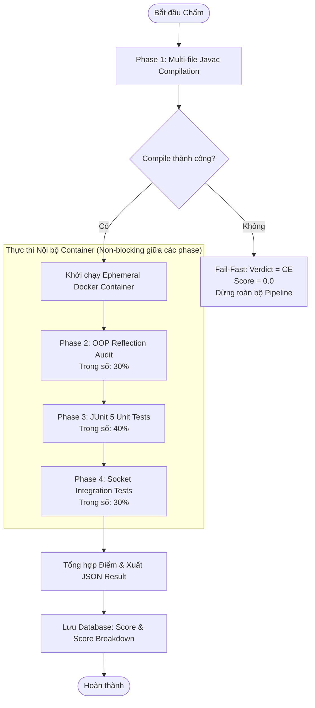

# TÀI LIỆU THIẾT KẾ DỰ ÁN & ĐẶC TẢ KIẾN TRÚC TOÀN DIỆN (PROJECT SPECIFICATION)
## HỆ THỐNG MINI LEETCODE — PHÂN HỆ ĐÁNH GIÁ CHUYÊN SÂU OOP GRINDING (OOP & LAN SOCKET JUDGE)

* **Tên phân hệ:** Mini LeetCode Platform — OOP Grinding Extension (`oop_grinding`)
* **Phiên bản:** 3.7.0 (Airtight Specification for AI Coding Agent Implementation)
* **Tiêu chuẩn thiết kế:** Kế thừa từ Mini LeetCode Monorepo (Spring Boot 3.3.4, Java 17 LTS, Maven Multi-Module, Docker Engine)
* **Trạng thái:** **APPROVED FOR IMPLEMENTATION** (Khóa chặt 3 ranh giới: Security Sandbox, Socket Contract, Execution Result Contract)

---

## 1. KHẢO SÁT THỰC TẾ CODEBASE & PHÂN TÍCH KHOẢNG TRỐNG (INVESTIGATE-FIRST)

Dựa trên kết quả khảo sát trực tiếp mã nguồn của Monorepo:

### 1.1. Hiện trạng Codebase đã kiểm chứng
1. **`mini-leetcode-judge`:** `JudgeServiceImpl` hiện đang gọi trực tiếp `DockerExecutor` với cơ chế đơn luồng tuần tự hoặc song song; **chưa áp dụng Strategy Pattern**. Cần refactor để tách ranh giới chiến lược chấm.
2. **`Problem.java`:** Chỉ có `difficulty` và `status` (`DRAFT`, `PUBLISHED`, `ARCHIVED`); **chưa có `ProblemType`**.
3. **`Submission.java`:** Lưu trữ `passTestCases`, `totalTestCases`, `verdict` (`AC`, `WA`, `TLE`, v.v.); **chưa có cột `score` (Double), `score_breakdown` (JSON)** và **`execution_phase` (String)** để hỗ trợ tính điểm từng phần.
4. **Cơ chế Nạp Code:** Hiện tại `submissionService.getSubmissionCode(id)` chỉ trả về 1 chuỗi ký tự code và lưu ra 1 file đơn lẻ; **chưa hỗ trợ đa file hoặc file nén `.zip`**.
5. **Hạ tầng Hàng đợi:** Rất vững chắc! Đã sử dụng **Redis Streams** với Consumer Groups, có `ZombieJobReclaimer` (`XCLAIM`) chống mất job và có cơ chế idempotent `isTerminal()` chống chấm lại.

### 1.2. Mục tiêu Phân hệ OOP Grinding
Xây dựng năng lực kiểm thử chuyên sâu cho bài tập Lập trình Hướng đối tượng & Mạng LAN Socket:
* **Mục tiêu 1:** Kiểm tra cấu trúc OOP tuân thủ quy chuẩn đề bài qua Bytecode Reflection (`OopConstraintRule`).
* **Mục tiêu 2:** Chạy kiểm thử đơn vị độc lập từng lớp bằng JUnit 5 Test Template.
* **Mục tiêu 3:** Kiểm thử tích hợp TCP/UDP Socket với cổng mạng Ephemeral trong môi trường cách ly tuyệt đối.

---

## 2. RANH GIỚI BẢO MẬT & SANDBOX (SECURITY BOUNDARY SPECIFICATION)

> [!CAUTION]
> **QUY TẮC BẤT DI BẤT DỊCH:** `ProcessBuilder` trên máy Host **KHÔNG PHẢI** là Sandbox. Mã nguồn sinh viên nộp là mã nguồn không đáng tin cậy (Untrusted Code), có thể đọc file hệ thống (`/etc/passwd`, file `.env`), chiếm dụng tài nguyên máy chủ, gọi mạng nội bộ để tấn công database, hoặc gọi `System.exit()`.
> **DOCKER CONTAINER LÀ RANH GIỚI BẢO MẬT DUY NHẤT VÀ BẮT BUỘC.**

```
┌───────────────────────────────────────────────────────────────────────────┐
│                       HOST MACHINE (SPRING BOOT WORKER)                   │
│                                                                           │
│  JudgeServiceImpl ──► OopGrindingJudgeStrategy ──► DockerExecutor         │
│                                                          │                │
│  (Chỉ điều phối Docker CLI qua ProcessBuilder,           │ docker run     │
│   tuyệt đối không chạy trực tiếp code sinh viên)         ▼                │
└──────────────────────────────────────────────────────────┼────────────────┘
                                                           │
┌──────────────────────────────────────────────────────────▼────────────────┐
│               EPHEMERAL DOCKER CONTAINER (JAVA 17 LTS RUNNER)             │
│                                                                           │
│  Security Flags:                                                          │
│  • --network none       (Chặn 100% Internet & Host Network;               │
│                          chỉ cho phép giao diện Loopback 'lo' nội bộ)     │
│  • --memory 256m        (Giới hạn RAM, chống tràn OutOfMemory)            │
│  • --cpus 1.0           (Giới hạn CPU, chống treo nhân máy chủ)           │
│  • --pids-limit 64      (Chống Fork-bomb tạo thread vô hạn)               │
│  • --read-only          (Hệ điều hành container chỉ đọc)                  │
│  • --user 1001:1001     (Chạy quyền User thường, không phải root)         │
│  • -v /workDir:/ws:rw   (Mount thư mục làm việc tạm thời)                 │
│                                                                           │
│  ┌─────────────────────────────────────────────────────────────────────┐  │
│  │                     TIẾN TRÌNH NỘI BỘ CONTAINER                     │  │
│  │                                                                     │  │
│  │   [Phase 1: Javac] ──► [Phase 2: Reflection] ──► [Phase 3: JUnit]  │  │
│  │                                                         │           │  │
│  │                                                         ▼           │  │
│  │              [Phase 4: Local Loopback Socket Harness]               │  │
│  │              (Giao tiếp TCP/UDP qua 127.0.0.1:0 nội bộ)             │  │
│  └─────────────────────────────────────────────────────────────────────┘  │
└───────────────────────────────────────────────────────────────────────────┘
```

### 2.1. Cấu hình Khởi chạy Container Chuẩn
`DockerExecutor` sẽ khởi chạy container thực thi với tập cờ nghiêm ngặt sau:
```bash
docker run --rm \
  --name judge-oop-${submissionId} \
  --network none \
  --memory 256m \
  --cpus 1.0 \
  --pids-limit 64 \
  --stop-timeout 5 \
  --read-only \
  --tmpfs /tmp:rw,noexec,nosuid,size=64m \
  --user 1001:1001 \
  -v ${workDir}:/workspace:rw \
  mini-leetcode-judge-runner:java17 \
  java -jar /opt/oop-harness.jar /workspace/harness-config.json
```

### 2.2. Tại sao `--network none` vẫn kiểm thử được Socket?
Trong Linux Kernel và Docker, cờ `--network none` ngắt toàn bộ kết nối ra Card mạng ngoài và Internet, **nhưng vẫn duy trì giao diện mạng nội bộ Loopback (`lo` - `127.0.0.1`)**.
* Client và Server của bài tập giao tiếp với nhau qua `127.0.0.1` với tốc độ bộ nhớ kernel (Zero network latency).
* Mã nguồn sinh viên bị chặn 100% nếu cố gắng kết nối ra IP bên ngoài hoặc quét cổng mạng của trường học.

---

## 3. ĐẶC TẢ GIAO THỨC SOCKET (SOCKET CONTRACT SPECIFICATION)

Khóa chặt các quy ước cấp port, khởi chạy Client/Server, handshake và xác định kết quả test.

### 3.1. Quy ước Cấp Cổng Mạng (Port Allocation Protocol)
1. **Tuyệt đối không dùng Port cứng và không quét Port:** Không dùng dải port cố định (như 8888) và không dùng phương pháp quét port kiểm tra `isPortAvailable()` vì dính lỗi **TOCTOU Race Condition**.
2. **Nguyên tắc Ephemeral Port:** Luôn khởi tạo `ServerSocket(0, 50, InetAddress.getByName("127.0.0.1"))`. Hệ điều hành sẽ tự động cấp một cổng rảnh ngẫu nhiên tại thời điểm bind. Lấy cổng qua `serverSocket.getLocalPort()`.

### 3.2. Mô hình Kiểm thử Hai Chiều (Two-Way Test Contract)

#### Kịch bản A: Học viên viết Client (Client-Side Assessment)
```
[Harness: Mock Server]                             [Học viên: Client Class]
         │                                                    │
         ├────── 1. Mở ServerSocket(0) trên 127.0.0.1 ────────┤
         │       (Lấy assignedPort = getLocalPort())          │
         │                                                    │
         ├────── 2. Fork Process chạy Client ────────────────►│
         │       java -cp /ws <ClientMain> 127.0.0.1 <port>   │
         │                                                    │
         │◄───── 3. socket.connect() (Timeout 2000ms) ────────┤
         │                                                    │
         ├────── 4. Gửi kịch bản Request Data ───────────────►│
         │◄───── 5. Nhận Response Data từ Client ─────────────┤
         │       (So sánh với Expected Output Payload)        │
         │                                                    │
         ├────── 6. Đóng kết nối & Chờ Client thoát ─────────►│
         ▼                                                    ▼
```

#### Kịch bản B: Học viên viết Server (Server-Side Assessment)
* **Quy ước Giao diện Dòng lệnh của Server:** Server của học viên bắt buộc phải nhận cổng lắng nghe qua tham số dòng lệnh `args[0]`:
  `java -cp /workspace <ServerMain> <port>`.
* **Trình tự Thực thi:**
  1. Harness mở `ServerSocket(0)` để nhận một port rảnh ngẫu nhiên từ OS, sau đó đóng ngay socket lại để giải phóng port.
  2. Harness khởi chạy Server của học viên trong một background thread/process:
     `java -cp /workspace <ServerMain> <assignedPort>`.
  3. **Polling Ready Check:** Harness tạo một loop thăm dò kết nối đến `127.0.0.1:<assignedPort>` (thử lại mỗi 200ms, tối đa 10 lần = 2 giây).
  4. Khi kết nối thành công $\to$ Harness đóng vai trò **Concurrent Mock Clients** (hỗ trợ tạo pool 5-10 clients cùng lúc nếu đề bài yêu cầu test đa luồng), gửi request và kiểm tra response.
  5. **Dọn dẹp:** Harness gửi lệnh tắt giao thức (hoặc gửi tín hiệu `SIGTERM` hủy process server của học viên khi hoàn thành bài test).

### 3.3. Tiêu chí Xác định Kết quả Test Socket (Verdict Criteria)

| Mã Kết quả | Điều kiện kích hoạt | Điểm số Phase 4 |
| :--- | :--- | :---: |
| `SUCCESS` | Kết nối thành công, bắt tay đúng kịch bản, payload phản hồi khớp 100% trong thời gian quy định. | **100%** |
| `CONNECTION_FAILURE` | Không thể kết nối đến Server học viên sau 2 giây (Connection Refused). | **0%** |
| `PROTOCOL_MISMATCH` | Kết nối được nhưng dữ liệu trả về sai cấu trúc, sai chuỗi, hoặc thiếu byte dữ liệu. | **0%** |
| `SCENARIO_TIMEOUT` | Giao dịch truyền nhận vượt quá 3000ms trên một kịch bản đơn lẻ. | **0%** |
| `RESOURCE_LEAK` | Hoàn thành kịch bản nhưng Server/Client không giải phóng socket connection (vẫn ở trạng thái `CLOSE_WAIT` hoặc `ESTABLISHED`). | **Trừ 50%** |

---

## 4. HỢP ĐỒNG KẾT QUẢ THỰC THI & CHẤM ĐIỂM (EXECUTION RESULT CONTRACT)

### 4.1. Ma trận Luồng Chấm & Chính sách Fail-Fast / Non-blocking



* **Phase 1 (Biên dịch):** Áp dụng **Fail-Fast**. Lỗi compile $\to$ Kết thúc ngay, không khởi động container, điểm = 0.
* **Phase 2, 3, 4:** Áp dụng **Non-blocking (Chấm điểm thành phần)**:
  * Kể cả khi Phase 2 (OOP Inspection) bị 0 điểm (ví dụ: quên khai báo `abstract`), Phase 3 vẫn chạy để kiểm tra các phương thức logic.
  * Kể cả khi Phase 4 (Socket) bị lỗi mạng (Connection Refused), học viên vẫn nhận đủ điểm của Phase 2 và Phase 3.

### 4.2. Công thức Điểm Chuẩn hóa (Mathematical Formula)
Tổng điểm được tính trên thang điểm $100.0$:

$$\text{TotalScore} = (0.30 \times \text{OopScore}) + (0.40 \times \text{UnitTestScore}) + (0.30 \times \text{SocketScore})$$

*Quy tắc chuẩn hóa:* Nếu đề bài không có phần Socket, trọng số tự động co giãn về: **40% OOP + 60% Unit Test**.

### 4.3. Hệ thống Giới hạn Thời gian Phân cấp (Hierarchical Timeout Budget)
1. **Container Hard Timeout:** **30 giây** (Docker daemon tự động cưỡng chế `docker kill` sau 30s).
2. **Compilation Timeout:** **10 giây** (Quá 10s coi là lỗi biên dịch/treo compiler).
3. **Unit Test Timeout:** **2 giây / test case** (Áp dụng qua JUnit 5 `@Timeout(value = 2, unit = TimeUnit.SECONDS)`).
4. **Socket Scenario Timeout:** **3 giây / scenario** (Socket `setSoTimeout(3000)`).

### 4.4. Đặc tả CSDL & Cấu trúc Dữ liệu JSON (Data Persistence Contract)

#### Migration SQL (Flyway: `V4__add_oop_grinding_fields.sql`)
```sql
ALTER TABLE problems ADD COLUMN problem_type VARCHAR(30) NOT NULL DEFAULT 'ALGORITHMIC';

ALTER TABLE submissions ADD COLUMN score DOUBLE DEFAULT NULL;
ALTER TABLE submissions ADD COLUMN execution_phase VARCHAR(30) DEFAULT NULL;
ALTER TABLE submissions ADD COLUMN score_breakdown JSON DEFAULT NULL;
```

#### JSON Schema Lưu tại cột `submissions.score_breakdown`
```json
{
  "submissionId": 1284,
  "executionPhase": "COMPLETED",
  "totalScore": 76.0,
  "verdict": "AC",
  "phases": {
    "compilation": {
      "passed": true,
      "durationMs": 1120,
      "errors": null
    },
    "oopInspection": {
      "score": 100.0,
      "weight": 0.30,
      "weightedScore": 30.0,
      "rules": [
        {"ruleName": "ABSTRACT_CLASS_SHAPE", "passed": true, "message": "Class Shape is abstract with 2 abstract methods"},
        {"ruleName": "ENCAPSULATION_CIRCLE", "passed": true, "message": "All 2 fields in Circle are private"}
      ]
    },
    "unitTest": {
      "score": 80.0,
      "weight": 0.40,
      "weightedScore": 32.0,
      "passedCount": 4,
      "totalCount": 5,
      "failures": [
        {"testClass": "CircleTest", "testMethod": "testPerimeterZeroRadius", "error": "AssertionFailedError: expected <0.0> but was <NaN>"}
      ]
    },
    "socketIntegration": {
      "score": 46.7,
      "weight": 0.30,
      "weightedScore": 14.0,
      "scenarios": [
        {"scenarioName": "TCP_HANDSHAKE_ECHO", "passed": true, "latencyMs": 14},
        {"scenarioName": "CONCURRENT_5_CLIENTS", "passed": false, "error": "Client #4 Connection Reset"}
      ]
    }
  }
}
```

### 4.5. Cơ chế Nộp bài Đa hình thức & Starter Scaffolding (Hybrid Ingestion & Fast Run)
*(Chi tiết đặc tả xem tại [HYBRID_SUBMISSION_SPECIFICATION.md](file:///c:/Users/aDMIN/Documents/JSD/Mini%20Leetcode/docs/HYBRID_SUBMISSION_SPECIFICATION.md))*:
1. **Không chỉ nộp file ZIP:** Hệ thống hỗ trợ đa kênh tiếp nhận mã nguồn thông qua `MultiFileSourceExtractor`:
   * **Web Multi-tab Editor:** Sinh viên code trực tiếp trên nhiều tab của Monaco Editor (gửi payload JSON `{"files": [{"path": "...", "content": "..."}]}`).
   * **Kéo thả / Upload:** Kéo thả trực tiếp file `.zip` hoặc chọn đồng thời nhiều file `.java`.
   * **Cú pháp Delimited Text:** Viết nhiều file trên 1 editor duy nhất ngăn cách bằng `// === FILE: Name.java ===`.
   * **Single File Fallback:** Nộp 1 file `.java` đơn lẻ (tự động phát hiện tên class công khai).
2. **Starter Scaffolding & Offline Development:** Cung cấp cây thư mục mẫu trực tiếp trên Web kèm nút **"Download Starter Project (.zip)"** để sinh viên code offline trên IDE (IntelliJ/VS Code).
3. **Phân cấp Chạy thử (Run Code vs Submit):**
   * **"Run Code":** Chạy kiểm tra nhanh cấu trúc OOP công khai và các bài Sample Unit Test (< 2s), không tốn tài nguyên chạy socket nặng.
   * **"Submit":** Chạy đầy đủ chu trình 4 phase, ghi nhận kết quả và tính điểm chính thức.

---

## 5. THIẾT KẾ CẤU TRÚC CODE & STRATEGY PATTERN (JAVA-ARCHITECT)

### 5.1. Refactor `JudgeServiceImpl` & Strategy Pattern
Trích xuất giao diện chiến lược trong package `jsd.toiyeujava.mini_leetcode.judge.strategy`:

```java
public interface JudgeStrategy {
    boolean supports(ProblemType problemType);
    void executeJudge(SubmissionTaskMessage message, Problem problem, Path workDir);
}
```

1. **`AlgorithmicJudgeStrategy`:** Chứa toàn bộ logic chạy Docker stdin/stdout hiện tại (79/79 bài test đang dùng).
2. **`OopGrindingJudgeStrategy`:** Điều phối pipeline 4 phase bên trong Docker Runner.

### 5.2. Cấu trúc Package Tinh gọn (`mini-leetcode-judge`)
```
mini-leetcode-judge/src/main/java/jsd/toiyeujava/mini_leetcode/judge/
├── strategy/
│   ├── JudgeStrategy.java
│   ├── AlgorithmicJudgeStrategy.java
│   └── OopGrindingJudgeStrategy.java
│
└── oop_grinding/
    ├── compilation/
    │   └── MultiFileSourceExtractor.java       # Unzip .zip hoặc phân rã bundle file
    ├── runner/
    │   └── OopDockerRunner.java                # Gọi docker run với --network none & loopback
    └── model/
        ├── OopConstraintRule.java              # Đặc tả rule JSON cho từng bài
        └── ExecutionReport.java                # Model DTO hứng JSON output từ Container
```

---

## 6. ĐẶC TẢ YÊU CẦU CHỨC NĂNG CHUẨN EARS (FEATURE-FORGE)

* **REQ-OOPG-001 (Multi-file Archive Extraction):**
  * *When* hệ thống nhận được bài nộp dạng file ZIP hoặc multipart, *the system shall* giải nén và kiểm tra an toàn (bảo đảm không có path traversal `../`) với dung lượng sau giải nén tối đa 20MB.
* **REQ-OOPG-002 (Fail-Fast Compilation):**
  * *When* lệnh `javac *.java` thất bại, *the system shall* cập nhật `verdict = CE`, `score = 0.0` và ngắt ngay pipeline mà không tạo Docker container.
* **REQ-OOPG-003 (Strict Sandboxing):**
  * *The system shall* luôn thực thi code sinh viên bên trong Docker Container với các cờ `--network none`, `--memory 256m`, `--pids-limit 64`, và cấm hoàn toàn quyền root.
* **REQ-OOPG-004 (Ephemeral Port Handshake):**
  * *While* kiểm thử Socket, *the system shall* luôn gán cổng số 0 cho `ServerSocket` để hệ điều hành cấp phát cổng rảnh ngẫu nhiên, truyền thông số cổng tới Client/Server qua tham số dòng lệnh.
* **REQ-OOPG-005 (Independent Phase Scoring):**
  * *Where* bài làm biên dịch thành công, *the system shall* tính điểm độc lập cho từng phase theo công thức $\text{TotalScore} = 0.3 \times \text{OOP} + 0.4 \times \text{Unit} + 0.3 \times \text{Socket}$, không phụ thuộc vào việc các phase khác có đạt điểm tối đa hay không.
* **REQ-OOPG-006 (Structured Breakdown Storage):**
  * *When* tiến trình kiểm thử hoàn tất, *the system shall* lưu trữ toàn bộ cây chi tiết lỗi và điểm số từng phase dưới dạng JSON vào cột `score_breakdown`.

---

## 7. TIÊU CHÍ CHẤP NHẬN CHUẨN GHERKIN (ACCEPTANCE CRITERIA)

### Scenario 1: Chấm điểm thành phần khi Socket gặp sự cố
```gherkin
Given sinh viên nộp bài đồ án "Chat Server"
When mã nguồn biên dịch thành công
And Phase OOP Inspection đạt 100% (đủ class, interface, private field)
And Phase JUnit 5 Unit Tests đạt 75% (3/4 test method pass)
But Phase Socket Integration bị lỗi "CONNECTION_FAILURE" (0%) do server bị crash khi khởi động
Then hệ thống cập nhật execution_phase = "COMPLETED"
And tổng điểm đạt chính xác: 0.30*100 + 0.40*75 + 0.30*0 = 60.0 điểm
And cột score_breakdown lưu rõ chi tiết: OOP 30đ, UnitTest 30đ, Socket 0đ
```

### Scenario 2: Chặn mã độc phá hoại Host bằng Docker Sandbox
```gherkin
Given sinh viên cố tình nộp mã độc gọi `Runtime.getRuntime().exec("rm -rf /")` hoặc `System.exit(0)`
When bài nộp được thực thi trong Ephemeral Docker Container
Then lệnh xóa file chỉ ảnh hưởng đến container tạm thời (đã được mount read-only ngoại trừ /tmp)
And lệnh `System.exit(0)` chỉ thoát container runner mà không ảnh hưởng tới Spring Boot Worker
And hệ thống thu thập mã thoát (exit code), không bị sập dịch vụ máy chấm
```

---

## 8. KẾ HOẠCH TRIỂN KHAI CHO AI CODING AGENT (ACTIONABLE TODO LIST)

Triển khai tuần tự theo 4 lát cắt (Vertical Slices), mỗi lát cắt đều có bài test tích hợp tương ứng:

### Slice 0: Hạ tầng Cơ sở Dữ liệu & Strategy Pattern
- [ ] Tạo file migration `V4__add_oop_grinding_fields.sql` bổ sung 3 cột (`problem_type`, `score`, `score_breakdown`, `execution_phase`).
- [ ] Cập nhật Entity `Problem.java` và `Submission.java` tương ứng.
- [ ] Trích xuất `JudgeStrategy` interface trong `mini-leetcode-judge`; chuyển logic cũ vào `AlgorithmicJudgeStrategy`.
- [ ] **Verification:** Chạy `mvn test` đảm bảo 79/79 test case cũ vẫn vượt qua 100%.

### Slice 1: Nạp Đa File & Compiler
- [ ] Cài đặt `MultiFileSourceExtractor` xử lý giải nén an toàn file ZIP hoặc bundle string vào `workDir`.
- [ ] Cài đặt cơ chế kiểm tra `javac` Fail-Fast trong `OopGrindingCompiler`.
- [ ] **Verification:** Viết unit test nộp 1 file zip gồm 3 file Java, biên dịch thành công và xuất ra thư mục `/classes`.

### Slice 2: Docker Harness Runner & OOP Inspector
- [ ] Tạo script/harness `oop-harness.jar` (hoặc test runner class) đóng gói trong runner image.
- [ ] Triển khai `OopGrindingInspector` quét Reflection đối chiếu `OopConstraintRule` JSON.
- [ ] Tích hợp `JUnit 5 Platform Console Launcher` chạy test templates trong container.
- [ ] **Verification:** Chạy thử bài tập Shape/Circle trong container, trích xuất được `oopScore` và `unitTestScore` dạng JSON.

### Slice 3: Ephemeral Socket Integration Harness
- [ ] Cài đặt kịch bản `SocketTestHarness` bên trong runner container với `ServerSocket(0)`.
- [ ] Cài đặt kịch bản Client Assessment và Server Assessment với timeout 3000ms.
- [ ] **Verification:** Viết test giả lập 1 Echo Client của sinh viên, harness gửi "HELLO", client phản hồi "HELLO_ACK" qua cổng ngẫu nhiên `127.0.0.1:0`.

### Slice 4: Score Aggregator & E2E Submission Flow
- [ ] Cài đặt `OopScoreCalculator` tính điểm theo trọng số $30\% - 40\% - 30\%$.
- [ ] Cập nhật kết quả vào bảng `submissions` và đẩy cache kết quả lên Redis.
- [ ] **Verification:** Gửi 1 message nộp bài kiểu `OOP_GRINDING` vào Redis Stream, verify kết quả trong Database đạt đúng điểm và breakdown JSON.
