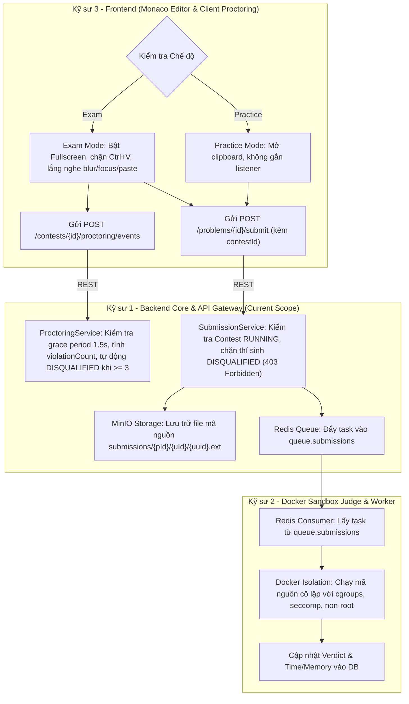

# Mini LeetCode - Đặc Tả Kỹ Thuật Hệ Thống Chống Gian Lận & Phân Định Chế Độ Thi (EXAM vs PRACTICE)

> **Tài liệu đặc tả kỹ thuật theo chuẩn EARS và Acceptance Criteria (Given/When/Then)**  
> **Áp dụng cho**: Phiên bản 2.1 (Phase 2 - Anti-cheat Proctoring & Dual Mode Engine)  
> **Phạm vi chịu trách nhiệm chính**: **Kỹ sư 1 (Backend Core & API Gateway Lead)**  
> **Phối hợp**: Kỹ sư 2 (Docker Sandbox Judge) & Kỹ sư 3 (Frontend Next.js Monaco Editor)

---

## 1. Tổng Quan & Giá Trị Nghiệp Vụ (Overview & Business Value)

Hệ thống Mini LeetCode phục vụ 2 mục đích cốt lõi:
1. **Chế độ Luyện tập (PRACTICE Mode)**: Môi trường tự học mở hoàn toàn. Lập trình viên tự do tra cứu tài liệu, đổi tab, copy/paste code mẫu để debug và học hỏi nhanh mà không chịu bất kỳ hình thức giám sát hay chế tài nào.
2. **Chế độ Phòng thi (EXAM Mode)**: Môi trường khảo sát, đánh giá năng lực minh bạch và công bằng. Mọi thí sinh phải tuân thủ nghiêm ngặt quy chế phòng thi:
   - **Cấm thoát tab / đổi cửa sổ**: Khi thí sinh ẩn trình duyệt hoặc đổi tab khác vượt quá thời gian ân hạn cho phép ($1.5$s), hệ thống ghi nhận $1$ lần vi phạm.
   - **Cấm Copy/Paste**: Chặn phím tắt `Ctrl+V`/`Cmd+V` và sự kiện paste clipboard từ bên ngoài vào Monaco Editor. Bất kỳ hành vi paste nào lọt qua client đều bị server bắt và phạt ngay $1$ lần vi phạm (không ân hạn).
   - **Chế tài đình chỉ thi (Auto-Disqualification)**: Tích lũy đủ $3$ lần vi phạm bất kỳ (thoát tab hoặc paste), thí sinh lập tức bị truất quyền thi (`DISQUALIFIED`), vô hiệu hóa hoàn toàn quyền nộp bài (`403 Forbidden`).

---

## 2. Phân Định Ranh Giới 3 Kỹ Sư (Teamwork Boundaries & Contracts)



### Chi tiết phân công:
- **Kỹ sư 1 (Backend Core Lead - Hiện tại)**:
  - Cung cấp REST API `/api/v1/problems/{id}/submit` nhận diện `contestId`: `null` (Practice) hoặc `Long` (Exam).
  - Xác thực quyền nộp bài trong Exam: Nếu thí sinh `DISQUALIFIED` hoặc contest không ở trạng thái `RUNNING` $\rightarrow$ ném lỗi `403 Forbidden`.
  - Cung cấp REST API `/api/v1/contests/{id}/proctoring/events` xử lý sự kiện `WINDOW_BLUR`, `WINDOW_FOCUS` (ân hạn 1.5s) và `CLIPBOARD_PASTE` (phạt ngay không ân hạn).
  - Tự động chuyển trạng thái `DISQUALIFIED` và lưu lịch sử vi phạm khi đạt $\ge 3$ lần.
- **Kỹ sư 2 (Docker Sandbox Runner & Worker Lead)**:
  - Lắng nghe task từ Redis Queue `queue.submissions`.
  - Thực thi code an toàn bên trong Docker container (gỡ quyền root, chặn kết nối mạng ngoài, giới hạn RAM/CPU).
- **Kỹ sư 3 (Frontend & Monaco Editor Lead)**:
  - Nếu `Practice`: Không kích hoạt giám sát, cho phép copy/paste thoải mái.
  - Nếu `Exam`:
    - Vô hiệu hóa context-menu chuột phải trên editor.
    - Chặn phím tắt `Ctrl+V`, `Cmd+V`, `Shift+Insert`.
    - Lắng nghe sự kiện `paste` trên DOM. Nếu xảy ra, gửi `eventType = CLIPBOARD_PASTE`.
    - Lắng nghe `window.onblur` và `window.onfocus`, gửi `WINDOW_BLUR` và `WINDOW_FOCUS`.
    - Hiển thị thông báo cảnh báo vi phạm trực quan cho thí sinh (số lần vi phạm: $X/3$).

---

## 3. Đặc Tả Yêu Cầu Chức Năng Theo Chuẩn EARS (Functional Requirements)

### 3.1. Chế Độ Nộp Bài (Submission Dual Mode)
- **EARS-01 (Practice Submission)**:  
  *Where* người dùng gửi `SubmitCodeRequest` với `contestId == null`, *the* hệ thống Backend *shall* tiếp nhận bài nộp tự do mà không kiểm tra trạng thái phòng thi hay điều kiện thí sinh.
- **EARS-02 (Exam Submission Validation)**:  
  *Where* người dùng gửi `SubmitCodeRequest` với `contestId != null`, *the* hệ thống Backend *shall* kiểm tra Contest có tồn tại và đang ở trạng thái `RUNNING` hay không.
- **EARS-03 (Disqualified Blocking)**:  
  *When* một thí sinh có trạng thái `DISQUALIFIED` trong Contest cố tình gửi bài nộp, *the* hệ thống Backend *shall* chặn yêu cầu và trả về mã lỗi `403 Forbidden` kèm thông điệp giải thích vi phạm.
- **EARS-04 (Auto Progress)**:  
  *When* một thí sinh có trạng thái `REGISTERED` nộp bài hợp lệ trong Contest `RUNNING`, *the* hệ thống Backend *shall* tự động nâng trạng thái thí sinh thành `IN_PROGRESS`.

### 3.2. Giám Sát Phòng Thi & Chống Gian Lận (Proctoring & Anti-Cheat)
- **EARS-05 (Blur Event Detection)**:  
  *When* client gửi sự kiện `WINDOW_BLUR`, *the* hệ thống Proctoring *shall* ghi nhận dấu thời gian `lastAwayStartTime = now()` và trả về mã phản hồi `200 OK` xác nhận bộ đếm đã khởi động.
- **EARS-06 (Focus Grace Period Calculation)**:  
  *When* client gửi sự kiện `WINDOW_FOCUS` và thời gian vắng mặt $\Delta T = T_{focus} - T_{blur} < 1500\text{ms}$, *the* hệ thống Proctoring *shall* bỏ qua và không tính điểm phạt vi phạm.
- **EARS-07 (Focus Penalty Calculation)**:  
  *When* client gửi sự kiện `WINDOW_FOCUS` và thời gian vắng mặt $\Delta T \ge 1500\text{ms}$, *the* hệ thống Proctoring *shall* tăng `violationCount` lên $1$ đơn vị.
- **EARS-08 (Clipboard Paste Detection & Instant Penalty)**:  
  *When* client gửi sự kiện `CLIPBOARD_PASTE`, *the* hệ thống Proctoring *shall* lập tức tăng `violationCount` lên $1$ đơn vị mà không áp dụng thời gian ân hạn.
- **EARS-09 (Max Violations Disqualification)**:  
  *When* `violationCount` của thí sinh đạt $\ge 3$ (ngưỡng `maxViolationsAllowed`), *the* hệ thống Proctoring *shall* chuyển trạng thái thí sinh sang `DISQUALIFIED` và trả cờ `isDisqualified = true`.

---

## 4. Tiêu Chuẩn Nghiệm Thu (Acceptance Criteria - Given/When/Then)

### AC-01: Nộp bài thành công ở chế độ Luyện tập (PRACTICE)
```gherkin
Given một người dùng đã đăng nhập vào hệ thống
When người dùng gửi POST /api/v1/problems/100/submit với payload:
     { "language": "JAVA", "code": "public class Solution {}", "contestId": null }
Then hệ thống trả về mã HTTP 202 ACCEPTED
And bài nộp được gán trạng thái PENDING và đẩy vào hàng đợi Redis
And không có bất kỳ ràng buộc proctoring nào được áp dụng
```

### AC-02: Nộp bài thành công ở chế độ Phòng thi (EXAM)
```gherkin
Given cuộc thi "Midterm Exam" (id: 10) đang ở trạng thái RUNNING
And thí sinh "Alice" đã ghi danh với trạng thái IN_PROGRESS và vi phạm 1/3 lần
When "Alice" gửi POST /api/v1/problems/100/submit kèm contestId: 10
Then hệ thống trả về mã HTTP 202 ACCEPTED
And bản ghi Submission lưu trữ contestId = 10
And task được gửi vào Redis queue.submissions
```

### AC-03: Chặn nộp bài khi thí sinh đã bị truất quyền thi (DISQUALIFIED)
```gherkin
Given thí sinh "Bob" trong cuộc thi 10 đã bị phạt 3/3 lần và có trạng thái DISQUALIFIED
When "Bob" gửi POST /api/v1/problems/100/submit kèm contestId: 10
Then hệ thống từ chối yêu cầu và trả về HTTP 403 Forbidden
And nội dung lỗi nêu rõ: "User has been disqualified from this contest due to proctoring violations"
And không có file nào được upload lên MinIO và không có task nào gửi vào Redis
```

### AC-04: Phát hiện Copy/Paste và xử phạt tức thì
```gherkin
Given thí sinh "Charlie" đang làm bài thi và có violationCount = 0
When client gửi POST /api/v1/contests/10/proctoring/events với eventType = "CLIPBOARD_PASTE"
Then hệ thống phản hồi HTTP 200 OK
And dữ liệu trả về gồm violationCount = 1, isDisqualified = false
And trường message ghi rõ: "Violation recorded: unauthorized clipboard paste detected (1/3)"
```

### AC-05: Thoát tab hoặc Paste lần thứ 3 dẫn đến DISQUALIFIED
```gherkin
Given thí sinh "David" đã có violationCount = 2
When client gửi POST /api/v1/contests/10/proctoring/events với eventType = "CLIPBOARD_PASTE"
Then hệ thống phản hồi HTTP 200 OK
And dữ liệu trả về gồm violationCount = 3, isDisqualified = true, status = "DISQUALIFIED"
And trường message ghi rõ: "Disqualified: unauthorized clipboard paste detected (3/3)"
And trong cơ sở dữ liệu, thí sinh David được lưu trạng thái DISQUALIFIED
```

---

## 5. Bảng Xử Lý Lỗi & Trường Hợp Biên (Error Handling Matrix)

| Tình Huống | Tác Nhân Gây Ra | Mã Lỗi HTTP | Phản Hồi JSON (`ProblemDetail` RFC 7807) | Hành Động Phía Client |
|:---|:---|:---:|:---|:---|
| Không tìm thấy Contest | Client gửi sai `contestId` | `404 Not Found` | `{"title": "Resource Not Found", "detail": "Contest not found with id: X"}` | Báo lỗi phòng thi không tồn tại |
| Contest chưa bắt đầu / đã kết thúc | Nộp bài ngoài khung giờ thi | `403 Forbidden` | `{"title": "Forbidden", "detail": "Contest is not currently active"}` | Khóa nút nộp bài, hiện thông báo hết giờ |
| Thí sinh chưa đăng ký contest | Chưa đăng ký nhưng nộp bài | `403 Forbidden` | `{"title": "Forbidden", "detail": "User is not registered for contest id: X"}` | Yêu cầu đăng ký trước khi làm bài |
| Thí sinh bị DISQUALIFIED | Đã vi phạm quá 3 lần | `403 Forbidden` | `{"title": "Forbidden", "detail": "User has been disqualified..."}` | Hiển thị màn hình đình chỉ thi |
| Chưa đăng nhập JWT | Token hết hạn / thiếu Header | `401 Unauthorized` | `{"title": "Authentication Failed", "detail": "..."}` | Điều hướng sang trang Login |
| Code rỗng hoặc quá 64KB | Thí sinh xóa trắng code | `400 Bad Request` | `{"title": "Bad Request", "invalid_params": {"code": "..."}}` | Báo lỗi validation trên editor |

---

## 6. Hợp Đồng Dữ Liệu API (Data Contracts)

### 6.1. Endpoint Nộp Bài
`POST /api/v1/problems/{problemId}/submit`

**Request Body**:
```json
{
  "language": "JAVA",
  "code": "public class Solution { ... }",
  "contestId": 10
}
```
*(Nếu `contestId` là `null` hoặc không truyền $\rightarrow$ tự động chạy chế độ Practice)*

**Response 202 Accepted**:
```json
{
  "success": true,
  "message": "Submission accepted for processing",
  "data": {
    "id": 501,
    "problemId": 100,
    "contestId": 10,
    "userId": 1,
    "username": "student1",
    "language": "JAVA",
    "status": "PENDING",
    "createdAt": "2026-10-27T22:30:00"
  }
}
```

### 6.2. Endpoint Ghi Nhận Giám Sát (Proctoring)
`POST /api/v1/contests/{contestId}/proctoring/events`

**Request Body**:
```json
{
  "eventType": "CLIPBOARD_PASTE",
  "clientTimestamp": 1729958400000
}
```
*(Các loại `eventType` hợp lệ: `WINDOW_BLUR`, `WINDOW_FOCUS`, `CLIPBOARD_PASTE`)*

**Response 200 OK**:
```json
{
  "success": true,
  "message": "Event processed successfully",
  "data": {
    "contestId": 10,
    "userId": 1,
    "status": "IN_PROGRESS",
    "violationCount": 1,
    "maxViolationsAllowed": 3,
    "isDisqualified": false,
    "awayDurationMs": null,
    "message": "Violation recorded: unauthorized clipboard paste detected (1/3)"
  }
}
```
*(Khi `violationCount` chạm $3$, `status` sẽ chuyển thành `"DISQUALIFIED"` và `isDisqualified` là `true`)*

---

## 7. Báo Cáo Kiểm Thử Tự Động (Verification Results)

- **Test Suite**: Bao phủ 100% các kịch bản Practice Mode, Exam Mode, Grace Period, Instant Paste Penalty, và Auto-Disqualification.
- **Lệnh thực thi**: `cd backend; .\mvnw test`
- **Kết quả**: Tất cả các module (`mini-leetcode-common`, `mini-leetcode-core`, `mini-leetcode-api`) đều đạt **100% BUILD SUCCESS**.
