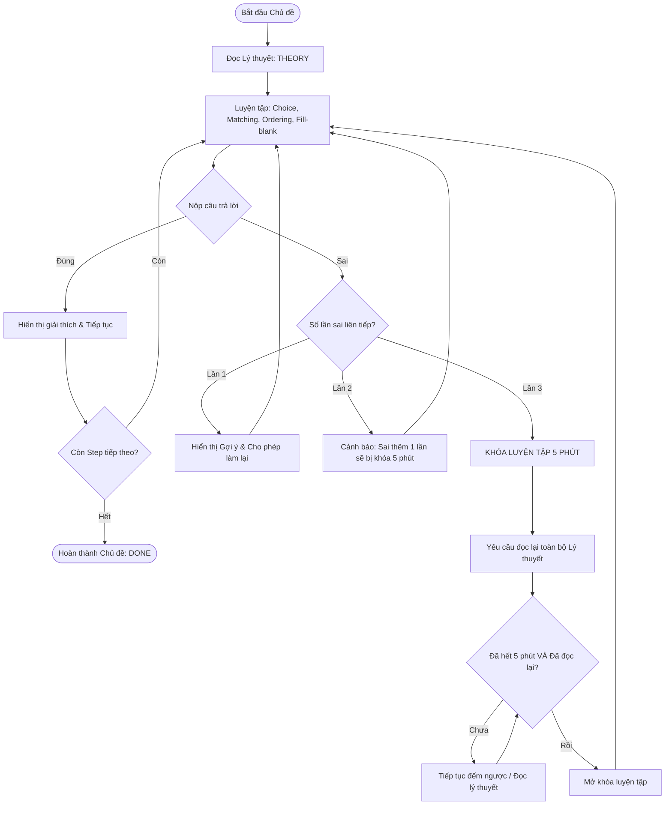

# ĐẶC TẢ & HƯỚNG DẪN HỆ THỐNG BÀI HỌC TƯƠNG TÁC (INTERACTIVE TOPICS & EXERCISES)

> **Phiên bản tài liệu:** 1.0.0  
> **Phân hệ:** Study Plans, Lesson Topics & Interactive Exercise Engine  
> **Đối tượng:** Giảng viên (Instructor), Quản trị viên (Admin), Lập trình viên và Học viên  

---

## 1. TỔNG QUAN & TRIẾT LÝ THIẾT KẾ

Hệ thống **Interactive Topics** (Chủ đề học vi mô) trong Mini LeetCode được thiết kế theo mô hình **Project-based Learning & Micro-learning** (lấy cảm hứng từ phương pháp sư phạm hiện đại của Hyperskill và Coursera).

Thay vì chỉ đưa ra một bài tập lớn hoặc danh sách bài tập khô khan:
- Mỗi **Study Plan** gồm các **Projects** nhiều giai đoạn (**Stages**).
- Gắn liền trước mỗi Stage là một chuỗi các **Topics** (Chủ đề lý thuyết & bài tập tương tác) bổ trợ kiến thức cần thiết để giải quyết giai đoạn đó.
- Mỗi Topic là một chuỗi các **Steps** có thứ tự sư phạm chặt chẽ: từ đọc hiểu lý thuyết nền tảng đến các bài tập kiểm tra nhận thức đa dạng trước khi bắt tay vào viết code thực tế.

```
+---------------------------------------------------------------------------------------+
| Study Plan: OOP in Java (Mini Bank)                                                   |
| +-----------------------------------------------------------------------------------+ |
| | Stage 1: Accounts (OOP_GRINDING Problem)                                          | |
| |   ├── [Topic 1] Classes and Objects (15 min)                                      | |
| |   │     ├── Step 1: Theory (Class definition, fields, methods)                    | |
| |   │     ├── Step 2: Choice (Single choice: default access modifier)               | |
| |   │     ├── Step 3: Fill-in-the-blank (Declare private field)                     | |
| |   │     └── Step 4: Code Exercise (Create first Account class)                    | |
| |   ├── [Topic 2] Encapsulation & Getters/Setters (15 min)                          | |
| |   └── [Main Project Task] Complete Stage 1 (Multi-file Java Sandbox Evaluation)    | |
| +-----------------------------------------------------------------------------------+ |
+---------------------------------------------------------------------------------------+
```

---

## 2. CÁC DẠNG BÀI TẬP & WIDGET TƯƠNG TÁC (INTERACTION TYPES)

Hệ thống hỗ trợ 6 loại Step với các UI Widget chuyên biệt:

### 2.1. Đọc lý thuyết phân đoạn (THEORY)
- **Mục đích:** Cung cấp kiến thức cô đọng, có định dạng Markdown trực quan, khối mã nguồn (code blocks) tô màu cú pháp.
- **Trải nghiệm:**
  - Mục lục động (Table of Contents) bên trái điều hướng nhanh giữa các section (chia theo thẻ `##`).
  - Hỗ trợ chế độ đọc mở rộng từng phần (**Read more**) hoặc mở toàn bộ (**Expand all**).
  - Nút **Mark as read** để ghi nhận hoàn thành phần lý thuyết.

### 2.2. Trắc nghiệm lựa chọn (CHOICE)
Hỗ trợ cả 2 dạng: **Single Choice** (Một đáp án đúng) và **Multiple Choice** (Nhiều đáp án đúng):
- **Single Choice (Radio Button):** Học viên chọn 1 phương án duy nhất. Phù hợp cho câu hỏi phân biệt khái niệm hoặc nhận diện cú pháp.
- **Multiple Choice (Checkboxes):** Học viên chọn một hoặc nhiều phương án. Hệ thống chấm đúng tuyệt đối khi học viên chọn đúng toàn bộ các phương án hợp lệ.
- **Tính năng sư phạm:**
  - Hỗ trợ **See Hint**: Gợi ý ngắn gọn khi học viên gặp khó khăn.
  - Phản hồi **Explanation**: Giải thích chi tiết bản chất khi nộp đáp án đúng.

### 2.3. Ghép cặp khái niệm (MATCHING)
- **Mục đích:** Kiểm tra khả năng liên kết giữa thuật ngữ - định nghĩa, hoặc cú pháp - kết quả thực thi.
- **Giao diện & Tương tác:**
  - Cột bên trái (Left Items) cố định; cột bên phải (Right Items) có thể tương tác.
  - Hỗ trợ cả **Kéo thả (Drag-and-Drop)** bằng chuột và nút điều khiển **Mũi tên lên/xuống (↑/↓)** để học viên thao tác thuận tiện bằng bàn phím.
  - **Xáo trộn ngẫu nhiên an toàn:** Phía server tự động xáo trộn thứ tự các phần tử cột phải dựa trên `step_id` trước khi trả về client nhằm chống lộ đáp án.

### 2.4. Sắp xếp thứ tự (ORDERING)
- **Mục đích:** Kiểm tra quy trình logic, ví dụ thứ tự thực thi của constructor, vòng đời đối tượng, hoặc thứ tự các bước trong luồng xử lý ngoại lệ.
- **Tương tác:** Học viên sắp xếp danh sách các mục theo đúng thứ tự logic bằng kéo thả hoặc nút bấm di chuyển. Server xáo trộn danh sách khi tải ban đầu.

### 2.5. Điền chỗ trống trong mã nguồn (FILL_BLANK)
- **Mục đích:** Luyện tập cú pháp chính xác, viết từ khóa hoặc tên kiểu dữ liệu vào đoạn mã còn khuyết.
- **Cơ chế:**
  - Đoạn mã mẫu chứa các vị trí khuyết được đánh dấu theo định dạng `[[id]]` (ví dụ: `public [[1]] String getName()`).
  - Trình duyệt hiển thị input box nội dòng (inline) ngay tại vị trí khuyết trong code block.
  - Chuẩn hóa đầu vào thông minh: Loại bỏ khoảng trắng đầu/cuối, chuẩn hóa khoảng trắng thừa. Hỗ trợ cấu hình phân biệt hoa thường (`caseSensitive`) hoặc không phân biệt.

### 2.6. Thử thách code thực tế (CODE)
- **Mục đích:** Gắn kết bài học lý thuyết trực tiếp vào bài tập lập trình có sẵn trong hệ thống (như các bài OOP Grinding).
- **Cơ chế:** Step CODE liên kết với một bài tập (thông qua `problem_id`). Khi học viên giải quyết bài toán và đạt verdict `Accepted` trên hệ thống chấm Docker Sandbox, step này sẽ tự động chuyển sang trạng thái hoàn thành (`DONE`).

---

## 3. TRẢI NGHIỆM HỌC VIÊN (LEARNER EXPERIENCE WORKFLOW)



### 3.1. Luồng học tập tuần tự
1. **Khám phá Chủ đề (`/topics/[slug]`):**
   - Thanh tiến độ trên đầu trang hiển thị vị trí step hiện tại (Ví dụ: `Step 3/7`).
   - Nút chuyển nhanh giữa **Theory** và **Practice**.
   - Nút **Skip topic**: Học viên có quyền bỏ qua chủ đề lý thuyết nếu đã nắm vững kiến thức (chủ đề chuyển sang trạng thái `SKIPPED`, không cản trở việc làm Stage chính). Trạng thái Skip có thể hoàn tác bất kỳ lúc nào.

2. **Cơ chế phản hồi sư phạm:**
   - Khi trả lời sai, hệ thống cung cấp phản hồi mang tính hướng dẫn (ví dụ: `2/4 cặp đúng`, `Ô số 2 chưa chính xác`) kèm nút xem gợi ý (**See hint**) mà không để lộ đáp án cuối cùng.
   - Khi trả lời đúng, hệ thống hiển thị huy hiệu thành công và phần giải thích cặn kẽ (**Explanation**).

3. **Luật chống thử sai (3-Strike Practice Lockout):**
   - Để ngăn chặn hành vi đoán mò ngẫu nhiên (brute-force) trong các bài trắc nghiệm hay ghép cặp, hệ thống áp dụng cơ chế khóa nghiêm ngặt:
     - **Sai lần 1:** Gợi ý xem lại lý thuyết.
     - **Sai lần 2:** Cảnh báo: *"One more wrong answer locks practice for 5 minutes."*
     - **Sai lần 3 liên tiếp:** Luyện tập của toàn bộ chủ đề bị **khóa trong 5 phút** (ghi nhận vào bảng `topic_locks`). Đồng thời, tất cả các step THEORY của chủ đề bị đánh dấu là **chưa đọc**.
   - **Điều kiện mở khóa:** Học viên bắt buộc phải:
     1. Chờ hết thời gian đếm ngược 5 phút.
     2. Đọc lại toàn bộ nội dung lý thuyết trong chủ đề.
   - Trong thời gian bị khóa, mọi yêu cầu nộp câu trả lời đều bị từ chối với mã lỗi `409 Conflict (TOPIC_LOCKED)`.

---

## 4. CÔNG CỤ SOẠN THẢO DÀNH CHO GIẢNG VIÊN & QUẢN TRỊ VIÊN

Quản trị viên và Giảng viên được trang bị bộ công cụ soạn thảo trực quan tại giao diện `/admin/topics` và Course Builder `/admin/study-plans`.

### 4.1. Quản lý Chủ đề (`/admin/topics`)
- Danh sách tìm kiếm, phân trang và lọc theo trạng thái (`DRAFT`, `PUBLISHED`, `ARCHIVED`).
- Thông tin cơ bản: Tiêu đề (`title`), đường dẫn tĩnh (`slug`), tóm tắt ngắn (`summary`), thời lượng ước tính (`estMinutes`).
- Chuyển đổi trạng thái chủ đề thông qua luồng xét duyệt an toàn.

### 4.2. Trình soạn thảo Step đa dạng (Visual Step Editor)
Giảng viên có thể thêm, chỉnh sửa, kéo thả thay đổi vị trí hoặc xóa từng Step:
- **Soạn Trắc nghiệm (Choice):**
  - Nhập câu hỏi (hỗ trợ Markdown).
  - Tích chọn **Allow multiple correct answers** để chuyển đổi giữa Single Choice và Multiple Choice.
  - Thêm danh sách phương án, đánh dấu checkbox vào (các) phương án đúng.
  - Nhập gợi ý (Hint) và giải thích sau khi làm đúng (Explanation).
- **Soạn Ghép cặp (Matching):**
  - Thêm các cặp tương ứng (Item bên trái - Item bên phải).
  - Hệ thống tự động trích xuất metadata và bảo mật bảng ánh xạ cặp đúng ở phía server.
- **Soạn Sắp xếp (Ordering):**
  - Nhập danh sách các phần tử theo đúng thứ tự chuẩn.
- **Soạn Điền code (Fill-in-the-blank):**
  - Trình soạn thảo mã nguồn cho phép chèn cú pháp placeholder `[[1]]`, `[[2]]` trực tiếp vào code.
  - Khai báo danh sách các chuỗi chấp nhận cho từng ô khuyết (cho phép nhiều đáp án đồng nghĩa) và tùy chọn phân biệt hoa thường.

### 4.3. Gắn Chủ đề vào Project Stage (Course Builder)
- Trong giao diện chỉnh sửa Study Plan (`/admin/study-plans`):
- Mỗi Stage trong Project có một dropdown tìm kiếm và chọn nhanh các Chủ đề đã xuất bản.
- Giảng viên có thể sắp xếp thứ tự hiển thị các chủ đề trước khi học viên bước vào giải bài tập chính của Stage.

---

## 5. TÍCH HỢP HỆ THỐNG & TÍNH TOÀN VẸN DỮ LIỆU

1. **Bảo mật đề thi & đáp án:**
   - Dữ liệu `content` (công khai) được gửi xuống trình duyệt không chứa bất kỳ thông tin nào về đáp án đúng.
   - Dữ liệu `answer` (bí mật) được mã hóa/lưu trữ riêng tại backend, chỉ nạp vào bộ nhớ khi `StepGrader` thực hiện chấm điểm attempt.
2. **Độc lập tiến độ:**
   - Tiến độ bài học (`topic_step_progress`) được lưu trữ độc lập theo từng người dùng.
   - Việc hoàn thành hay bỏ qua Topic không làm ảnh hưởng đến tính toàn vẹn của tiến độ Stage (Stage chỉ mở khóa khi Stage trước đó đạt `Accepted`).
