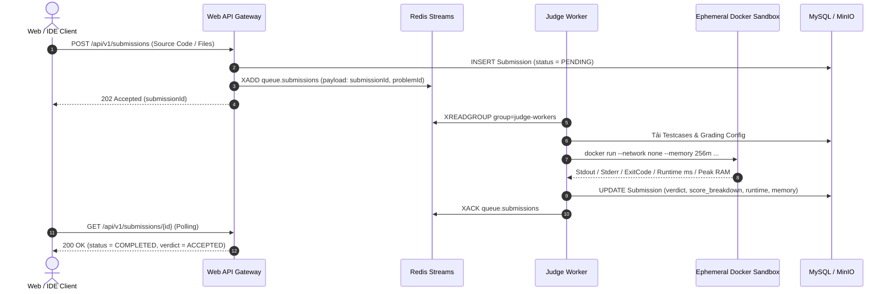

# MINI LEETCODE PLATFORM — DEVELOPER ONBOARDING GUIDE
> **Hướng dẫn Nhập môn Toàn diện cho Kỹ sư Phát triển Hệ thống**  
> **Tài liệu chuẩn hóa kiến trúc Monorepo & Quy chuẩn Kỹ thuật**

---

## 1. Project Overview & Mission

**Mini LeetCode** là nền tảng luyện tập thuật toán trực tuyến (Online Judge), rèn luyện lập trình hướng đối tượng (OOP Grinding), thi đấu thuật toán và tổ chức phòng thi trực tuyến có giám sát liêm chính học thuật (Proctored Exams).

Hệ thống được thiết kế theo mô hình **Modular Monolith** kết hợp phân tách nghiêm ngặt ranh giới bảo mật giữa Web API Gateway và Judge Execution Engine.

### 1.1. Core Tech Stack

| Tầng | Công nghệ chính | Phiên bản | Vai trò & Mục đích |
|---|---|---|---|
| **Backend Runtime** | Java OpenJDK | 17 LTS | Multi-module Maven (`mini-leetcode-common`, `core`, `api`, `judge`) |
| **Backend Framework** | Spring Boot | 3.3.4 | Spring Web, Spring Security 6, Spring Data JPA, Flyway Migration |
| **Database** | MySQL | 8.0 | InnoDB, `utf8mb4_unicode_ci`, quản lý schema qua Flyway scripts |
| **Cache & Queue** | Redis | 7.0 | Queue bài nộp bền vững (`Redis Streams`), Cache verdict & rate limiting |
| **Object Storage** | MinIO | S3-Compatible | Lưu trữ testcase (input/output) và artifact bài nộp sinh viên |
| **Sandbox Execution** | Docker Engine | CLI / SDK | Ephemeral sandbox cô lập tuyệt đối (`--network none`, cgroups) |
| **Frontend Web** | Next.js (App Router) | 14.2 | React 18, TypeScript, Tailwind CSS, Base UI, Monaco Editor |
| **IDE Extension** | IntelliJ Platform SDK | 2025.3+ | Gradle plugin (JDK 21) cho phép code và nộp bài trực tiếp từ IDE |
| **Testing Harness** | JUnit 5, Playwright | Modern | JUnit 5, Mockito, Testcontainers, H2 in-memory, Playwright E2E |

---

## 2. Monorepo Architecture & Package Layout

Dự án được cấu trúc theo mô hình đa module độc lập, tách rời tầng Web và tầng Worker:

```
Mini Leetcode/
├── backend/                                # Java 17 LTS, Maven Multi-Module
│   ├── pom.xml                             # Parent POM quản lý dependency versions tập trung
│   ├── mini-leetcode-common/               # Shared Enums (Verdict, Language, Difficulty), ErrorCodes, DTOs
│   ├── mini-leetcode-core/                 # JPA Entities, Spring Data Repositories, Flyway DDL, MinIO Client
│   ├── mini-leetcode-api/                  # REST Controllers, JWT Stateless Auth, Redis Publisher (XADD)
│   ├── mini-leetcode-judge/                # Redis Queue Consumer (XREADGROUP), Docker Runner, OOP Inspector
│   └── tools/                              # Dữ liệu mẫu, seed generation, testcase builders
├── frontend/                               # Next.js 14 App Router (TypeScript + Tailwind CSS)
│   ├── src/app/                            # 21 routes tĩnh và động (/problems, /study-plans, /exam, /admin)
│   ├── src/components/                     # Monaco Workspace, Header, DifficultyBadge, Admin Authoring
│   ├── src/lib/                            # services.ts (Single API adapter), auth-context, utils
│   └── e2e/                                # Playwright E2E Test Suite (Mock API & Browser scenarios)
├── ide-plugin/                             # IntelliJ IDEA Plugin cho Study Plan
├── docs/                                   # Tài liệu kiến trúc, đặc tả nghiệp vụ và kiểm thử
│   ├── ONBOARDING.md                       # Tài liệu này (Developer Onboarding Guide)
│   ├── PROJECT.md                          # Kiến trúc toàn diện hệ thống (v3.7.0)
│   ├── TECHNICAL_AND_BUSINESS_DOCUMENTATION.md # Đặc tả chi tiết nghiệp vụ & kỹ thuật (v4.0.0)
│   ├── OOP_GRINDING_HANDOFF.md             # Bàn giao kỹ thuật phân hệ OOP Grinding
│   ├── HYBRID_SUBMISSION_SPECIFICATION.md  # Đặc tả nộp bài đa kênh & starter scaffolding
│   ├── EXAM_ANTI_CHEAT_SPECIFICATION.md    # Đặc tả giám sát thi & chống gian lận
│   └── TEST_INFRA.md                       # Ma trận kiểm thử & hạ tầng test
└── specs/                                  # 12 file đặc tả tính năng chi tiết theo từng user story
```

### Ranh giới Trách nhiệm giữa các Module Backend:
1. `mini-leetcode-common`: Module thuần Java, không chứa business logic hay database. Chỉ chứa Enums, API response DTOs (`ApiResponse<T>`), và Base Exceptions.
2. `mini-leetcode-core`: Tầng dữ liệu chung. Chứa thực thể JPA (User, Problem, Submission, Contest, StudyPlan), MinIO Object Storage Service, và các migration Flyway trong `src/main/resources/db/migration/`.
3. `mini-leetcode-api`: **Web Gateway**. Tiếp nhận request từ Client, xác thực token JWT, lưu trạng thái bài nộp `PENDING`, và bắn message vào Redis Streams (`queue.submissions`). **Tuyệt đối không mount Docker socket.**
4. `mini-leetcode-judge`: **Judge Worker**. Chạy tiến trình nền độc lập, lắng nghe queue Redis, tải testcases từ MinIO hoặc thư mục tạm, khởi tạo container Docker ngắn hạn, chấm điểm và ghi nhận Verdict.

---

## 3. Core Architectural Mechanisms

### 3.1. Asynchronous Submission Pipeline



### 3.2. Ephemeral Sandbox Security Boundaries
- **Ngắt mạng 100%:** Flag `--network none`. Container chỉ có loopback interface nội bộ `127.0.0.1`.
- **Giới hạn tài nguyên:** RAM tối đa 256MB (`--memory 256m`), 1.0 CPU (`--cpus 1.0`), PIDs limit 64 (`--pids-limit 64`) để triệt tiêu Fork Bomb.
- **Bảo vệ hệ thống tệp:** Rootfs chỉ đọc (`--read-only`), thư mục chứa testcase mount chế độ Read-Only (`:ro`).
- **Phân quyền thấp:** Chạy bằng tài khoản non-root (`uid:gid = 1001:1001`).
- **Fail-Fast Policy:** Quá trình chấm dừng ngay ở testcase đầu tiên thất bại để tối ưu tài nguyên tính toán.

### 3.3. OOP Grinding & Partial Scoring Mechanism
Đối với bài toán dạng `OOP_GRINDING`, hệ thống chấm theo 3 phần độc lập (Non-blocking Partial Scoring):
$$\text{Total Score} = 30\% \times \text{OOP Audit} + 40\% \times \text{Unit/IO Tests} + 30\% \times \text{Socket Scenarios}$$
*(Nếu đề bài không yêu cầu Socket, trọng số tự động điều chỉnh thành $40\% / 60\%$)*.
- **OOP Structural Audit:** `OopGrindingInspector` phân tích cấu trúc class file qua reflection nội bộ (không thực thi mã), kiểm tra tính đóng gói (`private` fields, cho phép `protected` khi kế thừa), tính trừu tượng (`interface`, `abstract`), hỗ trợ ký tự đại diện wildcard `*`.
- **Unit / Stdin Tests:** Thực thi testcase chuẩn I/O trong Docker Sandbox.
- **Socket Testing:** `SocketIntegrationHarness` cấp phát dynamic ephemeral port trên `127.0.0.1` qua `ServerSocket(0)` để tránh xung đột cổng (Zero TOCTOU), thiết lập timeout 3000ms cho kịch bản Client/Server.

---

## 4. Quick Start: Local Development Setup

### 4.1. Cài đặt Tiền đề (Prerequisites)
- **Java Development Kit (JDK):** OpenJDK 17 LTS.
- **Node.js:** v18+ (khuyên dùng Node.js 20 LTS) & npm.
- **Docker & Docker Compose:** Docker Desktop (Windows/macOS) hoặc Docker Engine (Linux).
- **Git:** Git 2.30+.

### 4.2. Bước 1: Khởi động Hạ tầng (Docker Compose)
Tại thư mục gốc của repository:
```bash
docker compose up -d
```
Lệnh này sẽ khởi động 4 container cốt lõi:
- **MySQL 8.0:** Port `3306` (User: `root` / Pass: `rootpassword`, DB: `mini_leetcode`)
- **Redis 7.0:** Port `6379`
- **MinIO S3:** Port `9000` (API), Port `9001` (Web Console - `minioadmin` / `minioadminpassword`)
- **MinIO Provisioner:** Tự động tạo sẵn 2 bucket `testcases` và `submissions`.

### 4.3. Bước 2: Build & Chạy Backend
Di chuyển vào thư mục `backend/`:
```bash
cd backend

# Chạy toàn bộ test suites (450+ tests)
./mvnw clean test

# Build package bỏ qua test để tiết kiệm thời gian
./mvnw clean package -DskipTests
```

Chạy Web API Gateway:
```bash
java -jar mini-leetcode-api/target/mini-leetcode-api-0.0.1-SNAPSHOT.jar
```
Web API sẽ lắng nghe tại `http://localhost:8080`.
- **Swagger UI:** `http://localhost:8080/swagger-ui.html`
- **OpenAPI 3.1 Spec:** `http://localhost:8080/v3/api-docs`
- **Health Check:** `http://localhost:8080/actuator/health`

### 4.4. Bước 3: Cài đặt & Khởi chạy Frontend
Di chuyển vào thư mục `frontend/`:
```bash
cd frontend

# Cài đặt toàn bộ dependencies
npm install

# Khởi chạy server development (Next.js 14)
npm run dev
```
Giao diện Web sẽ khả dụng tại `http://localhost:3000`.

### 4.5. Bước 4: Kiểm thử Tự động (Verification)
- **Kiểm thử Backend:** `cd backend && ./mvnw test -pl mini-leetcode-judge`
- **Kiểm thử Typescript / Lint Frontend:** `cd frontend && npm run build`
- **Kiểm thử End-to-End Playwright:** `cd frontend && npx playwright test`

---

## 5. Key File Map & Code Locations

| Trách nhiệm nghiệp vụ | Tệp nguồn cốt lõi | Vị trí đường dẫn |
|---|---|---|
| **API Client Adapter** | `services.ts` | `frontend/src/lib/services.ts` |
| **Workspace Monaco Editor** | `workspace.tsx` | `frontend/src/components/workspace/workspace.tsx` |
| **Độ khó theo Signal Meter** | `difficulty-badge.tsx` | `frontend/src/components/problems/difficulty-badge.tsx` |
| **OOP Preset Authoring** | `problem-authoring.tsx` | `frontend/src/components/admin/problem-authoring.tsx` |
| **OOP Structural Inspector** | `OopGrindingInspector.java` | `backend/.../judge/oop_grinding/inspector/OopGrindingInspector.java` |
| **Grading Config Validator** | `GradingConfigValidator.java`| `backend/.../judge/authoring/GradingConfigValidator.java` |
| **Socket Integration Harness**| `SocketIntegrationHarness.java`| `backend/.../judge/oop_grinding/socket/SocketIntegrationHarness.java`|
| **Judge Strategy Factory** | `JudgeStrategyFactory.java`| `backend/.../judge/strategy/JudgeStrategyFactory.java` |
| **Redis Queue Worker** | `JudgeQueueConsumer.java` | `backend/.../judge/queue/JudgeQueueConsumer.java` |
| **Server-Side Proctoring** | `ProctoringService.java` | `backend/.../core/service/ProctoringService.java` |

---

## 6. Complexity Hotspots & Developer Gotchas

> [!WARNING]
> **1. Ranh giới Docker Socket:**
> `mini-leetcode-api` tuyệt đối KHÔNG ĐƯỢC mount Docker Socket (`/var/run/docker.sock`). Mọi tác vụ chạy sandbox chỉ được thực hiện bởi `mini-leetcode-judge`. Nếu thêm logic chạy Docker vào module API, bạn đang phá vỡ mô hình bảo mật cốt lõi.

> [!CAUTION]
> **2. Dynamic Loopback Port Allocation:**
> Không bao giờ hardcode cổng TCP khi kiểm thử Socket. Luôn dùng `new ServerSocket(0)` để hệ điều hành cấp port rảnh động, sau đó truyền port này vào client/server. Tránh hoàn toàn lỗi TOCTOU race conditions khi nhiều worker chạy song song.

> [!IMPORTANT]
> **3. Monaco Editor SSR Hydration:**
> Monaco Editor tương tác trực tiếp với DOM window và web workers. Trong Next.js 14 App Router, mọi component nhúng Monaco PHẢI được bọc qua Dynamic Import với cờ `{ ssr: false }` để tránh lỗi server hydration mismatch.

> [!TIP]
> **4. Flyway Migrations Immutability:**
> Một khi file migration SQL (`V1__...`, `V2__...`) đã được merge vào `main` hoặc chạy trên môi trường cục bộ, tuyệt đối không chỉnh sửa nội dung file cũ (sẽ gây lỗi checksum Flyway). Mọi thay đổi cấu trúc bảng luôn được tạo bằng migration mới tăng dần (`V{N+1}__...`).
