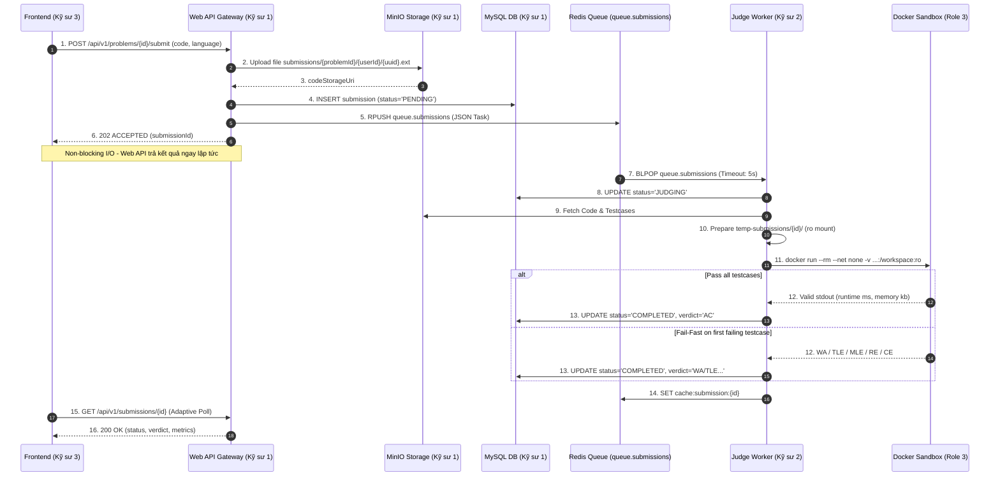

# TÀI LIỆU ĐẶC TẢ KỸ THUẬT BACKEND PHASE 2 (PHASE 2 BACKEND SPECIFICATION)
## DỰ ÁN: MINI LEETCODE PLATFORM
**Tác giả:** Kỹ sư 1 (Backend Core & API Gateway Lead)  
**Phiên bản:** 2.0.0 (Phase 2 - Execution Engine, Queue Dispatcher & Anti-cheat Proctoring)  
**Tình trạng kiểm thử:** 96/96 Tests Passed (100% BUILD SUCCESS)

---

## 1. TỔNG QUAN PHÂN VAI & RANH GIỚI TRÁCH NHIỆM (ROLE BOUNDARIES)

Theo ma trận phân nhiệm WBS (`docs/ROADMAP_AND_WBS.md`), dự án được phát triển song song bởi 3 chuyên trách:

```
┌─────────────────────────────────────────────────────────────────────────────┐
│                      MINI LEETCODE MONOREPO WORKSPACE                       │
├─────────────────────────┬─────────────────────────┬─────────────────────────┤
│ KỸ SƯ 1 (Bạn phụ trách)  │ KỸ SƯ 2                 │ KỸ SƯ 3                 │
│ Backend Core & Web API  │ Sandbox & Judge Engine  │ Frontend & Workspace    │
├─────────────────────────┼─────────────────────────┼─────────────────────────┤
│ • MySQL & Flyway DDL    │ • Docker Sandbox Runner │ • Next.js 14 App Router │
│ • JWT Stateless Auth    │ • Linux Cgroups/Seccomp │ • Monaco Code Editor    │
│ • MinIO Storage Service │ • Worker BLPOP Consumer │ • Proctoring Tracker UI │
│ • Submission Web API    │ • Fail-Fast Evaluator   │ • Real-time Polling     │
│ • Redis Queue Producer  │ • CPU/RAM Metrics       │ • Leaderboard & History │
│ • Server-side Proctoring│ • Bắt 7 Verdicts        │ • Split-view Layout     │
└─────────────────────────┴─────────────────────────┴─────────────────────────┘
```

> [!IMPORTANT]
> **Nguyên tắc an toàn cốt lõi**: `mini-leetcode-api` tuyệt đối **không mount Docker Socket (`/var/run/docker.sock`)**. Việc thực thi mã độc hoàn toàn được cô lập sang `mini-leetcode-judge` thông qua hàng đợi Redis (`queue.submissions`).

---

## 2. KIẾN TRÚC ĐIỀU PHỐI HÀNG ĐỢI & VÒNG ĐỜI BÀI NỘP



---

## 3. THIẾT KẾ CƠ SỞ DỮ LIỆU & ENTITY (JPA PERSISTENCE)

### 3.1 Bảng `submissions`
| Cột | Kiểu | Mô tả |
| :--- | :--- | :--- |
| `id` | `BIGINT AUTO_INCREMENT` | Khóa chính |
| `user_id` | `BIGINT NOT NULL` | FK tham chiếu `users(id)` |
| `problem_id` | `BIGINT NOT NULL` | FK tham chiếu `problems(id)` |
| `contest_id` | `BIGINT NULL` | FK tham chiếu `contests(id)` (nếu nộp trong phòng thi) |
| `language` | `ENUM('JAVA', 'PYTHON', 'CPP')` | Ngôn ngữ nộp bài |
| `code_storage_uri` | `VARCHAR(500) NOT NULL` | Đường dẫn tệp lưu trữ trên MinIO |
| `status` | `ENUM('PENDING', 'JUDGING', 'COMPLETED', 'FAILED')` | Vòng đời bài nộp |
| `verdict` | `ENUM('AC', 'WA', 'TLE', 'MLE', 'CE', 'RE', 'SV', 'FLAGGED_CHEATING')` | Kết quả phán quyết |
| `execution_time_ms`| `INT NULL` | Thời gian chạy CPU lớn nhất (ms) |
| `memory_used_kb` | `INT NULL` | Dung lượng RAM đỉnh (KB) |
| `pass_test_cases` | `INT NOT NULL DEFAULT 0` | Số testcase vượt qua |
| `total_test_cases` | `INT NOT NULL DEFAULT 0` | Tổng số testcase |
| `error_message` | `TEXT NULL` | Chi tiết lỗi biên dịch (`CE`) hoặc Stacktrace (`RE`) |

### 3.2 Bảng `contests` & `contest_participants`
- **`contests`**: `id`, `title`, `slug`, `start_time`, `end_time`, `scoring_policy` (`ACM_ICPC`, `PARTIAL_IOI`), `max_violations_allowed` (mặc định: 3), `status` (`SCHEDULED`, `RUNNING`, `COMPLETED`), `created_by`.
- **`contest_participants`**: `id`, `contest_id`, `user_id`, `status` (`REGISTERED`, `IN_PROGRESS`, `SUBMITTED`, `DISQUALIFIED`), `violation_count` (số lần vi phạm), `last_away_start_time` (thời điểm rời tab), `score`, `penalty_time_minutes`.

---

## 4. HỢP ĐỒNG HÀNG ĐỢI REDIS (QUEUE CONTRACT GIỮA KỸ SƯ 1 & KỸ SƯ 2)

### 4.1 Cấu hình Hàng đợi
- **Tên hàng đợi Redis List**: `queue.submissions`
- **Lệnh Publisher (Web API)**: `RPUSH queue.submissions <json_payload>`
- **Lệnh Consumer (Judge Worker)**: `BLPOP queue.submissions 5`

### 4.2 Cấu trúc Thông điệp JSON (`SubmissionTaskMessage`)
```json
{
  "submissionId": 501,
  "problemId": 10,
  "userId": 1,
  "language": "JAVA"
}
```

> [!TIP]
> **Hướng dẫn cho Kỹ sư 2 (Sandbox Specialist)**:
> 1. Khi nhận được JSON trên qua `BLPOP`, Worker chỉ cần lấy `submissionId = 501`.
> 2. Truy vấn Database bảng `submissions` để lấy `code_storage_uri`.
> 3. Tải code từ MinIO và testcases từ `test_cases` về thư mục `temp-submissions/501/`.
> 4. Chạy Docker container với cờ `--network none --memory 256m --memory-swap 256m --pids-limit 64 -v ...:/workspace:ro`.
> 5. Cập nhật kết quả vào MySQL và lưu cache Redis: `SET cache:submission:501 <json_result> EX 300`.

---

## 5. ĐẶC TẢ REST API CONTRACTS (CHO KỸ SƯ 3 - FRONTEND)

Tất cả các API được bảo vệ bởi header `Authorization: Bearer <jwt_token>` và bọc trong Envelope chuẩn [`ApiResponse<T>`](file:///c:/Users/aDMIN/Documents/JSD/Mini%20Leetcode/backend/mini-leetcode-common/src/main/java/jsd/toiyeujava/mini_leetcode/dto/ApiResponse.java):

```json
{
  "success": true,
  "statusCode": 200,
  "message": "...",
  "data": { ... },
  "timestamp": "2026-10-27T14:48:00Z"
}
```

---

### 5.1 Nộp bài tập (Submit Code)
- **Endpoint**: `POST /api/v1/problems/{problemId}/submit`
- **Mã phản hồi thành công**: **`202 ACCEPTED`**
- **Request Body**:
  ```json
  {
    "language": "JAVA",
    "code": "import java.util.*;\npublic class Solution {\n    public static void main(String[] args) {\n        Scanner sc = new Scanner(System.in);\n        int a = sc.nextInt(), b = sc.nextInt();\n        System.out.println(a + b);\n    }\n}"
  }
  ```
- **Response Body (202 Accepted)**:
  ```json
  {
    "success": true,
    "statusCode": 200,
    "message": "Submission accepted and queued for judging",
    "data": {
      "id": 501,
      "problemId": 10,
      "problemTitle": "Two Sum",
      "userId": 1,
      "username": "coder_pro",
      "language": "JAVA",
      "status": "PENDING",
      "verdict": null,
      "executionTimeMs": null,
      "memoryUsedKb": null,
      "passTestCases": 0,
      "totalTestCases": 0,
      "errorMessage": null,
      "createdAt": "2026-10-27T14:48:15",
      "updatedAt": "2026-10-27T14:48:15"
    },
    "timestamp": "2026-10-27T14:48:15Z"
  }
  ```

---

### 5.2 Tra cứu chi tiết & kết quả bài nộp (Get Submission)
- **Endpoint**: `GET /api/v1/submissions/{id}`
- **Phân quyền bảo mật**: Chỉ chủ sở hữu bài nộp hoặc tài khoản `INSTRUCTOR`/`ADMIN` mới có quyền xem (`403 Forbidden` nếu cố ý xem bài của thí sinh khác).
- **Response Body khi đang chấm (`JUDGING`)**:
  ```json
  {
    "success": true,
    "statusCode": 200,
    "message": "Success",
    "data": {
      "id": 501,
      "status": "JUDGING",
      "verdict": null
    }
  }
  ```
- **Response Body khi chấm hoàn tất (`COMPLETED - AC`)**:
  ```json
  {
    "success": true,
    "statusCode": 200,
    "message": "Success",
    "data": {
      "id": 501,
      "problemId": 10,
      "problemTitle": "Two Sum",
      "userId": 1,
      "username": "coder_pro",
      "language": "JAVA",
      "status": "COMPLETED",
      "verdict": "AC",
      "executionTimeMs": 85,
      "memoryUsedKb": 32768,
      "passTestCases": 10,
      "totalTestCases": 10,
      "errorMessage": null,
      "createdAt": "2026-10-27T14:48:15",
      "updatedAt": "2026-10-27T14:48:19"
    }
  }
  ```

---

### 5.3 Xem lại mã nguồn bài nộp (Get Submitted Code)
- **Endpoint**: `GET /api/v1/submissions/{id}/code`
- **Response Body (200 OK)**:
  ```json
  {
    "success": true,
    "statusCode": 200,
    "message": "Source code retrieved successfully",
    "data": "public class Solution { ... }"
  }
  ```

---

### 5.4 Lịch sử nộp bài của tôi (Get My Submissions)
- **Endpoint**: `GET /api/v1/submissions/my?page=0&size=20`
- **Response Body (200 OK)**: Phân trang danh sách các bài đã nộp của tài khoản đang đăng nhập.

---

### 5.5 Giám sát phòng thi & Chống gian lận (Proctoring Event API)
- **Endpoint**: `POST /api/v1/contests/{contestId}/proctoring/events`
- **Mục đích**: Frontend gửi tín hiệu khi xảy ra sự kiện `visibilitychange`, `blur` hoặc `focus` của trình duyệt.
- **Request Body (Khi thí sinh rời màn hình)**:
  ```json
  {
    "eventType": "WINDOW_BLUR",
    "clientTimestamp": 1728123456000
  }
  ```
- **Request Body (Khi thí sinh quay lại màn hình)**:
  ```json
  {
    "eventType": "WINDOW_FOCUS",
    "clientTimestamp": 1728123460000
  }
  ```
- **Response Body khi vi phạm chưa vượt ngưỡng**:
  ```json
  {
    "success": true,
    "statusCode": 200,
    "message": "Proctoring event processed",
    "data": {
      "contestId": 4,
      "userId": 1,
      "status": "IN_PROGRESS",
      "violationCount": 1,
      "maxViolationsAllowed": 3,
      "isDisqualified": false,
      "awayDurationMs": 4000,
      "message": "Violation recorded: away for 4000ms (1/3)"
    }
  }
  ```
- **Response Body khi vượt quá 3 lần vi phạm (Tự động truất quyền thi)**:
  ```json
  {
    "success": true,
    "statusCode": 200,
    "message": "Proctoring event processed",
    "data": {
      "contestId": 4,
      "userId": 1,
      "status": "DISQUALIFIED",
      "violationCount": 3,
      "maxViolationsAllowed": 3,
      "isDisqualified": true,
      "awayDurationMs": 5200,
      "message": "Disqualified: exceeded maximum permitted window switches (3/3)"
    }
  }
  ```

---

## 6. BÁO CÁO KIỂM THỬ TỰ ĐỘNG TOÀN DIỆN (AUTOMATED TEST REPORT)

| Hạng mục kiểm thử | Lớp kiểm thử | Số test | Kết quả | Chi tiết nội dung kiểm thử |
| :--- | :--- | :---: | :---: | :--- |
| **Common Enums & Envelope** | `ApiResponseTest`<br>`SubmissionVerdictTest` | 6 | **6/6 PASS** | Envelope serialization, tính hợp lệ của 8 giá trị Verdict (`AC`, `WA`, `TLE`, `MLE`, `CE`, `RE`, `SV`, `FLAGGED_CHEATING`). |
| **Submission Service Logic** | `SubmissionServiceTest` | 5 | **5/5 PASS** | Tự động upload code lên MinIO, kiểm tra lỗi NotFound, cập nhật verdict và số lượng testcase pass. |
| **Submission REST API & Auth** | `SubmissionControllerTest` | 7 | **7/7 PASS** | Trả về `202 ACCEPTED`, đẩy đúng cấu trúc JSON vào Redis Queue, chặn code rỗng `400`, chặn xem bài người khác `403`, cho phép Admin `200`. |
| **Anti-cheat Proctoring** | `ProctoringIntegrationTest` | 5 | **5/5 PASS** | Bắt sự kiện blur, ân hạn `<1.5s` không phạt, phạt vi phạm khi `>1.5s`, tự động chuyển trạng thái `DISQUALIFIED` sau 3 lần, chặn khách `401`. |
| **Hệ thống cũ & Tích hợp** | `ProblemServiceTest`<br>`StorageServiceTest`<br>`ProblemAndTestCaseIntegrationTest`<br>`AuthControllerIntegrationTest`<br>... | 73 | **73/73 PASS** | Toàn bộ các luồng Phase 1 được bảo tồn nguyên vẹn 100%, không phát sinh regression. |
| **TỔNG CỘNG** | **5 Module Maven Multi-Module** | **96** | **96/96 PASS** | **100% BUILD SUCCESS (0 failures, 0 errors)** |
