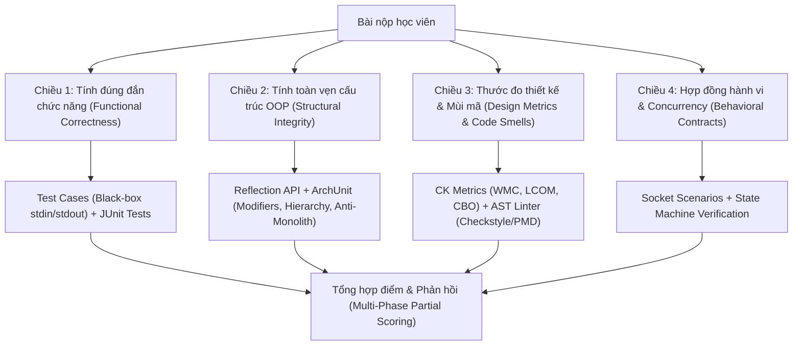

# NGHIÊN CỨU CHUYÊN SÂU: PHƯƠNG PHÁP LUẬN & QUY TẮC CHẤM TỰ ĐỘNG LẬP TRÌNH HƯỚNG ĐỐI TƯỢNG (AUTOMATED OOP ASSESSMENT)

> **Tác giả:** Nghiên cứu tổng hợp chuyên sâu cho Mini LeetCode Platform  
> **Ngày xuất bản:** 16/11/2026  
> **Đối tượng:** Giảng viên, Kiến trúc sư hệ thống chấm (Judge Architects), Kỹ sư giáo dục phần mềm (EdTech Software Engineers)  
> **Mục tiêu:** Khảo sát toàn diện cơ sở lý luận, phương pháp luận từ các chuyên gia khoa học máy tính (ACM, IEEE, SIGCSE), và các hệ thống giáo dục hàng đầu thế giới về cách chấm tự động code OOP Java.

---

## 1. NGHỊCH LÝ CỐT LÕI CỦA VIỆC CHẤM OOP TRUYỀN THỐNG (THE CORE DILEMMA)

### 1.1. Sự bất lực của mô hình Black-Box (LeetCode / Codeforces Model)
Các nền tảng lập trình thi đấu (Competitive Programming - CP) truyền thống hoạt động hoàn toàn dựa trên cơ chế hộp đen:
$$\text{Input (stdin)} \longrightarrow \text{Binary/Script} \longrightarrow \text{Output (stdout)}$$

Khi áp dụng mô hình này vào các bài toán thiết kế hướng đối tượng (ví dụ: *Design a Parking Lot*, *Bank Management*, *Elevator System*), hệ thống CP nảy sinh một nghịch lý nghiêm trọng mà các nhà nghiên cứu giáo dục gọi là **"Procedural Hack in OOP Clothing"** (Mã thủ tục đội lốt hướng đối tượng):
* Sinh viên có thể giải quyết toàn bộ bài toán bằng **một file duy nhất**, sử dụng một lớp `Main` khổng lồ (God Class / Monolith).
* Toàn bộ biến được khai báo `public static`, các mảng nguyên thủy toàn cục thay thế cho các đối tượng nghiệp vụ.
* Hoàn toàn không có tính đóng gói (Encapsulation), không có kế thừa hay đa hình (Polymorphism), không có phân chia trách nhiệm (Separation of Concerns).
* **Kết quả:** Hệ thống vẫn chấm **"Accepted 100%"** vì dữ liệu đầu ra `stdout` trùng khớp từng ký tự với test case mẫu!

### 1.2. Hậu quả sư phạm (Pedagogical Pitfalls)
Theo nghiên cứu của **Edwards (Virginia Tech, 2004)** và **Combéfis et al. (2014)** trên ACM SIGCSE:
1. **Dung dưỡng thói quen xấu:** Sinh viên tin rằng code chạy đúng kết quả tức là code có chất lượng tốt.
2. **Ảo tưởng về năng lực:** Khi bước vào môi trường doanh nghiệp với các dự án lớn, sinh viên hoàn toàn thiếu tư duy về kiến trúc, khả năng bảo trì, mở rộng và kiểm thử đơn vị (Unit Testing).

---

## 2. PHƯƠNG PHÁP LUẬN TỪ CÁC CHUYÊN GIA & TỔ CHỨC HÀNG ĐẦU

Để giải quyết bài toán trên, các đại học hàng đầu (MIT, Carnegie Mellon, Virginia Tech, Stanford, UIUC) và các tổ chức kiểm định quốc tế (Oracle Certified Professional, JetBrains Academy) đã xây dựng các phương pháp luận đánh giá OOP đa chiều.



### 2.1. Stephen H. Edwards (Virginia Tech) – Hệ thống Web-CAT
Giáo sư Stephen H. Edwards là người tiên phong trong việc chấm tự động OOP thông qua việc yêu cầu sinh viên **tự viết bài test** (Test-Driven Learning):
* Không chỉ chấm code sinh viên chạy đúng hay sai, Web-CAT dùng code coverage và mutation testing để chấm xem **bộ test của sinh viên có bao phủ hết các trường hợp biên** của bài toán không.
* Kết hợp phân tích tĩnh (Static Analysis) qua Checkstyle và PMD để chấm điểm phong cách và cấu trúc.

### 2.2. Chidamber & Kemerer (CK Metrics Suite) – Thước đo định lượng OOP
Năm 1994, Shyam Chidamber và Chris Kemerer (MIT / University of Pittsburgh) đã công bố bộ 6 thước đo kinh điển (IEEE Transactions on Software Engineering) để lượng hóa chất lượng hướng đối tượng. Các hệ thống chấm hiện đại dùng CK Metrics để trừ điểm tự động:

| Thước đo | Tên tiếng Anh | Ý nghĩa trong chấm bài OOP | Ngưỡng vi phạm (Threshold) |
|---|---|---|---|
| **WMC** | *Weighted Methods per Class* | Tổng độ phức tạp của các phương thức trong một lớp. | $\text{WMC} > 20 \rightarrow$ Nguy cơ lớp ôm đồm quá nhiều việc. |
| **DIT** | *Depth of Inheritance Tree* | Độ sâu phân cấp kế thừa từ lớp cha đến lớp con. | $\text{DIT} > 5 \rightarrow$ Kế thừa quá sâu, khó bảo trì; $\text{DIT} = 0$ khi đề yêu cầu đa hình $\rightarrow$ Vi phạm. |
| **NOC** | *Number of Children* | Số lượng lớp con trực tiếp kế thừa từ một lớp cha. | Đo lường tính tái sử dụng và khả năng mở rộng. |
| **CBO** | *Coupling Between Objects* | Số lượng lớp khác mà lớp này liên kết phụ thuộc. | $\text{CBO} > 10 \rightarrow$ Ghép nối quá chặt (Tight Coupling), khó kiểm thử độc lập. |
| **RFC** | *Response for a Class* | Tổng số phương thức có thể được thực thi khi nhận message. | Đo lường độ phức tạp giao tiếp giữa các đối tượng. |
| **LCOM** | *Lack of Cohesion in Methods* | Mức độ rời rạc giữa các phương thức và thuộc tính. | $\text{LCOM} \rightarrow 1 \rightarrow$ Vi phạm nguyên lý đơn nhiệm (SRP), lớp bị phân mảnh. |

---

## 3. PHÂN LOẠI CÁC KỸ THUẬT KIỂM SOÁT CẤU TRÚC MÃ NGUỒN

Khi xây dựng auto-grader cho OOP, các chuyên gia lựa chọn 4 trường phái kỹ thuật chính:

```
                                  KỸ THUẬT KIỂM SOÁT MÃ OOP
            ┌─────────────────────────────┼─────────────────────────────┐
            ▼                             ▼                             ▼
   1. Bytecode Reflection        2. Architectural Testing       3. AST Source Parsing
   (OopGrindingInspector)               (ArchUnit)              (Spoon / JavaParser)
   • Nạp .class an toàn          • Quét toàn bộ package graph   • Phân tích cú pháp thô
   • Kiểm tra modifier/types     • Cấm dependency trái phép     • Đo độ dài dòng, câu lệnh
   • Siêu nhanh (< 50ms)         • Đòi hỏi viết test JUnit      • Quét AST trước biên dịch
```

### 3.1. Trường phái 1: Bytecode Reflection cô lập (Isolate Reflection) — Mini LeetCode Core
* **Cơ chế:** Nạp bytecode `.class` đã biên dịch thông qua một `URLClassLoader` độc lập có parent là `PlatformClassLoader` (ngăn mã sinh viên truy cập classpath nội bộ của judge). Sử dụng cờ `initialize = false`:
  ```java
  Class<?> clazz = Class.forName(className, false, classLoader);
  ```
* **Ưu điểm vượt trội:**
  * **An toàn tuyệt đối:** `initialize = false` đảm bảo không bao giờ thực thi mã tĩnh (`static { ... }`) hay constructor của sinh viên ở bước này.
  * **Tốc độ cực cao:** Thời gian phân tích chỉ mất từ 10ms - 50ms cho hàng chục class.
  * **Chuẩn hóa cao:** Dễ dàng cấu hình dưới dạng quy tắc JSON linh hoạt (`OopConstraintRule`).
* **Hạn chế:** Không soi được bên trong thân hàm (method body) để đếm số vòng lặp hay cấu trúc lệnh điều khiển.

### 3.2. Trường phái 2: Architectural Testing (ArchUnit Model)
* **Cơ chế:** Phân tích trực tiếp các instruction bytecode của file `.class` (dùng ASM) mà không cần nạp class vào JVM.
* **Quy tắc tiêu biểu:**
  * "Classes trong package `service` không được phụ thuộc trực tiếp vào package `view`."
  * "Mọi class có tên kết thúc bằng `DTO` phải là bất biến (immutable - chỉ chứa `final fields`)."

### 3.3. Trường phái 3: AST Source Parsing (Spoon / JavaParser / Checkstyle)
* **Cơ chế:** Phân tích cây cú pháp trừu tượng (Abstract Syntax Tree) trực tiếp từ file `.java` trước khi biên dịch.
* **Ứng dụng:**
  * Phát hiện "Magic Numbers" (các số cứng viết thẳng vào code thay vì khai báo `static final`).
  * Phát hiện "Empty Catch Blocks" (nuốt ngoại lệ).
  * Kiểm tra xem sinh viên có dùng `instanceof` hay switch-case theo kiểu dữ liệu (vi phạm tính đa hình) hay không.

---

## 4. CHI TIẾT 3 TRỤ CỘT QUY TẮC OOP KINH ĐIỂN VÀ CÁCH ĐÁNH GIÁ

### 4.1. Tính Đóng Gói (Encapsulation & Information Hiding)
* **Cơ sở lý luận:** Được David Parnas đề xuất từ năm 1972 ("On the Criteria To Be Used in Decomposing Systems into Modules"). Trạng thái nội tại của đối tượng phải được bảo vệ khỏi sự can thiệp tùy tiện từ bên ngoài.
* **Tiêu chuẩn chuyên gia:**
  1. **Field Visibility:** 100% fields phải là `private` hoặc `protected`. Ngoại lệ duy nhất được phép là hằng số (`public static final`).
  2. **Representation Exposure (Rò rỉ biểu diễn):** Getter không được trả về trực tiếp tham chiếu của các đối tượng khả biến (như `Date`, `List`, `Map`, mảng). Ví dụ:
     ```java
     // Vi phạm Representation Exposure: bên ngoài có thể mutate danh sách
     public List<Account> getAccounts() { return this.accounts; }

     // Chuẩn OOP: Trả về bản sao phòng thủ hoặc unmodifiable view
     public List<Account> getAccounts() { return Collections.unmodifiableList(this.accounts); }
     ```

### 4.2. Tính Đa Hình & Trừu Tượng (Polymorphism & Abstraction)
* **Cơ sở lý luận:** Nguyên lý thay thế Liskov (Liskov Substitution Principle - Barbara Liskov, 1987). Các đối tượng của lớp con phải có thể thay thế cho các đối tượng của lớp cha mà không làm thay đổi tính đúng đắn của chương trình.
* **Chống Anti-pattern "Switch-on-Type":**
  Sinh viên chưa nắm vững OOP thường viết code như sau:
  ```java
  // Anti-pattern thủ tục: dùng switch-case hoặc if-else kiểm tra loại đối tượng
  public double calculateArea(Shape s) {
      if (s.type.equals("CIRCLE")) return Math.PI * s.r * s.r;
      else if (s.type.equals("RECTANGLE")) return s.w * s.h;
  }
  ```
  Chuyên gia yêu cầu chuyển đổi sang Dynamic Dispatch:
  ```java
  // Chuẩn OOP: Mỗi lớp con tự ghi đè hành vi tính diện tích
  public interface Shape { double getArea(); }
  public class Circle implements Shape { public double getArea() { return Math.PI * r * r; } }
  ```
* **Quy tắc kiểm tra trong hệ thống:**
  * Bắt buộc tồn tại ít nhất 1 `interface` hoặc `abstract class`.
  * Các lớp con bắt buộc phải `implements` hoặc `extends` và override đầy đủ các abstract methods.

### 4.3. Phân Tách Trách Nhiệm (Separation of Concerns & Anti-Monolithic)
* **Cơ sở lý luận:** Nguyên lý đơn nhiệm (Single Responsibility Principle - Robert C. Martin). Một lớp chỉ nên có một và chỉ một lý do để thay đổi.
* **Anti-pattern "God Class" / "The Blob":**
  Một lớp duy nhất chứa hàng chục phương thức, hàng trăm dòng lệnh, thực hiện từ việc đọc `Scanner`, validate dữ liệu, xử lý tính toán ngân hàng, đến in kết quả ra terminal.
* **Quy tắc kiểm tra trong hệ thống:**
  * Số lượng classes $\ge 2$ trong bài nộp.
  * Hàm `main()` trong lớp khởi chạy chỉ được phép làm nhiệm vụ: Khởi tạo các domain objects, nạp cấu hình và chuyển giao luồng điều khiển (delegation), không chứa business logic phức tạp.

---

## 5. SO SÁNH ĐỐI CHIẾU CÁC HỆ THỐNG TRÊN THẾ GIỚI

| Đặc tính / Tiêu chí | LeetCode / HackerRank | Web-CAT (Virginia Tech) | Gradescope (Autograder) | **Mini LeetCode (OOP Grinding)** |
|:---|:---:|:---:|:---:|:---:|
| **Hỗ trợ bài tập Java đa file** | Không (Chỉ 1 class Solution) | Có (Project Java đầy đủ) | Có (Custom Docker script) | **Có (Full multi-file IDE & Zip upload)** |
| **Kiểm tra cấu trúc OOP** | Không | Có (Checkstyle / PMD) | Phụ thuộc người ra đề viết code | **Có sẵn (`OopGrindingInspector` qua Reflection)** |
| **Bảo vệ chống code độc hại** | Sandbox Linux | SecurityManager cũ | Docker Container | **Docker Ephemeral + ClassLoader cô lập + cgroups** |
| **Kiểm tra giao tiếp Mạng (Socket)** | Không | Không | Rất khó cấu hình | **Có sẵn (`SocketIntegrationHarness` động trên 127.0.0.1)** |
| **Chấm điểm thành phần (Partial)** | Không (0 hoặc 100) | Có (Dựa trên code coverage) | Có (Theo điểm test case) | **Có ($30/40/30$ hoặc $40/60$ linh hoạt)** |
| **Giao diện cấu hình cho GV** | Không (Đóng kín) | File cấu hình XML/Ant | File shell script `run_autograder` | **Giao diện Web trực quan (Quick Presets + Two-way JSON sync)** |

---

## 6. KHUYẾN NGHỊ LỘ TRÌNH PHÁT TRIỂN TIẾP THEO (NEXT-GEN RECOMMENDATIONS)

Để hệ sinh thái Mini LeetCode trở thành một nền tảng chấm OOP hàng đầu tương đương các chuẩn quốc tế, nhóm phát triển có thể nghiên cứu bổ sung:

1. **Phân tích AST sâu (Deep AST Inspection với JavaParser):**
   * Bổ sung luật cấm sử dụng từ khóa `instanceof` trong các bài tập rèn luyện tính Đa hình (ép sinh viên phải dùng method overriding thay vì if-else kiểu đối tượng).
   * Kiểm tra "Representation Exposure": Quét các phương thức getter để đảm bảo không trả về trực tiếp mảng hoặc collection khả biến.
2. **Tích hợp ArchUnit Rules linh hoạt:**
   * Cho phép giáo viên định nghĩa luật kiến trúc phân tầng (ví dụ: `Controller` $\rightarrow$ `Service` $\rightarrow$ `Repository`) đối với các bài tập lớn (Project Stages).
3. **Phản hồi sư phạm hỗ trợ bởi AI (LLM-Assisted Pedagogical Feedback):**
   * Khi bài nộp bị vi phạm luật OOP (ví dụ: vi phạm đóng gói hoặc thiết kế dồn khối), AI đóng vai trò như một trợ giảng (TA), trích dẫn vị trí dòng vi phạm và giải thích trực quan tại sao nên refactor theo chuẩn thiết kế hướng đối tượng.

---

## TÀI LIỆU THAM KHẢO CHÍNH (PRIMARY SOURCES & CITATIONS)

1. **Parnas, D. L. (1972).** *On the criteria to be used in decomposing systems into modules.* Communications of the ACM, 15(12), 1053-1058.
2. **Chidamber, S. R., & Kemerer, C. F. (1994).** *A metrics suite for object oriented design.* IEEE Transactions on Software Engineering, 20(6), 476-493.
3. **Liskov, B. (1987).** *Data abstraction and hierarchy.* ACM SIGPLAN Notices, 23(5), 17-32.
4. **Edwards, S. H. (2004).** *Using software testing to move students from trial-and-error to reflection-in-action.* ACM SIGCSE Bulletin, 36(1), 26-30.
5. **Combéfis, S., Bibal, A., & Van Roy, P. (2014).** *Recasting a traditional course into a MOOC: A case study.* Proceedings of the 2014 Conference on Innovation and Technology in Computer Science Education (ITiCSE).
6. **ArchUnit Documentation.** *Unit test your Java architecture.* [https://www.archunit.org](https://www.archunit.org).
7. **Mini LeetCode Core Specs.** [OOP_GRINDING_HANDOFF.md](file:///c:/Users/aDMIN/Documents/01_HocTap/JSD/Mini%20Leetcode/docs/OOP_GRINDING_HANDOFF.md) & [PROJECT.md](file:///c:/Users/aDMIN/Documents/01_HocTap/JSD/Mini%20Leetcode/docs/PROJECT.md).
