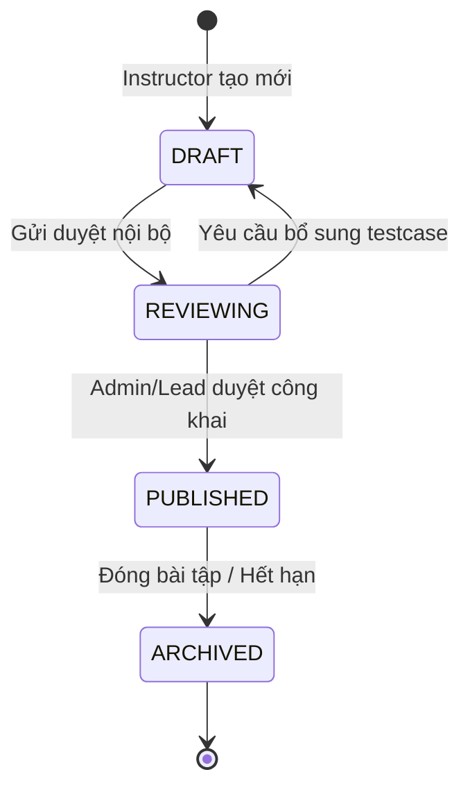
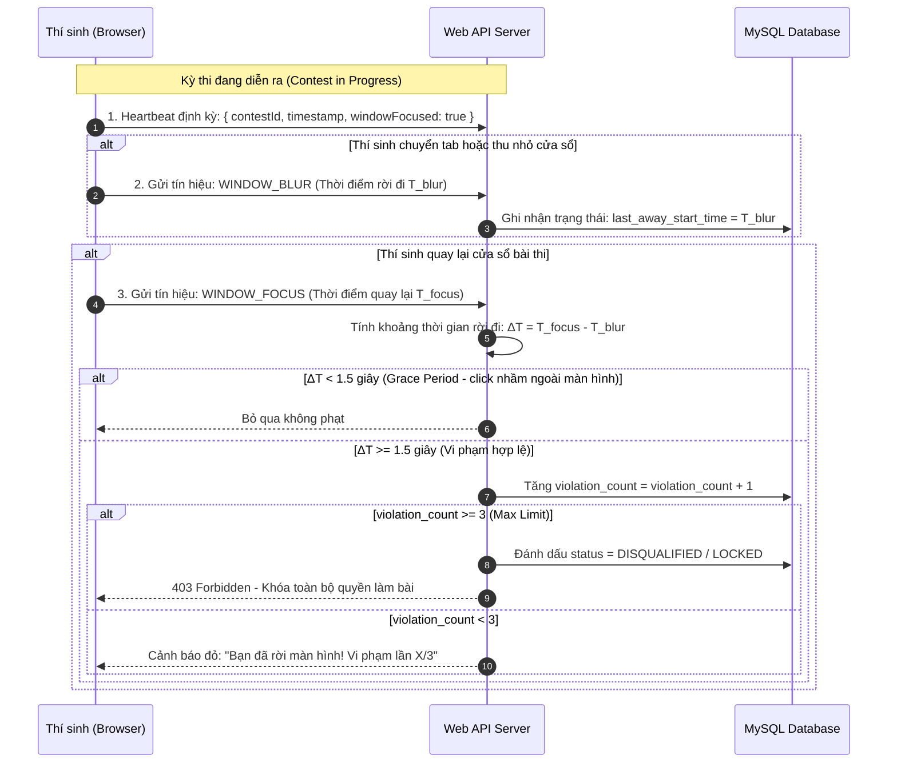
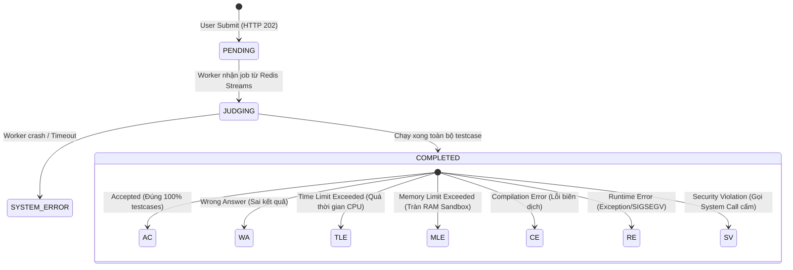

# MINI LEETCODE PLATFORM — ĐẶC TẢ NGHIỆP VỤ & KIẾN TRÚC KỸ THUẬT TOÀN DIỆN
## (COMPREHENSIVE BUSINESS & TECHNICAL SPECIFICATIONS)

> **Phiên bản tài liệu:** 4.0.0 (Chuẩn hóa toàn diện theo kiến trúc Maven Multi-Module Monolith)  
> **Dự án:** Mini LeetCode Platform  
> **Tác giả:** Principal Software Engineer & Backend Lead  
> **Trạng thái:** Production-Ready Documentation Baseline  

---

## MỤC LỤC
1. [Tổng quan Sản phẩm & Mục tiêu Nghiệp vụ](#1-tổng-quan-sản-phẩm--mục-tiêu-nghiệp-vụ)
2. [Chân dung Người dùng & Ma trận Phân quyền (RBAC)](#2-chân-dung-người-dùng--ma-trận-phân-quyền-rbac)
3. [Luồng Nghiệp vụ Cốt lõi & Máy trạng thái (Business Workflows)](#3-luồng-nghiệp-vụ-cốt-lõi--máy-trạng-thái-business-workflows)
   - 3.1. Vòng đời Quản lý Đề bài (Problem Lifecycle)
   - 3.2. Phòng thi & Giám sát Liêm chính (Server-Side Proctoring)
   - 3.3. Quy chế Chấm thi & Bảng xếp hạng (Contest Leaderboard)
   - 3.4. Vòng đời Chấm bài & Bộ 7 Mã Phán quyết (Judge Verdicts)
4. [Kiến trúc Kỹ thuật Hệ thống (System Architecture)](#4-kiến-trúc-kỹ-thuật-hệ-thống-system-architecture)
   - 4.1. Cấu trúc Maven Multi-Module Monolith
   - 4.2. Chiến lược Đóng gói Dual-Target (Web API vs Judge Worker)
   - 4.3. Mô hình Bộ nhớ & Streaming I/O Tránh Tràn RAM
   - 4.4. Hàng đợi Bền vững Redis Streams & Xử lý Zombie Jobs
   - 4.5. Bảo mật Phiên làm việc (RFC 6819 Token Family Revocation & Pessimistic Lock)
5. [Đặc tả Cơ sở Dữ liệu Chuẩn hóa (MySQL 8.0 DDL & Flyway Migration)](#5-đặc-tả-cơ-sở-dữ-liệu-chuẩn-hóa-mysql-80-ddl--flyway-migration)
6. [Hợp đồng Giao tiếp RESTful APIs & Chuẩn Lỗi RFC 7807](#6-hợp-đồng-giao-tiếp-restful-apis--chuẩn-lỗi-rfc-7807)
7. [Hướng dẫn Khởi chạy Cục bộ & Vận hành Hạ tầng (DevOps & Deployment)](#7-hướng-dẫn-khởi-chạy-cục-bộ--vận-hành-hạ-tầng-devops--deployment)

---

## 1. TỔNG QUAN SẢN PHẨM & MỤC TIÊU NGHIỆP VỤ

Mini LeetCode Platform là nền tảng thi đấu và rèn luyện thuật toán trực tuyến với hệ thống chấm bài cô lập an toàn, đo lường thời gian thực và giám sát liêm chính phía máy chủ. Hệ thống giải quyết hai bài toán nghiệp vụ cốt lõi:

1. **Chế độ Luyện tập Tự do (Practice Mode):**
   - Cho phép học viên tự do lựa chọn bài tập theo độ khó (`EASY`, `MEDIUM`, `HARD`), thẻ phân loại (`tag`), tìm kiếm từ khóa.
   - Thử nghiệm giải thuật với các ngôn ngữ phổ biến (Java 17 LTS, Python 3).
   - Nhận phản hồi tức thời về thời gian thực thi (Runtime ms), mức tiêu thụ RAM (Memory KB) và thông tin so sánh kết quả (Diff Output) trên các testcase công khai.

2. **Chế độ Thi đấu Đánh giá có Giám sát (Exam / Contest Mode):**
   - Môi trường kiểm tra năng lực lập trình đồng bộ theo thời gian thực (Real-time Contest).
   - **Tính giờ nghiêm ngặt (Server-Authority Strict Timer):** Đồng hồ đếm ngược được khóa theo mốc thời gian máy chủ, tự động khóa nộp bài khi hết giờ.
   - **Chống gian lận phía máy chủ (Server-Side Proctoring):** Đánh giá các sự kiện rời khỏi màn hình (`blur`/`visibilitychange`), áp dụng thời gian dung sai $\Delta T \ge 1.5$s và chính sách khóa bài tự động khi vượt quá 3 lần vi phạm.
   - **Bảng xếp hạng thời gian thực:** Áp dụng chuẩn quốc tế ACM/ICPC Rules (điểm tuyệt đối + phạt thời gian) và Partial IOI Rules.

---

## 2. CHÂN DUNG NGƯỜI DÙNG & MA TRẬN PHÂN QUYỀN (RBAC)

Hệ thống thiết lập 3 vai trò người dùng với ranh giới quyền hạn được phân định chặt chẽ:

| Chức năng | USER (Thí sinh / Học viên) | INSTRUCTOR (Giảng viên / Ra đề) | ADMIN (Quản trị viên Hệ thống) |
|---|:---:|:---:|:---:|
| **Đăng ký tài khoản mới** | Tự do qua API public | Được cấp bởi Admin | Được cấp quyền hệ thống |
| **Xem danh sách bài tập công khai** | Có (`PUBLISHED`) | Có (Toàn bộ) | Có (Toàn bộ) |
| **Xem Testcase của Đề bài** | Chỉ xem testcase công khai (`is_hidden = false`) | Xem toàn bộ (công khai + ẩn) | Xem toàn bộ |
| **Tạo mới & Sửa Đề bài** | Không (403 Forbidden) | Có (Tự sinh slug duy nhất) | Có |
| **Xóa Đề bài** | Không (403 Forbidden) | Không (403 Forbidden) | Có (`ADMIN` only) |
| **Upload Testcase (Input/Output)** | Không (403 Forbidden) | Có (Stream lên MinIO) | Có |
| **Nộp bài & Chấm thử (Submit)** | Có | Có | Có |
| **Tổ chức Kỳ thi (Contest)** | Tham gia làm bài | Tạo kỳ thi, quản lý đề thi | Quản lý toàn bộ kỳ thi |
| **Xem Báo cáo Gian lận / Mất Focus** | Không xem được | Xem báo cáo thí sinh lớp mình | Toàn quyền kiểm tra và mở khóa |

---

## 3. LUỒNG NGHIỆP VỤ CỐT LÕI & MÁY TRẠNG THÁI (BUSINESS WORKFLOWS)

### 3.1. Vòng đời Quản lý Đề bài (Problem Lifecycle)

Đề bài trong hệ thống vận hành theo máy trạng thái 4 bước:



- **Quy tắc Sinh Slug SEO Tự động:**
  - Tiêu đề được chuyển về dạng chữ thường, thay khoảng trắng và ký tự đặc biệt bằng dấu gạch ngang `-`.
  - **Chuẩn hóa tiếng Việt:** Ký tự `đ/Đ` được chuẩn hóa thành `d/D`, các ký tự có dấu thanh được phân rã Unicode và loại bỏ (ví dụ: *"Đếm Số Lượng Đảo"* $\to$ `dem-so-luong-dao`).
  - **Xử lý xung đột (Collision Loop):** Nếu slug đã tồn tại, hệ thống tự động gắn hậu tố tăng dần: `dem-so-luong-dao-1`, `dem-so-luong-dao-2`.

---

### 3.2. Phòng thi & Giám sát Liêm chính (Server-Side Proctoring)

Hệ thống bác bỏ hoàn toàn tư duy tin tưởng client (`Client-Side Trust Fallacy`). Client tuyệt đối không được tự gửi số lần vi phạm lên server.



---

### 3.3. Quy chế Chấm thi & Bảng xếp hạng (Contest Leaderboard)

1. **Chuẩn ACM/ICPC (Mặc định):**
   - Xếp hạng theo **Số bài giải đúng (AC count)** giảm dần.
   - Nếu bằng số bài AC: Ưu tiên người có **Tổng thời gian phạt (Penalty Time)** thấp hơn.
   - Công thức tính Penalty Time cho mỗi bài giải đúng:
     $$\text{Penalty} = T_{\text{AC}} + 20 \times N_{\text{WA}}$$
     *(Trong đó: $T_{\text{AC}}$ là số phút tính từ khi bắt đầu thi đến khi AC; $N_{\text{WA}}$ là số lần nộp sai trước khi đạt AC).*
     *Các bài nộp sai nhưng không bao giờ đạt AC sẽ không bị tính thời gian phạt.*

2. **Bảo vệ rớt mạng (Network Resilience):**
   - Client tự động lưu bản thảo (Draft) tại LocalStorage và đồng bộ lên Server mỗi 15 giây.
   - Khi mất mạng, đồng hồ đếm ngược của Server vẫn tiếp tục đếm. Khi có mạng trở lại, client tự động đẩy bản draft mới nhất lên server.

---

### 3.4. Vòng đời Chấm bài & Bộ 7 Mã Phán quyết (Judge Verdicts)

Mọi bài nộp qua API trải qua quy trình chấm bất đồng bộ:



---

## 4. KIẾN TRÚC KỸ THUẬT HỆ THỐNG (SYSTEM ARCHITECTURE)

### 4.1. Cấu trúc Monorepo & Maven Multi-Module
Hệ thống được tổ chức theo cấu trúc **Monorepo** với 3 phân vùng độc lập:

```
Mini Leetcode/
├── backend/                        # Java 17 LTS Maven Multi-Module
│   ├── pom.xml                     # Parent POM quản lý versions tập trung
│   ├── mini-leetcode-common/       # Java Enums thuần, Base Exceptions (Zero dependencies)
│   ├── mini-leetcode-core/         # JPA Entities, Repositories, Services, Flyway, MinIO Storage
│   ├── mini-leetcode-api/          # REST Controllers, JWT Filter, OpenAPI 3.1 (Executable JAR)
│   └── mini-leetcode-judge/        # Sandbox Worker, Redis Queue Consumer, Docker Runner
├── frontend/                       # Client Tier (Next.js 14 / React + Monaco Editor)
│   ├── README.md                   # Onboarding & Hướng dẫn tích hợp Frontend
│   └── .env.example                # Cấu hình API URL môi trường client
├── docs/                           # Hồ sơ Kiến trúc, Đặc tả Nghiệp vụ & ADRs
│   ├── ADR-001_MODULAR_MONOLITH_ARCHITECTURE.md
│   ├── ADR-002_MAVEN_MULTI_MODULE_MONOLITH.md
│   ├── ADR-003_PACKAGE_BY_FEATURE_STRUCTURE.md
│   ├── ADR-004_PRAGMATIC_SANDBOX_DESIGN.md
│   └── team-pipeline/              # Đội ngũ Team Agent Pipeline
├── docker-compose.yml              # MySQL 8.0, Redis 7, MinIO (elestio/minio) + Provisioner
└── .gitignore                      # Cấu hình bỏ qua tệp tin toàn diện Monorepo
```

- **Nguyên tắc ranh giới:** `api` phụ thuộc vào `core`, `core` phụ thuộc vào `common`. `api` **tuyệt đối không phụ thuộc vào `judge`**. Trình biên dịch Java (`javac`) là người gác cổng bảo vệ ranh giới. Frontend giao tiếp với Backend 100% qua chuẩn REST API và JWT Token.

---

### 4.2. Phân định 3 Role Chuyên trách trong Luồng Chấm Sandbox

Hệ thống phân định ranh giới và trách nhiệm độc lập thành **3 Roles** rõ rệt:

1. **Role 1: Web API Gateway (`mini-leetcode-api.jar`):**
   - Đóng gói từ module `mini-leetcode-api`, mở cổng 8080 tiếp nhận request từ người dùng.
   - Xác thực JWT, lưu metadata bài nộp với trạng thái ban đầu `status = PENDING`.
   - Đẩy message vào Redis Queue (`RPUSH queue.submissions`).
   - **Tuyệt đối KHÔNG mount `/var/run/docker.sock`**, triệt tiêu hoàn toàn nguy cơ Root Host Takeover nếu Web API gặp lỗ hổng bảo mật.

2. **Role 2: Judge Worker (`mini-leetcode-judge.jar`):**
   - Đóng gói từ module `mini-leetcode-judge`, chạy ngầm trong mạng nội bộ, kết nối Redis và MinIO.
   - Nhận job bất đồng bộ từ Redis Queue (`BLPOP queue.submissions`), chuyển trạng thái bài nộp sang `JUDGING`.
   - Tải file mã nguồn và testcases từ MinIO xuống thư mục tạm `temp-submissions/{submissionId}/`.
   - Điều phối và giám sát vòng đời của Sandbox Runner qua Docker CLI, đo lường CPU runtime và peak RAM, xác định Verdict (`ACCEPTED`, `WRONG_ANSWER`, `TIME_LIMIT_EXCEEDED`, `MEMORY_LIMIT_EXCEEDED`, `RUNTIME_ERROR`, `COMPILATION_ERROR`), sau đó cập nhật kết quả vào MySQL và Redis Cache.

3. **Role 3: Ephemeral Sandbox Runner (Containerized Docker Execution):**
   - Khởi tạo container dùng 1 lần (`docker run --rm`), hỗ trợ nộp bài bằng **Java 17 LTS** và **Python 3**.
   - Cách ly an toàn cấp độ cao:
     - Mạng: `--network none` (Không thể kết nối Internet hoặc mạng nội bộ).
     - Bộ nhớ: `--memory 256m --memory-swap 256m` (Ngắt ngay lập tức khi tràn RAM - MLE).
     - Tiến trình: `--pids-limit 64` (Chống hoàn toàn Fork Bomb).
     - File System: Thư mục chứa code và input testcase được mount dạng Read-Only (`-v ...:/workspace:ro`).
   - **Chính sách Fail-Fast:** Dừng ngay lập tức khi phát hiện testcase lỗi đầu tiên để tiết kiệm tài nguyên.

---

### 4.3. Mô hình Bộ nhớ & File Staging Tránh Tràn RAM

- Cột trong MySQL chỉ lưu URI: `minio://testcases/problems/{id}/testcases/{order}_input.txt`.
- Khi client upload testcase hoặc khi worker tải testcase về chấm, dữ liệu được truyền thẳng qua file stream hoặc lưu trữ tại thư mục tạm `temp-submissions/{id}/`, **không bao giờ đọc toàn bộ byte mảng vào Java Heap RAM**.
- Nhờ vậy, ngay cả khi chấm các bài toán có dung lượng file input/output lớn, ứng dụng Spring Boot chỉ tốn < 150MB heap.

---

### 4.4. Hàng đợi Bền vững & Điều phối Bất đồng bộ

- **Mô hình triển khai đồ án (Pragmatic Queue):** Sử dụng Redis Queue (`RPUSH` / `BLPOP`), phân tách hoàn toàn luồng Web API non-blocking và luồng xử lý chấm bài nặng của Worker.
- **Định hướng mở rộng Enterprise:** Có thể nâng cấp lên Redis Streams Consumer Groups với cơ chế Dead-Letter và Auto Claim (XPENDING / XCLAIM) khi cần mở rộng quy mô worker trên nhiều máy chủ.

---

### 4.5. Kiến trúc Đóng gói Feature-First với Sub-packages nội bộ

Để giải quyết triệt để tình trạng trộn lẫn giữa các class Service, DTO, Entity và Repository trong cùng một package, hệ thống áp dụng cấu trúc **Feature-First với Sub-packages nội bộ (Feature-First, Layer-Second)** (chi tiết tại [ADR-003](file:///c:/Users/aDMIN/Documents/JSD/Mini%20Leetcode/docs/ADR-003_PACKAGE_BY_FEATURE_STRUCTURE.md)):
- **Cấp 1 - Phân rã theo Feature:** `auth`, `problem`, `testcase`, `storage`.
- **Cấp 2 - Phân rã theo Layer chuyên trách bên trong mỗi Feature:**
  - `auth`:
    - `auth.entity`: `User`, `RefreshToken`
    - `auth.repository`: `UserRepository`, `RefreshTokenRepository`
    - `auth.service`: `AuthService`
    - `auth.dto`: `LoginRequest`, `RegisterRequest`, `AuthResponse`, `RefreshTokenRequest`, `LogoutRequest`, `UserDto`
    - `auth.security`: `CustomUserDetailsService`, `JwtTokenProvider`, `UserPrincipal`
  - `problem`:
    - `problem.entity`: `Problem`
    - `problem.repository`: `ProblemRepository`
    - `problem.service`: `ProblemService`
    - `problem.dto`: `CreateProblemRequest`, `UpdateProblemRequest`, `ProblemResponse`
  - `testcase`:
    - `testcase.entity`: `TestCase`
    - `testcase.repository`: `TestCaseRepository`
    - `testcase.service`: `TestCaseService`
    - `testcase.dto`: `TestCaseResponse`
  - `storage`:
    - `storage.config`: `MinioConfig`
    - `storage.service`: `StorageService`, `MinioStorageService`
  - Tầng API Web (`mini-leetcode-api`):
    - `auth.controller`: `AuthController`
    - `problem.controller`: `ProblemController`
    - `testcase.controller`: `TestCaseController`
- **Lợi ích:** Không còn tình trạng file lộn xộn trong 1 thư mục; tách bạch rõ ràng giữa Data Model (Entity), Data Transfer (DTO), Business Logic (Service) và Persistence (Repository) mà vẫn đảm bảo ranh giới tính năng độc lập, dễ mở rộng sang Phase 2.

---

### 4.6. Bảo mật Phiên làm việc (RFC 6819 Token Family Revocation & Pessimistic Lock)

- **Access Token:** Ngắn hạn (30 phút), chứa claims (`userId`, `username`, `role`), ký bằng HMAC-SHA256.
- **Refresh Token:** Dài hạn (7 ngày), được băm SHA-256 (`token_hash`) trước khi ghi vào database MySQL.
- **Khóa bi quan (Pessimistic Write Lock):** Áp dụng `@Lock(LockModeType.PESSIMISTIC_WRITE)` khi truy vấn refresh token trong transaction để triệt tiêu race condition khi có nhiều request refresh đồng thời.
- **Token Family Revocation (RFC 6819):** Khi người dùng gọi `/api/v1/auth/refresh`, token cũ được chuyển sang `revoked = true` và cấp token mới. Nếu một token cũ đã revoked bị kẻ gian gửi lại, hệ thống phát hiện hành vi xâm phạm và **ngay lập tức hủy bỏ toàn bộ họ refresh token của user đó**.

---

## 5. ĐẶC TẢ CƠ SỞ DỮ LIỆU CHUẨN HÓA (MYSQL 8.0 DDL)

Toàn bộ 7 bảng được khởi tạo tự động qua Flyway Migration script (`V1__init_schema.sql`):

```sql
-- 1. Bảng Users (Hồ sơ người dùng & phân quyền)
CREATE TABLE users (
    id BIGINT AUTO_INCREMENT PRIMARY KEY,
    username VARCHAR(50) NOT NULL UNIQUE,
    email VARCHAR(100) NOT NULL UNIQUE,
    password_hash VARCHAR(255) NOT NULL,
    role ENUM('USER', 'INSTRUCTOR', 'ADMIN') NOT NULL DEFAULT 'USER',
    status ENUM('ACTIVE', 'BLOCKED') NOT NULL DEFAULT 'ACTIVE',
    created_at TIMESTAMP DEFAULT CURRENT_TIMESTAMP,
    updated_at TIMESTAMP DEFAULT CURRENT_TIMESTAMP ON UPDATE CURRENT_TIMESTAMP,
    INDEX idx_users_username (username),
    INDEX idx_users_email (email)
) ENGINE=InnoDB DEFAULT CHARSET=utf8mb4 COLLATE=utf8mb4_unicode_ci;

-- 2. Bảng Problems (Kho đề bài thuật toán)
CREATE TABLE problems (
    id BIGINT AUTO_INCREMENT PRIMARY KEY,
    title VARCHAR(200) NOT NULL,
    slug VARCHAR(200) NOT NULL UNIQUE,
    description MEDIUMTEXT NOT NULL,
    difficulty ENUM('EASY', 'MEDIUM', 'HARD') NOT NULL,
    time_limit_ms INT NOT NULL DEFAULT 1000,
    memory_limit_mb INT NOT NULL DEFAULT 256,
    status ENUM('DRAFT', 'REVIEWING', 'PUBLISHED', 'ARCHIVED') NOT NULL DEFAULT 'DRAFT',
    created_by BIGINT NOT NULL,
    created_at TIMESTAMP DEFAULT CURRENT_TIMESTAMP,
    updated_at TIMESTAMP DEFAULT CURRENT_TIMESTAMP ON UPDATE CURRENT_TIMESTAMP,
    CONSTRAINT fk_problems_creator FOREIGN KEY (created_by) REFERENCES users(id),
    INDEX idx_problems_status_diff (status, difficulty),
    INDEX idx_problems_slug (slug)
) ENGINE=InnoDB DEFAULT CHARSET=utf8mb4 COLLATE=utf8mb4_unicode_ci;

-- 3. Bảng Test Cases (Chỉ lưu Metadata & File Storage URI)
CREATE TABLE test_cases (
    id BIGINT AUTO_INCREMENT PRIMARY KEY,
    problem_id BIGINT NOT NULL,
    input_file_uri VARCHAR(500) NOT NULL COMMENT 'Đường dẫn MinIO tới input file',
    expected_output_uri VARCHAR(500) NOT NULL COMMENT 'Đường dẫn MinIO tới output file',
    is_hidden BOOLEAN NOT NULL DEFAULT TRUE,
    order_index INT NOT NULL DEFAULT 0,
    file_size_bytes BIGINT NOT NULL DEFAULT 0,
    created_at TIMESTAMP DEFAULT CURRENT_TIMESTAMP,
    CONSTRAINT fk_testcase_problem FOREIGN KEY (problem_id) REFERENCES problems(id) ON DELETE CASCADE,
    INDEX idx_testcases_problem (problem_id, is_hidden)
) ENGINE=InnoDB DEFAULT CHARSET=utf8mb4 COLLATE=utf8mb4_unicode_ci;

-- 4. Bảng Contests (Kỳ thi đánh giá năng lực)
CREATE TABLE contests (
    id BIGINT AUTO_INCREMENT PRIMARY KEY,
    title VARCHAR(200) NOT NULL,
    slug VARCHAR(200) NOT NULL UNIQUE,
    start_time TIMESTAMP NOT NULL,
    end_time TIMESTAMP NOT NULL,
    scoring_policy ENUM('ACM_ICPC', 'PARTIAL_IOI') NOT NULL DEFAULT 'ACM_ICPC',
    max_violations_allowed INT NOT NULL DEFAULT 3,
    status ENUM('SCHEDULED', 'RUNNING', 'COMPLETED') NOT NULL DEFAULT 'SCHEDULED',
    created_by BIGINT NOT NULL,
    created_at TIMESTAMP DEFAULT CURRENT_TIMESTAMP,
    CONSTRAINT fk_contest_creator FOREIGN KEY (created_by) REFERENCES users(id)
) ENGINE=InnoDB DEFAULT CHARSET=utf8mb4 COLLATE=utf8mb4_unicode_ci;

-- 5. Bảng Contest Participants (Hồ sơ thí sinh trong phòng thi)
CREATE TABLE contest_participants (
    id BIGINT AUTO_INCREMENT PRIMARY KEY,
    contest_id BIGINT NOT NULL,
    user_id BIGINT NOT NULL,
    status ENUM('REGISTERED', 'IN_PROGRESS', 'SUBMITTED', 'DISQUALIFIED') NOT NULL DEFAULT 'REGISTERED',
    violation_count INT NOT NULL DEFAULT 0,
    last_away_start_time TIMESTAMP NULL,
    score INT NOT NULL DEFAULT 0,
    penalty_time_minutes INT NOT NULL DEFAULT 0,
    created_at TIMESTAMP DEFAULT CURRENT_TIMESTAMP,
    CONSTRAINT fk_cp_contest FOREIGN KEY (contest_id) REFERENCES contests(id) ON DELETE CASCADE,
    CONSTRAINT fk_cp_user FOREIGN KEY (user_id) REFERENCES users(id),
    UNIQUE KEY uq_contest_user (contest_id, user_id)
) ENGINE=InnoDB DEFAULT CHARSET=utf8mb4 COLLATE=utf8mb4_unicode_ci;

-- 6. Bảng Submissions (Lịch sử nộp bài & Kết quả chấm)
CREATE TABLE submissions (
    id BIGINT AUTO_INCREMENT PRIMARY KEY,
    user_id BIGINT NOT NULL,
    problem_id BIGINT NOT NULL,
    contest_id BIGINT NULL,
    language ENUM('JAVA', 'PYTHON', 'CPP') NOT NULL,
    code_storage_uri VARCHAR(500) NOT NULL,
    status ENUM('PENDING', 'JUDGING', 'COMPLETED', 'FAILED') NOT NULL DEFAULT 'PENDING',
    verdict ENUM('AC', 'WA', 'TLE', 'MLE', 'CE', 'RE', 'SV') NULL,
    execution_time_ms INT NULL,
    memory_used_kb INT NULL,
    pass_test_cases INT NOT NULL DEFAULT 0,
    total_test_cases INT NOT NULL DEFAULT 0,
    error_message TEXT NULL,
    retry_count INT NOT NULL DEFAULT 0,
    created_at TIMESTAMP DEFAULT CURRENT_TIMESTAMP,
    updated_at TIMESTAMP DEFAULT CURRENT_TIMESTAMP ON UPDATE CURRENT_TIMESTAMP,
    CONSTRAINT fk_sub_user FOREIGN KEY (user_id) REFERENCES users(id),
    CONSTRAINT fk_sub_problem FOREIGN KEY (problem_id) REFERENCES problems(id),
    CONSTRAINT fk_sub_contest FOREIGN KEY (contest_id) REFERENCES contests(id) ON DELETE SET NULL,
    INDEX idx_submissions_user_problem (user_id, problem_id),
    INDEX idx_submissions_status (status)
) ENGINE=InnoDB DEFAULT CHARSET=utf8mb4 COLLATE=utf8mb4_unicode_ci;

-- 7. Bảng Refresh Tokens (Quản lý phiên làm việc bảo mật)
CREATE TABLE refresh_tokens (
    id BIGINT AUTO_INCREMENT PRIMARY KEY,
    user_id BIGINT NOT NULL,
    token_hash VARCHAR(64) NOT NULL UNIQUE COMMENT 'SHA-256 hash của refresh token',
    expires_at TIMESTAMP NOT NULL,
    revoked BOOLEAN NOT NULL DEFAULT FALSE,
    created_at TIMESTAMP DEFAULT CURRENT_TIMESTAMP,
    CONSTRAINT fk_rt_user FOREIGN KEY (user_id) REFERENCES users(id) ON DELETE CASCADE,
    INDEX idx_rt_user (user_id),
    INDEX idx_rt_hash (token_hash)
) ENGINE=InnoDB DEFAULT CHARSET=utf8mb4 COLLATE=utf8mb4_unicode_ci;
```

---

## 6. HỢP ĐỒNG GIAO TIẾP RESTFUL APIS & CHUẨN LỖI RFC 7807

### 6.1. Chuẩn hóa Lỗi Hệ thống (RFC 7807 Problem Details)
100% phản hồi lỗi trong hệ thống đều tuân thủ `application/problem+json`:

```json
{
  "type": "https://api.mini-leetcode.com/errors/validation-failed",
  "title": "Bad Request",
  "status": 400,
  "detail": "Validation failed for request fields",
  "instance": "/api/v1/problems",
  "timestamp": "2026-10-23T15:30:00Z",
  "invalid_params": {
    "title": "Problem title must not be blank",
    "timeLimitMs": "Time limit must be at least 100ms"
  }
}
```

### 6.2. Danh mục Endpoints Cốt lõi

#### Nhóm Xác thực (`/api/v1/auth`)
- `POST /api/v1/auth/register`: Đăng ký tài khoản (Ép buộc gán `Role.USER`).
- `POST /api/v1/auth/login`: Xác thực credentials, phát hành Access Token + Refresh Token.
- `POST /api/v1/auth/refresh`: Xoay vòng Refresh Token (Token Rotation & Revocation Reuse Detection).
- `POST /api/v1/auth/logout`: Thu hồi Refresh Token.

#### Nhóm Đề bài (`/api/v1/problems`)
- `GET /api/v1/problems`: Danh sách phân trang bài tập, hỗ trợ lọc `difficulty`, `status`, `search`.
- `GET /api/v1/problems/{idOrSlug}`: Lấy chi tiết đề bài theo ID số hoặc Slug SEO.
- `POST /api/v1/problems` (`INSTRUCTOR`, `ADMIN`): Tạo đề bài mới, tự sinh unique slug.
- `PUT /api/v1/problems/{id}` (`INSTRUCTOR`, `ADMIN`): Cập nhật thông tin đề bài và vòng đời status.
- `DELETE /api/v1/problems/{id}` (`ADMIN` only): Xóa đề bài, tự động dọn dẹp file testcase trên MinIO.

#### Nhóm Testcase (`/api/v1/problems/{problemId}/test-cases`)
- `POST /api/v1/problems/{problemId}/test-cases` (`INSTRUCTOR`, `ADMIN`): Upload multipart cặp file input/output lên MinIO.
- `GET /api/v1/problems/{problemId}/test-cases`: Thí sinh nhận testcase công khai; Instructor nhận toàn bộ.
- `DELETE /api/v1/problems/{problemId}/test-cases/{testCaseId}` (`INSTRUCTOR`, `ADMIN`): Xóa metadata và file MinIO.

---

## 7. HƯỚNG DẪN KHỞI CHẠY CỤC BỘ & VẬN HÀNH HẠ TẦNG (DEVOPS & DEPLOYMENT)

### 7.1. Khởi chạy 1-Click qua Docker Compose
Toàn bộ hạ tầng lưu trữ và đệm tải được khởi chạy bằng một lệnh duy nhất:

```bash
docker compose up -d
```

Hạ tầng bao gồm:
- **MySQL 8.0:** Cổng `3306`, user `leetcode`, password `leetcode_password`.
- **Redis 7.x Alpine:** Cổng `6379`, có mật khẩu `redis_password`, lưu bền vững AOF.
- **MinIO:** Cổng API `9000`, Cổng Console `9001` (`minioadmin` / `minioadminpassword`).
- **MinIO Provisioner:** Container tự động tạo bucket `testcases` và `submissions` ngay khi khởi động.

### 7.2. Biên dịch & Chạy Kiểm thử Toàn bộ Hệ thống
Từ thư mục gốc dự án:

```bash
# Di chuyển vào backend
cd backend

# Biên dịch và chạy 79 bài test kiểm thử tự động với Java 17 LTS
.\mvnw clean test

# Đóng gói sản phẩm JAR cho Web API
.\mvnw clean package -DskipTests
```

File thực thi được tạo tại: `backend/mini-leetcode-api/target/mini-leetcode-api-0.0.1-SNAPSHOT.jar`.

### 7.3. Giám sát Sức khỏe Runtime (Observability Probes)
- **Health Check:** `GET http://localhost:8080/actuator/health`
- **Application Info:** `GET http://localhost:8080/actuator/info`
- **Swagger UI:** `http://localhost:8080/swagger-ui.html`
- **OpenAPI 3.1 Spec:** `http://localhost:8080/v3/api-docs`
