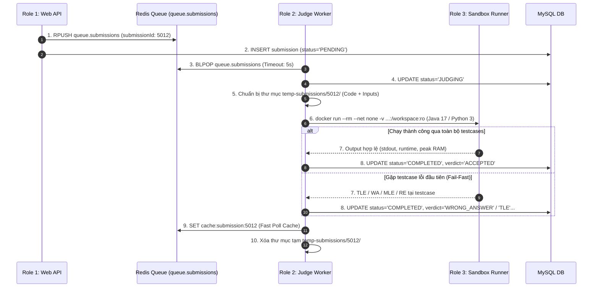

# TÀI LIỆU THIẾT KẾ KIẾN TRÚC HỆ THỐNG & ĐẶC TẢ KỸ THUẬT (SYSTEM ARCHITECTURE SPECIFICATION)
## DỰ ÁN: MINI LEETCODE PLATFORM
**Phiên bản:** 3.0.0 (Giải quyết triệt để các lỗ hổng bảo mật, độ nghẽn hiệu năng & độ tin cậy hàng đợi)  
**Tác giả:** Senior Software Architect  
**Trạng thái:** Production-Ready Architecture Baseline

---

## 1. TỔNG QUAN KIẾN TRÚC & NGUYÊN TẮC THIẾT KẾ (ARCHITECTURE PRINCIPLES)

Nhằm khắc phục toàn diện các điểm yếu về bảo mật máy chủ, độ nghẽn I/O và phù hợp với quy mô đồ án sinh viên (Pragmatic Architecture), kiến trúc Mini LeetCode phân định rõ 3 Role chuyên trách trong luồng Sandbox:
1. **Role 1 - Web API Gateway (`mini-leetcode-api`):** Tiếp nhận bài nộp, xác thực JWT, lưu metadata trạng thái `PENDING`, đẩy message vào Redis Queue. Web API **tuyệt đối không được mount `/var/run/docker.sock`**, triệt tiêu 100% nguy cơ chiếm quyền Host.
2. **Role 2 - Judge Worker (`mini-leetcode-judge`):** Dịch vụ chạy nền độc lập, tiêu thụ job từ Redis Queue (`BLPOP` / `XREAD`), tải testcases về thư mục tạm cục bộ, điều phối và giám sát vòng đời của Sandbox Runner qua Docker CLI, thu thập số liệu CPU/RAM và tính toán Verdict (`AC`, `WA`, `TLE`, `MLE`, `RE`, `CE`).
3. **Role 3 - Ephemeral Sandbox Runner (Docker Containerized):** Môi trường thực thi mã nguồn dùng 1 lần (Ephemeral Container) được cách ly tuyệt đối với các cờ: `--network none` (ngắt mạng), `--memory 256m` (giới hạn RAM), `--cpus 1` (giới hạn CPU), `--pids-limit 64` (chống Fork Bomb), mount thư mục testcase ở chế độ Read-Only (`-v ...:/workspace:ro`). Hỗ trợ **Java 17 LTS** và **Python 3**. Áp dụng chính sách Fail-Fast (dừng ngay ở testcase lỗi đầu tiên).

```mermaid
flowchart TD
    subgraph Client ["Client Tier (Next.js 14)"]
        Browser["Next.js App / Monaco Editor"]
        Watcher["Heartbeat & Proctoring Watcher"]
    end

    subgraph WebTier ["Web API Gateway (Spring Boot - No Docker Socket)"]
        PublicAPI["REST API & JWT Security"]
        HeartbeatService["Proctoring & Heartbeat Evaluator"]
        StorageService["Testcase File Manager"]
    end

    subgraph StorageInfra ["Data & Queue Tier"]
        MySQL[("MySQL 8.0 Primary DB")]
        RedisQueue[("Redis Queue: queue.submissions")]
        FileStorage[("Testcase Storage (MinIO / S3 Object)")]
    end

    subgraph JudgeTier ["Judge & Execution Tier"]
        WorkerService["Role 2: Judge Worker (mini-leetcode-judge)"]
        LocalStaging["Local Temp Staging (temp-submissions/{id})"]
        Runner["Role 3: Ephemeral Sandbox Runner (Java 17 / Python 3)\n(--net none, --memory 256m, --pids-limit 64)"]
    end

    Browser -->|1. Submit Code| PublicAPI
    Watcher -->|2. Heartbeat Ping / Window Events| HeartbeatService
    HeartbeatService -->|Update State| MySQL

    PublicAPI -->|3. Save Submission (PENDING)| MySQL
    PublicAPI -->|4. RPUSH queue.submissions| RedisQueue
    
    WorkerService -->|5. BLPOP queue.submissions| RedisQueue
    WorkerService -->|6. Fetch Testcase Files| FileStorage
    WorkerService -->|7. Prepare Input Files (ro mount)| LocalStaging
    LocalStaging -->|8. Mount -v ...:/workspace:ro| Runner
    Runner -->|9. Raw Output, Metrics, ExitCode (Fail-Fast)| WorkerService
    
    WorkerService -->|10. Update Verdict, Runtime, RAM| MySQL
    WorkerService -->|11. Cache Fast Result| RedisQueue

    Browser -->|12. Polling Submission Status| PublicAPI
    PublicAPI -->|13. Fast Cache Read| RedisQueue
```

---

## 2. PHÂN CHIA ROLE & AN NINH SANDBOX (PRAGMATIC ROLE SEPARATION)

### 2.1 Bảng phân định 3 Role chuyên trách trong hệ thống Sandbox

| Tiêu chí | Role 1: Web API Gateway (`api`) | Role 2: Judge Worker (`judge`) | Role 3: Ephemeral Sandbox Runner |
| :--- | :--- | :--- | :--- |
| **Bản chất** | REST API Service (Public facing) | Background Consumer Service (Internal) | Docker Container tạm thời (chạy xong hủy) |
| **Quyền hạn Docker** | **TUYỆT ĐỐI KHÔNG** có quyền Docker socket | Có quyền gọi Docker CLI / Docker API | Chạy dưới user không đặc quyền (`non-root`) |
| **Môi trường kết nối** | HTTP(S) Public, MySQL, Redis | Redis Queue, MySQL, MinIO, Docker Engine | Mạng bị cô lập hoàn toàn (`--network none`) |
| **Trách nhiệm chính** | Nhận code, kiểm tra payload, lưu trạng thái `PENDING`, trả response tức thì | Lấy job từ queue, tải testcase, điều phối runner, tổng hợp Verdict, cập nhật DB | Biên dịch và chạy code người dùng với input, xuất kết quả qua stdout/file |
| **Chế độ bảo vệ** | Rate Limiting, JWT Guard | Xử lý timeout (`Process.waitFor`), dọn file tạm | Giới hạn RAM (`256m`), CPU (`1 core`), PIDs (`64`) |

### 2.2 An ninh Sandbox: Loại bỏ nguy cơ Root Takeover và Khai thác Host

1. **Ranh giới cô lập (Isolation Boundary):**
   - Container `web-api` chỉ kết nối với MySQL và Redis. **Không có bất kỳ quyền hạn hay file socket nào liên quan đến Docker.** Nếu hacker tìm được lỗ hổng ở API, chúng không thể thao túng Docker host.
   - Chỉ có tiến trình `mini-leetcode-judge` mới giao tiếp với Docker Daemon qua socket nội bộ.
2. **Cấu hình Sandbox Runner tinh gọn & an toàn:**
   - **Mạng:** `--network none` (Cô lập 100% mạng, chặn truy cập ra ngoài hoặc vào các service nội bộ).
   - **Bộ nhớ:** `--memory 256m --memory-swap 256m` (Triệt tiêu Swap, cưỡng chế ngắt khi vượt ngưỡng để bắt mã `MLE`).
   - **Tiến trình:** `--pids-limit 64` (Ngăn chặn hoàn toàn Fork Bomb).
   - **File System:** Mount thư mục làm việc ở chế độ Read-Only (`-v ...:/workspace:ro`), vùng ghi tạm nằm trên RAM (`--tmpfs /tmp:rw,noexec,nosuid,size=32m`).
   - **Thời gian chạy:** Worker kiểm soát thời gian bằng `Process.waitFor(timeLimitMs, TimeUnit.MILLISECONDS)` để bắt mã `TLE`.

### 2.2 Xử lý Mã Độc: Loại bỏ Static Regex Blacklist

- **Vấn đề đã nhận diện:** Dùng Regex Blacklist (chặn `import os`, `System.exit`) là giải pháp ngây thơ. Kẻ tấn công dễ dàng vượt qua bằng Reflection (`Class.forName(...)`), Base64, mã hóa bytecode hoặc nạp động; ngược lại người dùng đặt biến vô tình trùng tên lại bị khóa bài oan (False Positive).
- **Giải pháp kiến trúc chuẩn:**
  1. **Tin tưởng Sandbox, không tin tưởng bộ lọc chuỗi:** Cho phép mọi cú pháp ngôn ngữ hợp lệ biên dịch bình thường. Toàn bộ hành vi của mã nguồn phải chịu sự chế tài của Sandbox OS-level.
  2. **Chặn System Calls qua Linux Seccomp Profile / AppArmor:**
     - Áp dụng cấu hình Seccomp Profile mặc định chặn các System Calls nguy hiểm: `ptrace`, `sys_chroot`, `setuid`, `setgid`, `socket`, `connect`, `reboot`.
     - Nếu code người dùng cố tình gọi `socket` hoặc `exec`, Kernel sẽ lập tức trả về tín hiệu lỗi (ví dụ: `EPERM` hoặc `SIGSYS`), chương trình kết thúc và hệ thống bắt phán quyết `RE` (Runtime Error) hoặc `SV` (Security Violation) một cách tự nhiên và an toàn.

### 2.3 Chống Gian lận Liêm chính: Nguyên tắc Server-Side Authority

- **Vấn đề đã nhận diện:** Client gửi trực tiếp số lần vi phạm (`tabSwitchCount: 2`) qua API khiến thí sinh có thể sửa gói tin bằng DevTools/Burp Suite để qua mặt.
- **Giải pháp kiến trúc chuẩn: State Machine & Server-Side Verification:**
  1. **Mô hình Heartbeat & Window State Report:**
     - Trong suốt thời gian thi, Client định kỳ gửi gói tin Heartbeat tối giản: `{ contestId, timestamp, windowFocused: boolean }`.
     - Khi xảy ra sự kiện `visibilitychange` hoặc `blur`, Client chỉ gửi **thời điểm phát sinh sự kiện (Event Timestamp)**:
       - `WINDOW_BLUR`: Thời điểm rời màn hình.
       - `WINDOW_FOCUS`: Thời điểm quay lại.
  2. **Thẩm quyền tính toán nằm 100% tại Máy chủ (Server Evaluation):**
     - Server nhận tín hiệu `WINDOW_BLUR` và lưu trạng thái `PENDING_AWAY`.
     - Khi nhận tín hiệu `WINDOW_FOCUS`, Server tự tính khoảng thời gian rời màn hình:
       $$\Delta T = T_{\text{focus}} - T_{\text{blur}}$$
     - **Ngưỡng dung sai (Grace Period):** Nếu $\Delta T < 1.5$ giây (vô tình click ngoài màn hình), Server bỏ qua không phạt.
     - Nếu $\Delta T \ge 1.5$ giây, Server tự động tăng biến đếm vi phạm trong Database (`violation_count = violation_count + 1`).
     - Khi `violation_count >= MAX_LIMIT`, Server cập nhật trạng thái thí sinh thành `BLOCKED`/`LOCKED`, vô hiệu hóa token làm bài của thí sinh.

---

### 2.4 Hàng đợi Bền vững & Phân tách Xử lý (Queue & Dispatching Lifecycle)

- **Triển khai Pragmatic:** Sử dụng **Redis Queue tinh gọn** (`RPUSH queue.submissions` từ Web API và `BLPOP queue.submissions 5` từ Judge Worker).
  - Web API không bị nghẽn (Non-blocking I/O), ngay lập tức trả về mã `202 ACCEPTED` kèm `submissionId`.
  - Judge Worker tiêu thụ tuần tự hoặc đa luồng độc lập, cập nhật trạng thái `JUDGING`.
- **Định hướng mở rộng Enterprise (Future Production Roadmap):** Có thể nâng cấp lên Redis Streams Consumer Groups kèm cơ chế thu hồi job bị kẹt (XPENDING/XCLAIM) khi mở rộng cụm worker phân tán nhiều máy chủ.



---

### 2.5 Hiệu năng & Quy mô (Performance & Scalability Optimization)

#### 1. Cơ chế Chấm Code Tinh gọn (1 Container Ephemeral duy nhất / Bài nộp):
- **Tránh Docker Spawn Overhead:**
  - Mỗi lượt nộp bài chỉ khởi tạo đúng **1 Container Ephemeral duy nhất** (`mini-leetcode-runner:1.0`) cho toàn bộ quá trình kiểm thử của bài đó.
  - Mã nguồn (Java 17 / Python 3) được biên dịch 1 lần (nếu là Java) bên trong container, sau đó lặp qua các file testcase input trong thư mục mounted.
  - **Chính sách Fail-Fast:** Container kết thúc và giải phóng tài nguyên ngay khi gặp testcase đầu tiên bị sai kết quả hoặc quá thời gian CPU (TLE), tránh lãng phí thời gian chạy các testcase còn lại.

#### 2. Chống Thundering Herd: Exponential Backoff & Dynamic Polling:
- Phía Client không poll cứng mỗi 1.5 giây. Thay vào đó, áp dụng thuật toán **Adaptive Polling kèm Jitter**:
  - Lần 1: Sau khi nộp bài 1.0 giây (thời gian tối thiểu cho các bài nộp siêu nhanh).
  - Lần 2: 2.0 giây.
  - Lần 3: 3.5 giây.
  - Lần 4 trở đi: Cứ mỗi 5.0 giây (kèm sai số ngẫu nhiên $\pm 500\text{ms}$ để phân tán tải).
  - Tích hợp Header `Retry-After` trả về từ Backend khi hàng đợi đang quá tải.
  - Kết quả được lưu tại Redis Key `cache:submission:{id}` với TTL 1 giờ để đảm bảo truy xuất $O(1)$ không chạm tới MySQL.

#### 3. Quản lý Testcase Lớn (Tránh tràn RAM MySQL & Backend Heap):
- Cột trong MySQL chỉ lưu Metadata: `id`, `problem_id`, `input_file_uri`, `output_file_uri`, `is_hidden`, `byte_size`.
- Dữ liệu I/O thực tế được lưu dưới dạng file trên MinIO / Object Storage.
- Khi chấm bài, Worker tải file I/O về thư mục tạm cục bộ và mount Read-Only vào container, **tuyệt đối không đọc toàn bộ chuỗi hàng chục MB vào bộ nhớ RAM của Java Backend**.

---

## 3. THIẾT KẾ CƠ SỞ DỮ LIỆU CHUẨN HÓA (MYSQL 8.0 DDL)

```sql
-- 1. Bảng Users
CREATE TABLE users (
    id BIGINT AUTO_INCREMENT PRIMARY KEY,
    username VARCHAR(50) NOT NULL UNIQUE,
    email VARCHAR(100) NOT NULL UNIQUE,
    password_hash VARCHAR(255) NOT NULL,
    role ENUM('USER', 'INSTRUCTOR', 'ADMIN') NOT NULL DEFAULT 'USER',
    status ENUM('ACTIVE', 'BLOCKED') NOT NULL DEFAULT 'ACTIVE',
    created_at TIMESTAMP DEFAULT CURRENT_TIMESTAMP,
    updated_at TIMESTAMP DEFAULT CURRENT_TIMESTAMP ON UPDATE CURRENT_TIMESTAMP,
    INDEX idx_users_username (username),
    INDEX idx_users_email (email)
) ENGINE=InnoDB DEFAULT CHARSET=utf8mb4 COLLATE=utf8mb4_unicode_ci;

-- 2. Bảng Problems
CREATE TABLE problems (
    id BIGINT AUTO_INCREMENT PRIMARY KEY,
    title VARCHAR(200) NOT NULL,
    slug VARCHAR(200) NOT NULL UNIQUE,
    description MEDIUMTEXT NOT NULL,
    difficulty ENUM('EASY', 'MEDIUM', 'HARD') NOT NULL,
    time_limit_ms INT NOT NULL DEFAULT 1000,
    memory_limit_mb INT NOT NULL DEFAULT 256,
    status ENUM('DRAFT', 'REVIEWING', 'PUBLISHED', 'ARCHIVED') NOT NULL DEFAULT 'DRAFT',
    created_by BIGINT NOT NULL,
    created_at TIMESTAMP DEFAULT CURRENT_TIMESTAMP,
    updated_at TIMESTAMP DEFAULT CURRENT_TIMESTAMP ON UPDATE CURRENT_TIMESTAMP,
    CONSTRAINT fk_problems_creator FOREIGN KEY (created_by) REFERENCES users(id),
    INDEX idx_problems_status_diff (status, difficulty),
    INDEX idx_problems_slug (slug)
) ENGINE=InnoDB DEFAULT CHARSET=utf8mb4 COLLATE=utf8mb4_unicode_ci;

-- 3. Bảng Test Cases (Chỉ lưu đường dẫn File Reference, không lưu nội dung I/O lớn)
CREATE TABLE test_cases (
    id BIGINT AUTO_INCREMENT PRIMARY KEY,
    problem_id BIGINT NOT NULL,
    input_file_uri VARCHAR(500) NOT NULL COMMENT 'Đường dẫn file storage chứa input',
    expected_output_uri VARCHAR(500) NOT NULL COMMENT 'Đường dẫn file storage chứa expected output',
    is_hidden BOOLEAN NOT NULL DEFAULT TRUE,
    order_index INT NOT NULL DEFAULT 0,
    file_size_bytes BIGINT NOT NULL DEFAULT 0,
    created_at TIMESTAMP DEFAULT CURRENT_TIMESTAMP,
    CONSTRAINT fk_testcase_problem FOREIGN KEY (problem_id) REFERENCES problems(id) ON DELETE CASCADE,
    INDEX idx_testcases_problem (problem_id, is_hidden)
) ENGINE=InnoDB DEFAULT CHARSET=utf8mb4 COLLATE=utf8mb4_unicode_ci;

-- 4. Bảng Contests / Exams
CREATE TABLE contests (
    id BIGINT AUTO_INCREMENT PRIMARY KEY,
    title VARCHAR(200) NOT NULL,
    slug VARCHAR(200) NOT NULL UNIQUE,
    start_time TIMESTAMP NOT NULL,
    end_time TIMESTAMP NOT NULL,
    scoring_policy ENUM('ACM_ICPC', 'PARTIAL_IOI') NOT NULL DEFAULT 'ACM_ICPC',
    max_violations_allowed INT NOT NULL DEFAULT 3,
    status ENUM('SCHEDULED', 'RUNNING', 'COMPLETED') NOT NULL DEFAULT 'SCHEDULED',
    created_by BIGINT NOT NULL,
    created_at TIMESTAMP DEFAULT CURRENT_TIMESTAMP,
    CONSTRAINT fk_contest_creator FOREIGN KEY (created_by) REFERENCES users(id)
) ENGINE=InnoDB DEFAULT CHARSET=utf8mb4;

-- 5. Bảng Hồ sơ Thí sinh trong phòng thi
CREATE TABLE contest_participants (
    id BIGINT AUTO_INCREMENT PRIMARY KEY,
    contest_id BIGINT NOT NULL,
    user_id BIGINT NOT NULL,
    status ENUM('REGISTERED', 'IN_PROGRESS', 'SUBMITTED', 'DISQUALIFIED') NOT NULL DEFAULT 'REGISTERED',
    violation_count INT NOT NULL DEFAULT 0,
    last_away_start_time TIMESTAMP NULL,
    score INT NOT NULL DEFAULT 0,
    penalty_time_minutes INT NOT NULL DEFAULT 0,
    created_at TIMESTAMP DEFAULT CURRENT_TIMESTAMP,
    CONSTRAINT fk_cp_contest FOREIGN KEY (contest_id) REFERENCES contests(id) ON DELETE CASCADE,
    CONSTRAINT fk_cp_user FOREIGN KEY (user_id) REFERENCES users(id),
    UNIQUE KEY uq_contest_user (contest_id, user_id)
) ENGINE=InnoDB DEFAULT CHARSET=utf8mb4;

-- 6. Bảng Submissions
CREATE TABLE submissions (
    id BIGINT AUTO_INCREMENT PRIMARY KEY,
    user_id BIGINT NOT NULL,
    problem_id BIGINT NOT NULL,
    contest_id BIGINT NULL,
    language ENUM('JAVA', 'PYTHON', 'CPP') NOT NULL,
    code_storage_uri VARCHAR(500) NOT NULL,
    status ENUM('PENDING', 'JUDGING', 'COMPLETED', 'FAILED') NOT NULL DEFAULT 'PENDING',
    verdict ENUM('AC', 'WA', 'TLE', 'MLE', 'CE', 'RE', 'SV', 'FLAGGED_CHEATING') DEFAULT NULL,
    execution_time_ms INT DEFAULT NULL,
    memory_used_kb INT DEFAULT NULL,
    pass_test_cases INT NOT NULL DEFAULT 0,
    total_test_cases INT NOT NULL DEFAULT 0,
    error_message TEXT DEFAULT NULL,
    retry_count INT NOT NULL DEFAULT 0,
    created_at TIMESTAMP DEFAULT CURRENT_TIMESTAMP,
    updated_at TIMESTAMP DEFAULT CURRENT_TIMESTAMP ON UPDATE CURRENT_TIMESTAMP,
    CONSTRAINT fk_sub_user FOREIGN KEY (user_id) REFERENCES users(id),
    CONSTRAINT fk_sub_problem FOREIGN KEY (problem_id) REFERENCES problems(id),
    CONSTRAINT fk_sub_contest FOREIGN KEY (contest_id) REFERENCES contests(id),
    INDEX idx_sub_user_created (user_id, created_at DESC),
    INDEX idx_sub_status (status)
) ENGINE=InnoDB DEFAULT CHARSET=utf8mb4 COLLATE=utf8mb4_unicode_ci;

-- 7. Bảng Nhật ký Giám sát (Proctoring Audit Logs)
CREATE TABLE proctoring_logs (
    id BIGINT AUTO_INCREMENT PRIMARY KEY,
    contest_id BIGINT NOT NULL,
    user_id BIGINT NOT NULL,
    event_type ENUM('WINDOW_BLUR', 'WINDOW_FOCUS', 'PASTE_SPIKE', 'HEARTBEAT_TIMEOUT') NOT NULL,
    duration_ms INT DEFAULT NULL,
    metadata JSON NULL,
    created_at TIMESTAMP DEFAULT CURRENT_TIMESTAMP,
    CONSTRAINT fk_log_contest FOREIGN KEY (contest_id) REFERENCES contests(id) ON DELETE CASCADE,
    CONSTRAINT fk_log_user FOREIGN KEY (user_id) REFERENCES users(id),
    INDEX idx_proctoring_audit (contest_id, user_id, event_type)
) ENGINE=InnoDB DEFAULT CHARSET=utf8mb4 COLLATE=utf8mb4_unicode_ci;
```

---

## 4. ĐẶC TẢ API CONTRACTS (RESTFUL STANDARD)

### 4.1 Submissions API (Asynchronous Submission Flow)
- **`POST /api/v1/problems/{problemId}/submit`**
  - **Header:** `Authorization: Bearer <jwt_token>`
  - **Request Body:**
    ```json
    {
      "language": "JAVA",
      "code": "class Solution { public int[] twoSum(int[] nums, int target) { ... } }"
    }
    ```
  - **Response 202 Accepted:**
    ```json
    {
      "success": true,
      "statusCode": 200,
      "message": "Submission accepted and queued for judging",
      "data": {
        "id": 8092,
        "problemId": 101,
        "problemTitle": "Two Sum",
        "userId": 1,
        "username": "coder_pro",
        "language": "JAVA",
        "status": "PENDING",
        "verdict": null,
        "executionTimeMs": null,
        "memoryUsedKb": null,
        "passTestCases": 0,
        "totalTestCases": 0,
        "errorMessage": null,
        "createdAt": "2026-10-27T14:48:15",
        "updatedAt": "2026-10-27T14:48:15"
      },
      "timestamp": "2026-10-27T14:48:15Z"
    }
    ```

- **`GET /api/v1/submissions/{submissionId}`**
  - **Response 200 OK (Completed):**
    ```json
    {
      "success": true,
      "statusCode": 200,
      "message": "Success",
      "data": {
        "id": 8092,
        "problemId": 101,
        "problemTitle": "Two Sum",
        "userId": 1,
        "username": "coder_pro",
        "language": "JAVA",
        "status": "COMPLETED",
        "verdict": "AC",
        "executionTimeMs": 42,
        "memoryUsedKb": 38400,
        "passTestCases": 15,
        "totalTestCases": 15,
        "errorMessage": null,
        "createdAt": "2026-10-27T14:48:15",
        "updatedAt": "2026-10-27T14:48:19"
      },
      "timestamp": "2026-10-27T14:48:19Z"
    }
    ```

### 4.2 Proctoring & State Tracking API
- **`POST /api/v1/contests/{contestId}/proctoring/events`**
  - **Header:** `Authorization: Bearer <jwt_token>`
  - **Mục đích:** Báo cáo sự kiện mất/nhận focus để Server tính toán thời gian vi phạm với thời gian ân hạn 1.5s.
  - **Request Body (Khi rời khỏi cửa sổ):**
    ```json
    {
      "eventType": "WINDOW_BLUR",
      "clientTimestamp": 1728123456000
    }
    ```
  - **Request Body (Khi quay lại cửa sổ):**
    ```json
    {
      "eventType": "WINDOW_FOCUS",
      "clientTimestamp": 1728123459500
    }
    ```
  - **Response 200 OK:**
    ```json
    {
      "success": true,
      "statusCode": 200,
      "message": "Proctoring event processed",
      "data": {
        "contestId": 4,
        "userId": 1,
        "status": "IN_PROGRESS",
        "violationCount": 2,
        "maxViolationsAllowed": 3,
        "isDisqualified": false,
        "awayDurationMs": 3500,
        "message": "Violation recorded: away for 3500ms (2/3)"
      },
      "timestamp": "2026-10-27T14:48:19Z"
    }
    ```
