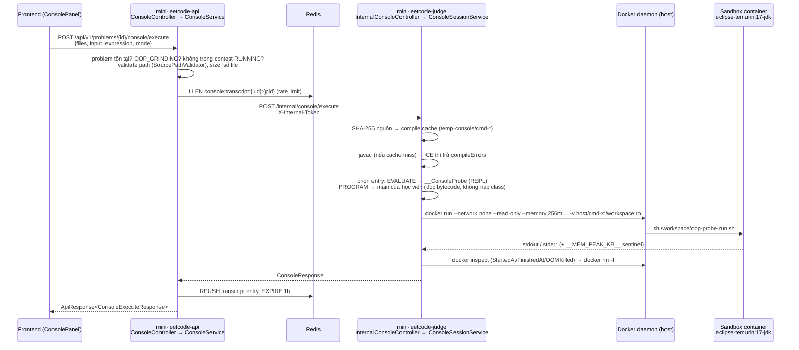

# OOP Console (stdin/stdout) & Runtime/Memory Metrics

> Trạng thái: **WIP** trên branch `fix/console-entrypoint-toggle` (chưa commit tại thời điểm viết, 2026-11-05).
> Spec gốc: [`specs/oop-console-runtime-metrics.spec.md`](../../specs/oop-console-runtime-metrics.spec.md).
> Tài liệu này mô tả **code thực tế đang có**, kèm review và danh sách việc còn lại.

---

## 1. Tóm tắt

Tính năng gồm 2 phần:

1. **Console tương tác cho bài `OOP_GRINDING`** — học viên gõ biểu thức Java (hoặc chạy `main` với stdin) trên chính các lớp mình viết. Code chạy trong **container Docker ephemeral**, không bao giờ trong JVM của API hay judge worker.
2. **Số đo Runtime / Peak memory thật cho bài nộp OOP** — trước đây ghi cứng `0`; giờ chạy thêm 1 container đo wall-clock + `cgroup memory.peak`, không đo được thì ghi `NULL`.

Console **không** tạo row `submissions`, không ảnh hưởng điểm, thống kê, leaderboard.

### Trạng thái theo slice của spec

| Slice | Nội dung | Trạng thái |
|---|---|---|
| A | Số đo Runtime/Peak memory thật cho bài OOP | ✅ Đã làm (`OopContainerExecutor`, `OopProbeHarnessGenerator`, `OopGrindingJudgeStrategy`) — **chưa có test riêng cho executor** |
| B | Judge worker thành HTTP service + endpoint nội bộ | ✅ Đã làm — **chưa có test `InternalConsoleController` / `ConsoleSessionService`** |
| C | API public + proxy + transcript Redis | ✅ Đã làm (`ConsoleController`, `ConsoleService`, `JudgeWorkerClient`, `ConsoleTranscriptStore`) |
| D | Frontend tab Console | ✅ Đã làm (`console-panel.tsx`, `workspace.tsx`) |
| E | Seed testcase mẫu cho 2 bài OOP | ❌ Chưa làm (`backend/tools/problems/oop_samples.py`, `seed-oop-console-samples.ps1` chưa tồn tại) |
| F | Test | 🟡 Một phần: unit/controller test + `e2e/console-oop.spec.ts` (10 case). Thiếu test judge-side và test Docker thật |

Kết quả chạy test (2026-11-05, local, offline Maven):

| Test | Kết quả |
|---|---|
| `ConsoleControllerTest` (api) | 4/4 pass |
| `ConsoleServiceTest` (core) | 11/11 pass |
| `OopMainClassDetectorTest` (judge) | 10/10 pass |
| `OopProbeHarnessGeneratorTest` (judge) | 5/5 pass |
| `OopGrindingJudgeStrategyTest` (judge) | 7/7 pass |
| `frontend: tsc --noEmit` | sạch |

---

## 2. Kiến trúc



### Phân bổ trách nhiệm

| Tầng | Kiểm tra / xử lý |
|---|---|
| **Frontend** | Chỉ hiện tab khi `isOopGrinding && !examMode && !locked`. Gửi toàn bộ `multiFiles` trong editor. |
| **API** (`ConsoleService`) | AuthN (`SecurityConfig`), loại bài, chặn khi contest RUNNING, validate path/kích thước, rate limit theo transcript Redis, ghi transcript. |
| **Judge** (`ConsoleSessionService`) | Xác thực token, compile cache, chọn entry point, rate limit thứ 2 (in-memory), chạy sandbox. |
| **Sandbox** | Thực thi code học viên. Cách ly mạng, FS read-only, giới hạn RAM/CPU/PID. |

---

## 3. Bản đồ file

### Backend — `mini-leetcode-common`
| File | Vai trò |
|---|---|
| `entity/ConsoleMode.java` | Enum `EVALUATE` (REPL biểu thức) / `PROGRAM` (chạy `main` + stdin) |
| `exception/ConsoleDisabledException.java` | → 403 |
| `exception/ConsoleRateLimitExceededException.java` | → 429 |
| `exception/SandboxUnavailableException.java` | → 503 |

### Backend — `mini-leetcode-core`
| File | Vai trò |
|---|---|
| `console/config/ConsoleGatewayProperties.java` | `app.console.*` phía API (base URL judge, token, limit) |
| `console/dto/ConsoleExecuteRequest.java` | Request public (`files`, `input`, `expression`, `contestId`, `mode`) |
| `console/dto/ConsoleExecuteResponse.java` | Response public |
| `console/dto/ConsoleTranscriptEntry.java`, `ConsoleTranscriptResponse.java` | Transcript |
| `console/service/ConsoleService.java` | Nghiệp vụ + kiểm soát bảo mật |
| `console/service/JudgeWorkerClient.java` | `RestClient` gọi judge, map HTTP status → exception |
| `console/service/ConsoleTranscriptStore.java` | Redis list `console:transcript:{userId}:{problemId}` |
| `contest/repository/ContestProblemRepository.java` | + `findContestsByProblemId` (chặn console khi thi) |

### Backend — `mini-leetcode-api`
| File | Vai trò |
|---|---|
| `console/controller/ConsoleController.java` | 3 endpoint public |
| `exception/GlobalExceptionHandler.java` | + handler 503/429/403 |
| `security/SecurityConfig.java` | `/api/v1/problems/*/console/**` → `authenticated()` |

### Backend — `mini-leetcode-judge`
| File | Vai trò |
|---|---|
| `judge/console/InternalConsoleController.java` | `POST /internal/console/execute`, kiểm token (constant-time) |
| `judge/console/ConsoleSessionService.java` | Compile cache, chọn entry, đếm lệnh, gọi sandbox |
| `judge/console/ConsoleReplHarness.java` | Sinh `__ConsoleProbe` — đọc từng dòng stdin, compile thành `__ExprEval` trong container rồi invoke |
| `judge/console/ConsoleProperties.java` | `app.console.*` phía judge |
| `judge/console/ConsoleRequest.java`, `ConsoleResponse.java` | DTO nội bộ |
| `judge/oop_grinding/runner/OopContainerExecutor.java` | `docker run` sandbox + đo runtime/memory |
| `judge/oop_grinding/runner/OopMainClassDetector.java` | Tìm `public static void main(String[])` bằng **parse bytecode** (không nạp class) |
| `judge/oop_grinding/runner/OopProbeHarnessGenerator.java` | Sinh `__OopMetricsProbe` để đo số liệu cho bài nộp |
| `judge/oop_grinding/model/OopExecutionMetrics.java` | Kết quả đo |
| `judge/SandboxHostPathResolver.java` | Tìm đường dẫn HOST cho bind-mount (`docker inspect` chính mình, fallback `HOST_WORK_DIR`) |
| `judge/strategy/OopGrindingJudgeStrategy.java` | Gọi đo metrics sau khi chấm; ghi `NULL` thay vì `0` |
| `judge/LanguageRuntime.java`, `MemoryProbe.java` | Tách `runScriptFor(...)`, public hóa `MemoryProbe` |

### Frontend
| File | Vai trò |
|---|---|
| `src/components/workspace/console-panel.tsx` | UI console: chọn mode, log `role="log"`, Send (Ctrl/⌘+Enter), Clear, Run example, đếm lệnh còn lại |
| `src/components/workspace/workspace.tsx` | Tab "Console"; tab "Testcase" đổi tên thành "Examples" cho bài OOP |
| `src/lib/services.ts` | `executeConsoleCommand`, `fetchConsoleTranscript`, `clearConsoleTranscript` |
| `src/types/api.ts` | Kiểu `ConsoleMode`, `ConsoleExecuteRequest/Response`, `ConsoleTranscript*` |
| `e2e/console-oop.spec.ts`, `e2e/fixtures/mock-api.ts` | E2E với mock API |

### Hạ tầng
- `docker-compose.yml`: thêm `JUDGE_BASE_URL`, `JUDGE_INTERNAL_TOKEN` cho api; token + limit + mount `./temp-console:/app/temp-console` cho judge. Judge **không** publish port.
- `backend/mini-leetcode-judge/Dockerfile`: `mkdir /app/temp-console`.
- `backend/mini-leetcode-judge/pom.xml`: thêm `spring-boot-starter-web`; `application.yml`: `web-application-type: servlet`, `server.port: 8081`.
- `.gitignore`: `temp-console/`.

---

## 4. API

### 4.1 Public (qua API, cần JWT)

#### `POST /api/v1/problems/{problemId}/console/execute`

Request:
```json
{
  "files": [{ "path": "src/Circle.java", "content": "..." }],
  "input": "",
  "expression": "new Circle(\"c\", 2).getArea()",
  "contestId": null,
  "mode": "EVALUATE"
}
```

| Field | Ràng buộc | Ghi chú |
|---|---|---|
| `files` | 1–100 phần tử, tổng ≤ 20MB, ít nhất 1 file `.java` | path qua `SourcePathValidator` + chặn `; & \| < > \`` |
| `input` | ≤ 65 536 ký tự | stdin cho `PROGRAM` |
| `expression` | ≤ 4 096 ký tự | dùng ở `EVALUATE`; rỗng thì fallback `input` |
| `contestId` | — | **Hiện không được server dùng** (xem R-09) |
| `mode` | `EVALUATE` (mặc định) \| `PROGRAM` | |

Response `200` (`data`):
```json
{
  "stdout": "12.566370614359172",
  "stderr": "",
  "exitCode": 0,
  "runtimeMs": 812,
  "peakMemoryKb": 41234,
  "compileErrors": null,
  "truncated": false,
  "timedOut": false
}
```
Lỗi biên dịch vẫn trả `200`, với `compileErrors != null` và `exitCode = null`.

#### `GET /api/v1/problems/{problemId}/console/transcript`
`{ entries: ConsoleTranscriptEntry[], limit: 50, used: n }` — chỉ transcript **của chính user**.

#### `DELETE /api/v1/problems/{problemId}/console/transcript`
`204 No Content`.

#### Mã lỗi

| Điều kiện | HTTP | Nguồn |
|---|---|---|
| Chưa đăng nhập | 401 | `SecurityConfig` |
| Bài không phải OOP / không có file `.java` | 400 | `IllegalArgumentException` |
| Bài không tồn tại | 404 | `ResourceNotFoundException` |
| > 100 file / > 20MB | 413 | `PayloadTooLargeException` |
| Path không hợp lệ | 400 | `InvalidSubmissionPathException` |
| Bài đang nằm trong contest RUNNING | 403 | `ConsoleDisabledException` |
| Vượt 50 lệnh | 429 | `ConsoleRateLimitExceededException` |
| Judge không với tới / Docker lỗi / **mọi lỗi 4xx-5xx khác từ judge** | 503 | `SandboxUnavailableException` (xem R-02) |

### 4.2 Internal (judge worker, chỉ trong docker network)

`POST /internal/console/execute` — header `X-Internal-Token` bắt buộc.

Body: `{ userId, problemId, files, input, expression, mode }`.
Response: `ConsoleResponse { stdout, stderr, exitCode, runtimeMs, peakMemoryKb, compileErrors, truncated, timedOut, errorMessage }`.

| Điều kiện | HTTP |
|---|---|
| Token thiếu/sai/rỗng | 401 |
| `errorMessage` chứa `"Docker sandbox is unavailable"` | 503 |
| `errorMessage` chứa `"limit reached"` | 429 |
| `errorMessage` khác (không có main, payload, path...) | 400 |
| Còn lại | 200 |

---

## 5. Hai chế độ console

### `EVALUATE` (mặc định)
- Luôn dùng REPL harness `__ConsoleProbe`, **bỏ qua** `main` của học viên.
- Mỗi **dòng** trong ô nhập là một biểu thức độc lập. Harness bọc thành:
  ```java
  public final class __ExprEval {
      public static void main(String[] args) {
          Object __result = <biểu thức>;
          System.out.println(__result);
      }
  }
  ```
  rồi gọi `javax.tools.JavaCompiler` **bên trong container**, nạp bằng `URLClassLoader` và invoke.
- Lỗi runtime được in thành `__CONSOLE_ERROR__=<Exception>: <msg>` và judge chuyển sang `stderr`.
- Giới hạn hiện tại:
  - không giữ biến giữa các dòng (`Circle c = ...` ở dòng 1 không dùng được ở dòng 2);
  - biểu thức `void` (`c.print()`) **không compile** được vì gán vào `Object`;
  - không hỗ trợ câu lệnh (`for`, khai báo biến...);
  - lớp học viên trong `package` phải gõ tên đầy đủ (không có import tự động).

### `PROGRAM`
- Tìm lớp có `public static void main(String[])` bằng `OopMainClassDetector` (parse constant pool + method table, bỏ qua các lớp harness `__ConsoleProbe`, `__OopMetricsProbe`, `__ExprEval`). Nhiều lớp có `main` ⇒ chọn lớp đầu tiên theo đường dẫn file.
- Không có `main` ⇒ judge trả 400 *"No 'public static void main(String[])' found..."* (nhưng API hiện đổi thành 503 — R-02).
- `input` được ghi vào stdin của container.

---

## 6. Sandbox

Cờ `docker run` (`OopContainerExecutor.buildDockerCommand`):

```
docker run -i --name judge-oop-probe-<uuid>
  --network none --memory 256m --memory-swap 256m --cpus 1.0 --pids-limit 64
  --cap-drop ALL --security-opt no-new-privileges:true
  --read-only --tmpfs /tmp:rw,noexec,nosuid,size=64m
  --user 1000:1000
  -v <host>/temp-console/cmd-xxx:/workspace:ro
  eclipse-temurin:17-jdk sh /workspace/oop-probe-run.sh
```

- JVM: `java -Xmx<75% limit>m -XX:+UseSerialGC -cp /workspace/classes <Class>`.
- Không dùng `--rm` để còn `docker inspect` lấy `StartedAt/FinishedAt/OOMKilled`; dọn bằng `docker rm -f` trong `finally`.
- Runtime = `FinishedAt − StartedAt` (bao gồm khởi động JVM, và ở chế độ EVALUATE bao gồm cả `javac` biểu thức).
- Peak memory = sentinel `__MEM_PEAK_KB__` do script đọc từ `cgroup memory.peak` sau khi lệnh kết thúc.
- Hard timeout = `timeoutMs + 5000ms` (hằng số `STARTUP_ALLOWANCE_MS`; cấu hình `startup-allowance-ms` **chưa được dùng** — R-07).
- Output mỗi luồng cắt ở 64KB → `truncated = true`.
- Exit 137 ⇒ coi là OOM (`Memory Limit Exceeded`).
- Bind-mount: Docker daemon chạy trên HOST nên path phải là path HOST — `SandboxHostPathResolver` hỏi `docker inspect <hostname>` để tìm mount nguồn của `temp-console`; fallback `HOST_WORK_DIR/../temp-console`.

> Spec ghi `--user 1001:1001`; code dùng `1000:1000`. Thư mục làm việc được `chmod 777` để user trong container đọc được (no-op trên Windows/NTFS).

---

## 7. Số đo Runtime / Peak memory cho bài nộp OOP

Trong `OopGrindingJudgeStrategy.process...` sau bước chấm (vẫn in-process như cũ):

1. Tìm `main` của học viên (`OopMainClassDetector`).
2. Sinh + compile `__OopMetricsProbe`:
   - có `main` ⇒ probe gọi `main` của học viên bằng reflection (tên lớp nhúng thẳng vào source);
   - không có `main` ⇒ probe chỉ nạp (không khởi tạo) các lớp học viên.
3. Chạy probe trong sandbox với stdin rỗng, timeout 10s, 256MB.
4. Ghi `runtimeMs` / `peakMemoryKb` vào `submissions.execution_time_ms` / `memory_used_kb` và vào `score_breakdown` (`ExecutionReport.runtimeMs/peakMemoryKb`).
5. Không đo được ⇒ `NULL` (UI hiện `—`). CE ⇒ cũng `NULL` (trước là `0`).

Lưu ý ngữ nghĩa: với bài không có `main`, con số phản ánh **JVM startup + nạp class**, không phải logic của học viên. Mỗi bài nộp OOP chậm thêm 1 lần khởi động container (tới 15s trong trường hợp xấu nhất).

---

## 8. Cấu hình

### API (`mini-leetcode-api` / `mini-leetcode-core`, prefix `app.console`)

| Key | Env | Mặc định | Được dùng? |
|---|---|---|---|
| `judge-base-url` | `JUDGE_BASE_URL` | `http://localhost:8081` (compose: `http://mini-leetcode-judge:8081`) | ✅ |
| `internal-token` | `JUDGE_INTERNAL_TOKEN` | `mini-leetcode-internal-token` | ✅ |
| `max-commands-per-session` | `CONSOLE_MAX_COMMANDS_PER_SESSION` | 50 | ✅ |
| `transcript-ttl-seconds` | `CONSOLE_TRANSCRIPT_TTL_SECONDS` | 3600 | ❌ (store hardcode 1h) |
| `max-source-bytes` | `CONSOLE_MAX_SOURCE_BYTES` | 20MB | ✅ (thông báo lỗi hardcode "20MB") |
| `max-files` | `CONSOLE_MAX_FILES` | 100 | ✅ |
| `request-timeout-ms` | `CONSOLE_REQUEST_TIMEOUT_MS` | 20000 | ❌ (RestClient không có timeout) |

### Judge (`mini-leetcode-judge`, prefix `app.console`)

| Key | Env | Mặc định | Được dùng? |
|---|---|---|---|
| `internal-token` | `JUDGE_INTERNAL_TOKEN` | `mini-leetcode-internal-token` | ✅ |
| `max-commands-per-session` | `CONSOLE_MAX_COMMANDS_PER_SESSION` | 50 | ✅ |
| `timeout-ms` | `CONSOLE_TIMEOUT_MS` | 3000 | ✅ |
| `startup-allowance-ms` | `CONSOLE_STARTUP_ALLOWANCE_MS` | 2000 | ❌ (executor dùng hằng 5000) |
| `memory-limit-mb` | `CONSOLE_MEMORY_LIMIT_MB` | 256 | ✅ |
| `max-output-bytes` | `CONSOLE_MAX_OUTPUT_BYTES` | 65536 | ❌ (executor dùng hằng 64KB) |
| `transcript-ttl-seconds` | — | 3600 | ❌ (judge không dùng Redis) |
| `max-source-bytes`, `max-files` | — | 20MB / 100 | ✅ |
| `server.port` | `JUDGE_SERVER_PORT` | 8081 | ✅ |

**Token mặc định phải đổi khi deploy** — giá trị mặc định nằm công khai trong repo (R-08).

---

## 9. Code review

Mức độ: 🔴 nên sửa trước khi merge · 🟠 nên sửa sớm · 🟡 cải thiện.

### 🔴 R-01 — Hai bộ đếm rate-limit lệch nhau; user có thể bị khoá vĩnh viễn hoặc bypass limit
- API đếm bằng `LLEN` transcript Redis (`ConsoleService.java:85`). Nút **Clear** xoá transcript ⇒ reset limit ⇒ bypass 50 lệnh vô hạn.
- Judge đếm bằng `ConcurrentHashMap<String, AtomicInteger>` trong RAM (`ConsoleSessionService.java:50,74,171`), **không TTL**, và `resetSession()` **không bao giờ được gọi**. Sau 50 lệnh thành công trên một bài, judge trả 429 mãi mãi cho user đó (đến khi restart worker) — trong khi UI vẫn hiển thị "50 commands left" sau Clear.
- Ngoài ra check-then-increment không atomic, lệnh compile-error không được judge đếm nhưng lại được API đếm.
- **Gợi ý:** chỉ giữ một nguồn đếm — Redis `INCR console:count:{uid}:{pid}` + `EXPIRE` ở API (atomic), không reset khi Clear transcript. Bỏ bộ đếm phía judge (judge là stateless executor).

### 🔴 R-02 — Mọi lỗi 4xx từ judge bị đổi thành 503 "sandbox unavailable"
`JudgeWorkerClient.java:75` — `onStatus(status.isError())` ném `SandboxUnavailableException`. Judge trả 400 cho trường hợp hợp lệ về nghiệp vụ như "PROGRAM mode nhưng không có main", "Invalid file path" ⇒ người dùng thấy 503.
**Gợi ý:** map 400 → `IllegalArgumentException`/exception riêng (400), giữ 503 chỉ cho 5xx / không kết nối được. Dùng `ObjectMapper` đọc `message` thay vì parse JSON tay (`extractMessage`).

### 🔴 R-03 — Race condition: cờ `outputTruncated` dùng chung trên singleton
`OopContainerExecutor.java:68,130,317` — `AtomicBoolean` là field của `@Component`, được `set(false)` đầu mỗi lần chạy. Console (nhiều request song song) và judge (đo metrics) dùng chung ⇒ cờ `truncated` của request này bị request khác ghi đè.
**Gợi ý:** tạo `AtomicBoolean` cục bộ trong `runClass(...)` và truyền vào `readLimited(...)`.

### 🔴 R-04 — Thư mục cache dùng chung giữa các request ⇒ ghi đè lẫn nhau
Compile cache key = SHA-256 của nguồn (`ConsoleSessionService.java:207-211`). Hai học viên mở cùng starter template (rất phổ biến) dùng chung **một** `cmd-*/`. Mỗi request lại:
- ghi đè `oop-probe-run.sh` trong workDir (`OopContainerExecutor.java:132`) — EVALUATE và PROGRAM chạy song song sẽ chạy nhầm lớp của nhau;
- ghi + compile lại `__ConsoleProbe` vào chung `classes/` (`ConsoleSessionService.java:130-144`) — container khác có thể đọc `.class` đang ghi dở.

**Gợi ý:** coi thư mục cache là **bất biến** (compile probe một lần lúc tạo cache), mỗi request tạo script trong thư mục riêng (hoặc truyền lệnh trực tiếp qua `docker run ... java -cp ...` thay vì script trong mount).

### 🟠 R-05 — `RestClient` không có timeout
`request-timeout-ms` được khai báo nhưng không dùng (`JudgeWorkerClient.java:32-36`). Judge treo ⇒ thread Tomcat của API treo vô hạn.
**Gợi ý:** cấu hình `ClientHttpRequestFactory` (`SimpleClientHttpRequestFactory#setReadTimeout` / `JdkClientHttpRequestFactory`) theo `requestTimeoutMs`.

### 🟠 R-06 — Rò rỉ đĩa & RAM
`temp-console/cmd-*` không bao giờ bị xoá; `compileCache` là map không giới hạn. Mỗi lần sửa code 1 ký tự tạo thư mục mới (máy local đã có 10 thư mục). Thư mục compile lỗi cũng không xoá.
**Gợi ý:** cache LRU có giới hạn (Caffeine/`LinkedHashMap` access-order) + xoá thư mục khi evict; job `@Scheduled` dọn thư mục quá N phút; xoá workDir ngay khi compile lỗi.

### 🟠 R-07 — Ngân sách timeout lệch spec
`STARTUP_ALLOWANCE_MS = 5000` hardcode (`OopContainerExecutor.java:56`) ⇒ treo vô hạn chỉ bị kill sau 8s, AC-006 yêu cầu ≤ 6s. `startup-allowance-ms` và `max-output-bytes` trong config không được dùng. Khi timeout, phần stdout đã in bị bỏ (`SandboxResult.timedOut` trả `""`).
**Gợi ý:** truyền allowance + max output từ `ConsoleProperties`; giữ stdout/stderr đã đọc khi timeout.

### 🟠 R-08 — Token nội bộ có giá trị mặc định công khai
`mini-leetcode-internal-token` nằm trong 2 `application.yml`, `docker-compose.yml`, và 2 class properties. Quên đặt env ⇒ ai vào được docker network đều chạy được code. Javadoc `ConsoleProperties` nói "rỗng ⇒ 503" nhưng thực tế trả 401.
**Gợi ý:** không có default trong code; fail-fast khi khởi động nếu token rỗng hoặc bằng giá trị mẫu ở profile `prod`.

### 🟠 R-09 — Chặn console trong kỳ thi chưa đúng ý spec
`ConsoleService.assertNotDuringContest` chặn theo **bài**: nếu bài thuộc bất kỳ contest nào đang RUNNING thì chặn **mọi người** (kể cả người không tham gia, staff, và lúc luyện tập ngoài contest). Field `contestId` trong request bị bỏ qua.
**Gợi ý:** chặn theo **người dùng**: user là participant của contest RUNNING có chứa bài này (hoặc `contestId != null`). Staff không bị chặn.

### 🟡 R-10 — FR-CONS-014 (staff xem transcript người khác) chưa có
Endpoint chỉ đọc transcript của chính user ⇒ không có đường cho staff điều tra, và AC-012 (403) không thể xảy ra. Nếu cần: thêm `GET /api/v1/admin/problems/{pid}/console/transcript?userId=` với `@PreAuthorize("hasAnyRole('INSTRUCTOR','ADMIN')")`.

### 🟡 R-11 — `ConsoleTranscriptStore` hardcode TTL/limit và giữ bản ghi cũ nhất
TTL `Duration.ofHours(1)` và `MAX_ENTRIES = 50` hardcode; `LTRIM key 0 49` giữ **50 bản ghi đầu tiên**, bỏ bản mới. Nếu tăng `max-commands-per-session` > 50, lệnh mới bị mất khỏi transcript.
**Gợi ý:** `LTRIM key -N -1` (giữ N bản mới nhất), lấy TTL/N từ `ConsoleGatewayProperties`. Gộp `RPUSH/LTRIM/EXPIRE` vào pipeline/`MULTI`.

### 🟡 R-12 — REPL hạn chế & chậm
Mỗi dòng compile một lớp riêng bằng `javac` trong container ⇒ ~1s+/dòng, dễ chạm timeout 3s khi gõ nhiều dòng; không giữ biến, không hỗ trợ biểu thức `void` và câu lệnh. `DEFAULT_EXPRESSION`, `listStudentClasses` không được dùng; Javadoc của `buildProbeSource` nhắc tham số `studentClasses` không tồn tại.
**Gợi ý ngắn hạn:** gộp tất cả dòng thành 1 lớp duy nhất (biến dùng được giữa các dòng, chỉ 1 lần `javac`); nếu biểu thức không gán được vào `Object` thì thử lại dạng câu lệnh. Dài hạn: cân nhắc `jshell` (`jdk.jshell` có sẵn trong JDK 17) chạy trong container.

### 🟡 R-13 — Frontend
- Transcript khôi phục sau F5 **không hiển thị dòng lệnh** `$ ...` vì `toLines(entry)` bỏ qua `entry.input` (`console-panel.tsx:80-82`).
- `Clear` không cập nhật `remaining` (hiện đang khớp với hành vi reset sai của R-01 nhưng sẽ sai khi sửa R-01).
- Ô nhập gửi cả `input` và `expression` cùng giá trị; nhiều dòng ở EVALUATE thành nhiều biểu thức độc lập — nên ghi rõ trong hint.
- `disabled={locked}` thừa vì tab đã bị ẩn khi `locked`.

### 🟡 R-14 — Linh tinh
- Phân loại lỗi bằng `message.contains(...)` (`InternalConsoleController.java:50-60`, `ConsoleSessionService.java:165`) — dễ vỡ; nên dùng enum `errorCode` trong `ConsoleResponse`.
- Judge trả 400 cho "payload quá lớn" (spec: 413).
- `docker inspect` trong `runDocker` không có timeout.
- Exit 137 được coi là OOM mà không kiểm `OOMKilled` (cũng có thể do SIGKILL khác).
- `@Transactional` trên `clearTranscript` (chỉ đụng Redis) là thừa.
- `ConsoleSessionService.hashSource` fallback `nanoTime` ⇒ phá cache im lặng; SHA-256 luôn có trong JDK, có thể ném `IllegalStateException`.

### Thiếu test
- `InternalConsoleController`: 401 thiếu/sai token (AC-013), mapping 503/429/400.
- `ConsoleSessionService`: cache hit/miss, PROGRAM không có main, giới hạn lệnh.
- `OopContainerExecutor` với `ProcessLauncher` mock: timeout, OOM, truncated, inspect lỗi.
- Test tích hợp có Docker thật (`@EnabledIf` docker available) cho AC-003/006/007.

---

## 10. Đối chiếu Acceptance Criteria

| AC | Trạng thái | Ghi chú |
|---|---|---|
| AC-001 Tab Console chỉ ở bài OOP | ✅ | e2e 1.1, 1.2 |
| AC-002 Ẩn trong thi + 403 | 🟡 | FE ẩn đúng; BE chặn theo bài, không theo user (R-09) |
| AC-003 Chạy biểu thức | 🟡 | Có code; chưa test với Docker thật |
| AC-004 Lỗi biên dịch | ✅ | e2e 2.3 (mock) |
| AC-005 Docker không khả dụng ⇒ 503 | ✅ | Không có fallback in-process |
| AC-006 Timeout ≤ 6s | ❌ | Hard timeout 8s (R-07) |
| AC-007 Output > 64KB ⇒ truncated | 🟡 | Có, nhưng race R-03 |
| AC-008 Lệnh thứ 51 ⇒ 429 | 🟡 | Có, nhưng bypass được bằng Clear (R-01) |
| AC-009 Runtime/Memory thật cho bài nộp OOP | 🟡 | Có code; cần kiểm thử end-to-end với Docker |
| AC-010 CE ⇒ NULL | ✅ | `recordFailureVerdict` |
| AC-011 Transcript sống qua reload | 🟡 | Có, nhưng không hiện lại dòng lệnh (R-13) |
| AC-012 403 khi xem transcript người khác | ➖ | Không áp dụng — endpoint chỉ trả của chính mình (R-10) |
| AC-013 Internal token | ✅ code / ❌ test | |
| AC-014 Không ảnh hưởng điểm/thống kê | ✅ | Console không ghi `submissions` |
| AC-015 Nút "Chạy mẫu" | 🟡 | Có nút "Run example", nhưng chưa seed testcase (Slice E) |

---

## 11. Chạy local

```bash
# Toàn bộ stack (judge cần /var/run/docker.sock)
export JUDGE_INTERNAL_TOKEN=$(openssl rand -hex 32)
docker compose up -d --build
docker pull eclipse-temurin:17-jdk      # image sandbox

# Test backend liên quan console
cd backend
./mvnw test -pl mini-leetcode-core,mini-leetcode-api,mini-leetcode-judge -am \
  -Dtest='ConsoleServiceTest,ConsoleControllerTest,OopMainClassDetectorTest,OopProbeHarnessGeneratorTest,OopGrindingJudgeStrategyTest' \
  -Dsurefire.failIfNoSpecifiedTests=false

# Frontend
cd frontend
npx tsc --noEmit
npx playwright test e2e/console-oop.spec.ts
```

Gọi thử (cần JWT):
```bash
curl -X POST http://localhost:8080/api/v1/problems/<id>/console/execute \
  -H "Authorization: Bearer $TOKEN" -H "Content-Type: application/json" \
  -d '{"files":[{"path":"Circle.java","content":"public class Circle { double r; Circle(double r){this.r=r;} double area(){return Math.PI*r*r;} }"}],"expression":"new Circle(2).area()","mode":"EVALUATE"}'
```

---

## 12. Việc tiếp theo (đề xuất thứ tự)

1. Sửa R-01 → R-04 (rate limit thống nhất, map lỗi 400, race `truncated`, cache bất biến).
2. R-05, R-07: timeout RestClient + dùng đúng config judge.
3. R-06: dọn `temp-console` + LRU cache.
4. Bổ sung test judge-side (mục "Thiếu test").
5. R-09: chặn console theo participant thay vì theo bài.
6. Slice E: seed testcase mẫu cho `shape-hierarchy`, `socket-echo-server`.
7. R-12/R-13: cải thiện REPL và hiển thị transcript.
8. Đồng bộ lại spec (user `1000:1000`, tên class `InternalConsoleController`/`ConsoleReplHarness`, `ConsoleMode` không có trong spec).
