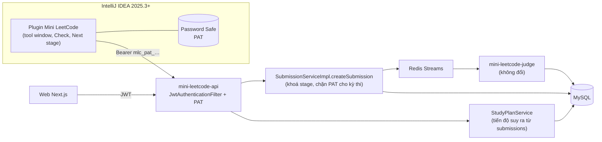

# Feature: Study Plan — Project-based Learning & Plugin IntelliJ

> **Trạng thái:** CHỐT v5 (sau tự review) — mọi quyết định sản phẩm / kỹ thuật đã chốt; chỉ còn [Q14 (lịch & người làm)](#câu-hỏi-còn-mở). **Chưa code.**
> Xem [Kết quả tự review v4 → v5](#kết-quả-tự-review-v4--v5) cho các thay đổi so với bản trước.

## Overview

**Study Plan** là lộ trình do INSTRUCTOR / ADMIN soạn, gồm các **project** thực tế (vd. "Mini Bank Console")
xen kẽ **bài luyện lẻ**. Mỗi project chia thành nhiều **stage** nối tiếp: stage sau mở rộng code của stage trước,
xong project là có một chương trình hoàn chỉnh.

Học viên làm bài theo hai cách:
1. **Plugin IntelliJ (cách chính):** tool window "Mini LeetCode" hiện cây plan → item → stage. Mở stage ⇒ plugin tạo / mở project Maven và mở đề `stages/stage-N.md` trong editor ⇒ code ⇒ **Check** ⇒ kết quả server hiện trong IDE ⇒ **Next stage**.
2. **Web workspace** (đã có): khi không có IntelliJ.

**Giá trị:** học viên luôn biết "làm gì tiếp", code trên IDE thật như đi làm; giảng viên đóng gói ngân hàng đề thành lộ trình có thứ tự.

## Quyết định đã chốt

| # | Quyết định | Chọn |
|---|---|---|
| A1 | Mục đích | Tự học, **project-based** như Hyperskill |
| A2 | Ai tạo plan | **ADMIN / INSTRUCTOR**; học viên chỉ học |
| A5 | Cách làm bài | Code và check **ngay trong IDE**; web workspace vẫn dùng được |
| Q1 | Đơn vị học | **Project nhiều stage + bài luyện lẻ** (bài lẻ = item 1 stage) |
| Q2 | Tích hợp IDE ở MVP | **Plugin IntelliJ** (không làm CLI) |
| Q3 | Xác thực IDE | **Personal Access Token (PAT)** tạo trên web, lưu trong Password Safe của IDE |
| Q4 | Lớp / nhóm | **Chưa làm ở MVP**; thêm ở giai đoạn 2 không phải sửa bảng plan |
| P1 | IDE hỗ trợ | **IntelliJ IDEA Community + Ultimate từ 2025.3** (`sinceBuild = 253`) |
| P2 | Ngôn ngữ plugin | **Java** — biên dịch bằng **JDK 21** (bắt buộc với IntelliJ Platform ≥ 2024.2). Backend giữ Java 17 |
| P3 | Phát hành | **File ZIP**, cài qua *Settings › Plugins › ⚙ › Install Plugin from Disk*; ZIP tải từ trang web |
| P4 | Nút Check | Nộp thẳng lên server; **không** có chạy test trên máy ở MVP (dùng Run `main` sẵn có của IntelliJ) |
| P5 | Bài lẻ trong plugin | Có, như item 1 stage |
| P6 | Lịch sử bài nộp | Không làm trong plugin; link mở trang web |
| Q5 | Mở khoá stage | **Tuần tự trong một item**; các item trong plan làm tuỳ ý |
| Q6 | Chống làm hỏng stage cũ | **Quy ước soạn đề:** testcase của stage N bao gồm testcase của stage 1..N-1 còn đúng (công cụ seed tự sao chép). Judge **không** đổi |
| Q7 | Pass stage | Verdict `AC` |
| Q8 | Project học viên | Java 17 + Maven |
| Q11 | Sửa stage đã phát hành | **Theo luật hiện có:** testcase đề `PUBLISHED` bị khoá ⇒ muốn sửa phải `PUBLISHED → ARCHIVED → DRAFT → … → PUBLISHED`; lần AC cũ vẫn tính |
| Q12 | Hoàn thành item / plan | Hiện nhãn **"Hoàn thành"** trên trang plan và tool window (không làm huy hiệu: chưa có trang hồ sơ) |
| Q13 | Project mẫu | Mini Bank Console, 5 stage |
| Q15 | Đề thuộc project trong `/problems` | **Ẩn** khỏi danh mục `/problems` của học viên (chỉ vào qua plan); bài lẻ vẫn hiện bình thường |

## Kết quả tự review v4 → v5

Review theo 5 góc: `/feature-forge` (đủ mục spec), `/architecture-designer` (ADR, failure mode), `/java-architect` (đối chiếu code Spring), `/code-review` (subagent soát diff), `/ponytail` (cắt phần thừa).

| # | Vấn đề ở v4 | Nguồn | Sửa ở v5 |
|---|---|---|---|
| R1 | Khoá stage chỉ đặt ở `submit-multipart`; nộp qua `POST /submissions` (JSON hoặc multipart) hoặc `/problems/{id}/submit` sẽ lách được | code-review, java-architect | Kiểm tra trong `SubmissionServiceImpl.createSubmission` — **mọi đường nộp đều đi qua hàm này** |
| R2 | Plugin ghi "Java 17" nhưng IntelliJ Platform từ 2024.2 bắt buộc Java 21 | java-architect ([Build number ranges](https://plugins.jetbrains.com/docs/intellij/build-number-ranges.html)) | Plugin build bằng JDK 21 |
| R3 | "Chấm cộng dồn stage 1..N" mâu thuẫn với "Stage = Problem, dùng lại judge 100%": judge chỉ chấm testcase của chính đề đó | code-review | Thành **quy ước soạn đề** (sao chép testcase cũ còn đúng); không gộp tự động vì output console có thể đổi hợp lệ giữa các stage |
| R4 | Q11 "cho sửa stage khi có người học" trái luật đóng băng testcase của `ProblemLifecycle` | code-review | Theo luật hiện có (xem Q11) |
| R5 | Allowlist PAT thiếu `GET /submissions/{id}` và tải starter ⇒ nút Check không bao giờ có kết quả | code-review | Liệt kê allowlist đầy đủ (mục *Bảo mật PAT*) |
| R6 | Thiếu NFR, bảng xử lý lỗi, checklist triển khai, ADR, sơ đồ, failure mode | feature-forge, architecture-designer | Bổ sung bên dưới |
| R7 | 4 endpoint mới cho plugin (`/auth/me`, `/projects/{slug}/skeleton`, `/stages/{n}/files`, enroll) | ponytail | Bỏ: plugin dùng `GET /problems/{slug}` + `starter-template` sẵn có; `pom.xml` mẫu đóng trong plugin; kiểm tra token bằng `GET /study-plans` |
| R8 | JCEF render Markdown, run configuration Maven, quy tắc file `.new`, bảng `enrollments`, bảng `projects` riêng, huy hiệu | ponytail | Bỏ: mở `stages/stage-N.md` bằng Markdown preview có sẵn của IntelliJ; chỉ tạo file chưa tồn tại; tiến độ suy ra từ submissions; 3 bảng thay vì 5 |
| R9 | Đề của stage 3 xuất hiện trong `/problems`, học viên mở thẳng | java-architect | Q15: ẩn đề thuộc project khỏi danh mục |
| R10 | Lỗi Quick Run tính `IN_PROGRESS` được nhắc nhưng không có AC | code-review | Thêm AC-009 |
| R11 | README: IOI, quyền INSTRUCTOR mở khoá / tạo kỳ thi, ADMIN duyệt / quản lý tài khoản, "chốt kết quả", trọng số OOP cố định — không khớp code | code-review | Đã sửa README cùng commit |

## Tham khảo

| Nguồn | Áp dụng |
|---|---|
| [Hyperskill — Study plan](https://hyperskill.org/study-plan) | Plan = kiến thức + project áp dụng |
| [Hyperskill Academy plugin](https://blog.jetbrains.com/education/2025/12/09/hyperskill-gets-its-own-plugin-inside-jetbrains-ides/) | UX: đăng nhập trong Settings, cây syllabus, nút Check, sang stage sau |
| [hs-test](https://github.com/hyperskill/hs-test) | Thông báo lỗi dễ hiểu cho từng stage |
| [JetBrains Academy — Educator guide](https://plugins.jetbrains.com/plugin/10081-jetbrains-academy/docs/educator-start-guide.html) | Manifest khai báo bằng file (`.mlc/project.yaml`) |
| [CodeCrafters](https://docs.codecrafters.io/challenges/how-challenges-work.md) | Stage kiểu TDD; server quyết định pass |
| [Exercism CLI](https://github.com/exercism/cli) | Xác thực bằng API token |
| [GitHub Classroom](https://docs.github.com/en/education/manage-coursework-with-github-classroom/teach-with-github-classroom/use-autograding) | Mô hình lớp cho giai đoạn 2; cảnh báo sửa test giữa khoá |
| IntelliJ SDK: [Gradle Plugin 2.x](https://plugins.jetbrains.com/docs/intellij/tools-intellij-platform-gradle-plugin.html), [Tool windows](https://plugins.jetbrains.com/docs/intellij/tool-windows.html), [PasswordSafe](https://plugins.jetbrains.com/docs/intellij/persisting-sensitive-data.html), [Build number ranges](https://plugins.jetbrains.com/docs/intellij/build-number-ranges.html) | Kiến trúc plugin |

## Kiến trúc



### Mô hình dữ liệu (Flyway `V10` — V8, V9 thuộc nhánh admin, merge trước)

```
study_plans               (id, slug UNIQUE, title, description, status DRAFT|PUBLISHED|ARCHIVED, created_by, timestamps)
study_plan_items          (id, plan_id FK, position, kind PROJECT|PROBLEM, title, description)   UNIQUE(plan_id, position)
study_plan_item_stages    (item_id FK, stage_no, problem_id FK)  PK(item_id, stage_no), UNIQUE(problem_id)
personal_access_tokens    (id, user_id FK, name, token_hash CHAR(64) UNIQUE, expires_at, last_used_at, revoked, created_at)
```

- **Stage = một `Problem`** ⇒ đề, testcase, `grading_config`, starter, judge dùng lại nguyên vẹn. Bài lẻ = item `PROBLEM` có đúng 1 stage.
- `UNIQUE(problem_id)` trên `study_plan_item_stages`: một đề chỉ thuộc một item ⇒ khoá stage và ẩn khỏi `/problems` có nghĩa rõ ràng. Muốn dùng lại đề ở plan khác thì sao chép đề *(giai đoạn sau nếu cần)*.
- **Không lưu tiến độ:** trạng thái stage = `DONE` nếu có submission chính thức `AC` (không Quick Run), `IN_PROGRESS` nếu có submission chính thức, `LOCKED` nếu stage trước chưa `DONE`, ngược lại `NEVER`. Dùng lại `findSolvedProblemIdsByUserId` / `findAttemptedProblemIdsByUserId` (2 truy vấn cho cả plan, không N+1).
- **Giai đoạn 2 — Lớp:** thêm `classes`, `class_members`, `class_plan_assignments(class_id, plan_id, due_at NULL)`; không sửa 3 bảng plan.

### Backend thay đổi

| Thay đổi | Ghi chú |
|---|---|
| `GET /api/v1/study-plans` | Plan `PUBLISHED` + % tiến độ của người gọi |
| `GET /api/v1/study-plans/{slug}` | Items → stages (problemId, slug, title, difficulty, trạng thái) |
| `POST/PUT/DELETE /api/v1/study-plans…`, `POST /{slug}/transitions` | `@PreAuthorize("hasAnyRole('INSTRUCTOR','ADMIN')")`; chỉ gắn đề `PUBLISHED`; người tạo hoặc ADMIN mới được sửa |
| `POST/GET/DELETE /api/v1/me/tokens` | Quản lý PAT — **chỉ JWT**, PAT không gọi được |
| `JwtAuthenticationFilter` | Bearer bắt đầu bằng `mlc_pat_` ⇒ tra `SHA-256(token)`; `UserPrincipal` thêm cờ `viaPat`; cập nhật `last_used_at` tối đa 1 lần / phút |
| `SubmissionServiceImpl.createSubmission` | (1) đề thuộc stage N > 1 mà stage N-1 chưa `DONE` ⇒ `409 STAGE_LOCKED` (áp dụng cả Run lẫn Submit); (2) `viaPat && contestId != null` ⇒ `403 PAT_FORBIDDEN` |
| `ProblemService.getProblems` (người dùng không phải staff) | `NOT EXISTS` đề thuộc item `PROJECT` |
| `SubmissionRepository.findAttemptedProblemIdsByUserId` | Thêm `and s.quickRun = false` (sửa lỗi tồn tại) |

### Bảo mật PAT

- Token = `mlc_pat_` + 32 byte ngẫu nhiên (`SecureRandom`, base64url). Chỉ hiện **một lần**; DB lưu `SHA-256` (token đủ entropy, không cần bcrypt, tra cứu theo hash). Hạn mặc định 90 ngày; thu hồi được; tối đa 5 token còn hiệu lực mỗi người.
- **Allowlist khi xác thực bằng PAT** (ngoài danh sách ⇒ `403 PAT_FORBIDDEN`):
  - `GET /api/v1/study-plans`, `GET /api/v1/study-plans/{slug}`
  - `GET /api/v1/problems/{idOrSlug}`, `GET /api/v1/problems/{idOrSlug}/starter-template`
  - `POST /api/v1/problems/{id}/submit`, `/submit-multipart`, `POST /api/v1/submissions`
  - `GET /api/v1/submissions/{id}` (đã kiểm tra chủ sở hữu)
- PAT không bao giờ được ghi log; plugin lưu bằng `PasswordSafe`, không ghi vào thư mục project.

### Plugin IntelliJ

```
ide-plugin/                         Gradle (tách khỏi Maven backend), IntelliJ Platform Gradle Plugin 2.x, JDK 21
├─ build.gradle.kts                 intellijIdeaCommunity("2025.3"), sinceBuild = "253", không đặt untilBuild
├─ src/main/resources/
│  ├─ META-INF/plugin.xml           depends: com.intellij.modules.platform
│  └─ templates/pom.xml             pom Java 17 dùng cho mọi project
└─ src/main/java/…/
   ├─ ApiClient.java                java.net.http.HttpClient + Gson (đã đóng sẵn trong IntelliJ Platform, không thêm dependency)
   ├─ SettingsConfigurable.java     Server URL + PAT (PasswordSafe)
   ├─ PlanToolWindowFactory.java    cây Plan › Item › Stage, nút Refresh
   ├─ OpenStageAction.java          tạo / mở project, tải starter, ghi stages/stage-N.md
   └─ CheckAction.java              Task.Backgroundable: zip src/main → submit → poll → hiển thị
```

| # | Chức năng | Cách làm tối giản |
|---|---|---|
| PL-1 | Đăng nhập | Settings › Tools › Mini LeetCode: URL + PAT; "Test connection" = `GET /study-plans` |
| PL-2 | Tool window | `Tree` Swing: plan › item › stage + icon `LOCKED/NEVER/IN_PROGRESS/DONE` |
| PL-3 | Mở item | Chọn thư mục ⇒ ghi `pom.xml` mẫu + `.mlc/project.yaml` + giải nén starter stage 1 (`starter-template`) ⇒ `ProjectUtil.openOrImport` |
| PL-4 | Xem đề | Ghi `description` của `GET /problems/{slug}` thành `stages/stage-N.md` ⇒ mở bằng editor (Markdown preview có sẵn) |
| PL-5 | **Check** | Zip `src/main/**` ⇒ `POST /problems/{id}/submit-multipart` ⇒ poll `GET /submissions/{id}` (1s, tối đa 60s) ⇒ balloon + panel: verdict, điểm OOP/testcase/socket, lỗi đầu tiên |
| PL-6 | Next stage | Khi `DONE`: tải starter stage N+1, **chỉ tạo file chưa tồn tại**, ghi `stage-(N+1).md`, cập nhật `project.yaml` |

## Functional Requirements (EARS)

- **FR-SP-001** When người dùng mở danh sách plan (web hoặc plugin), the system shall trả các plan `PUBLISHED` kèm số item, số stage và % stage `DONE` của người gọi.
- **FR-SP-002** When người dùng mở một plan, the system shall trả item theo `position` và stage theo `stage_no`, mỗi stage kèm trạng thái `LOCKED` / `NEVER` / `IN_PROGRESS` / `DONE`.
- **FR-SP-003** If người dùng nộp (Run hoặc Submit) đề là stage N > 1 của một item mà stage N-1 chưa `DONE`, then the system shall trả `409 STAGE_LOCKED` và không tạo submission.
- **FR-SP-004** The system shall tính trạng thái stage chỉ từ submission có `is_quick_run = false`.
- **FR-SP-005** While người dùng không phải INSTRUCTOR / ADMIN, the system shall không trả đề thuộc item `PROJECT` trong `GET /problems`.
- **FR-SP-006** Where người dùng là INSTRUCTOR / ADMIN, the system shall cho tạo / sửa plan, item, stage; chỉ gắn đề `PUBLISHED`; chỉ người tạo hoặc ADMIN sửa được plan.
- **FR-SP-007** If plan không ở `PUBLISHED` và người gọi không phải staff, then the system shall trả `404`.
- **FR-PAT-001** When người dùng tạo PAT, the system shall trả token đúng một lần và chỉ lưu `SHA-256` của token.
- **FR-PAT-002** If request xác thực bằng PAT gọi endpoint ngoài allowlist, then the system shall trả `403 PAT_FORBIDDEN`.
- **FR-PAT-003** If request xác thực bằng PAT nộp bài có `contestId`, then the system shall trả `403 PAT_FORBIDDEN`.
- **FR-PAT-004** If PAT hết hạn hoặc đã thu hồi, then the system shall trả `401`.
- **FR-PL-001** When học viên bấm Check, the plugin shall nộp `src/main/**` cho đúng stage ghi trong `.mlc/project.yaml` và hiển thị kết quả trong ≤ 2 giây sau khi server chấm xong.
- **FR-PL-002** When chuyển sang stage mới, the plugin shall không ghi đè bất kỳ file nào đã tồn tại.
- **FR-PL-003** The plugin shall lưu PAT bằng `PasswordSafe` và không ghi PAT vào thư mục project.

## Non-Functional Requirements

| Loại | Yêu cầu |
|---|---|
| Hiệu năng | `GET /study-plans/{slug}` ≤ 300 ms p95 với plan 50 stage (2 truy vấn tiến độ, không N+1). Plugin poll 1 s, dừng sau 60 s |
| Bảo mật | PAT như mục *Bảo mật PAT*; mọi kiểm tra quyền ở server; test ẩn và `grading_config` không bao giờ trả về plugin |
| Tương thích | IntelliJ IDEA 2025.3+ (Community/Ultimate); không đặt `untilBuild`, kiểm thử trên 2025.3 và bản mới nhất trước mỗi lần phát hành ZIP |
| Tin cậy | Plugin không bao giờ xoá / ghi đè code học viên; mất mạng thì code vẫn ở máy |
| Khả năng bảo trì | Judge không đổi; logic khoá stage nằm ở một chỗ (`createSubmission`) |

## Acceptance Criteria

- **AC-001 Check trong IntelliJ:** Given đã đăng nhập plugin, đang ở stage 2 Mini Bank · When bấm Check · Then panel hiện `AC 100/100` và nút "Next stage"; trên web stage 2 là `DONE`.
- **AC-002 Lỗi rõ ràng:** Given `SavingsAccount` không kế thừa `Account` · When Check · Then panel hiện rule sai *"SavingsAccount phải kế thừa Account"* kèm điểm từng phần.
- **AC-003 Khoá stage trên mọi đường nộp:** Given stage 2 chưa `DONE` · When nộp đề stage 3 qua `POST /problems/{id}/submit`, `/submit-multipart`, `POST /submissions` (JSON) và `/run` · Then cả 4 trả `409 STAGE_LOCKED`, không tạo submission.
- **AC-004 Không ghi đè code:** Given học viên đã sửa `Bank.java` · When Next stage có starter chứa `Bank.java` · Then `Bank.java` giữ nguyên, chỉ thêm file mới và `stage-3.md`.
- **AC-005 Quy ước cộng dồn:** Given testcase stage 3 gồm testcase stage 1 (seed sao chép) · When học viên làm hỏng `DEPOSIT` rồi Check stage 3 · Then `WA`.
- **AC-006 PAT poll được kết quả:** Given PAT hợp lệ · When gọi `GET /submissions/{id}` của chính mình · Then `200`; của người khác ⇒ `403`.
- **AC-007 PAT bị chặn ngoài allowlist:** Given PAT hợp lệ · When gọi `POST /api/v1/me/tokens` hoặc nộp bài có `contestId` · Then `403 PAT_FORBIDDEN`.
- **AC-008 Token thu hồi:** Given PAT đã thu hồi · When Check · Then `401`, plugin mở Settings với thông báo "Token hết hiệu lực".
- **AC-009 Run không tính tiến độ:** Given stage 1 đang `NEVER` · When học viên chỉ bấm Run trên web · Then stage vẫn `NEVER`.
- **AC-010 Ẩn đề project:** Given đề `mini-bank-stage-3` thuộc item PROJECT · When USER gọi `GET /problems` · Then không có đề đó; INSTRUCTOR vẫn thấy.
- **AC-011 Web vẫn làm được:** Given không có IntelliJ · When mở stage trên web và Submit `AC` · Then plugin Refresh thấy stage `DONE`.

## Error Handling

| Tình huống | Server | Plugin / Web hiển thị |
|---|---|---|
| PAT sai / hết hạn / thu hồi | `401` | Mở Settings: "Token hết hiệu lực, tạo token mới trên web" |
| PAT gọi endpoint không cho phép / kỳ thi | `403 PAT_FORBIDDEN` | "Thao tác này chỉ làm được trên web" |
| Stage chưa mở | `409 STAGE_LOCKED` | "Hoàn thành stage N-1 trước" + nút mở stage N-1 |
| Plan / đề không công khai | `404` | Refresh cây, bỏ mục đó |
| Đề stage đang `ARCHIVED` (bảo trì) | `404` khi tải / nộp | "Stage đang được cập nhật, thử lại sau" |
| ZIP > 20 MB / file không hợp lệ | `413` / `400` (đã có) | Hiện thông báo của server |
| Chấm quá 60 s (PENDING / JUDGING) | — | "Đang chấm, xem kết quả trên web" + link |
| Mất mạng / server sập | — | Balloon lỗi + nút thử lại; code giữ nguyên |
| IDE cũ hơn 2025.3 | — | IDE từ chối cài (do `sinceBuild`) |

## Kiến trúc: quyết định chính (ADR rút gọn)

**ADR-SP-1 — Tích hợp IDE bằng plugin IntelliJ.** *Bối cảnh:* cần code & check trong IDE. *Phương án:* CLI (mọi IDE, ít UX), plugin IntelliJ (UX tốt nhất, chỉ JetBrains), extension VS Code, git push. *Quyết định:* plugin IntelliJ (người dùng chọn). *Hệ quả:* + trải nghiệm như Hyperskill; − học SDK mới, chỉ IntelliJ, phải kiểm thử mỗi bản IDE; VS Code dùng web.

**ADR-SP-2 — Personal Access Token.** *Phương án:* PAT, OAuth device flow, username/password + refresh 7 ngày. *Quyết định:* PAT với allowlist. *Hệ quả:* + đơn giản, thu hồi được, phạm vi hẹp; − người dùng phải tạo token thủ công trên web.

**ADR-SP-3 — Stage là `Problem`, judge không đổi.** *Phương án:* (a) stage là đề riêng, testcase cộng dồn theo quy ước soạn; (b) judge tự gộp testcase các stage trước; (c) kiểu đề `PROJECT_STAGE` mới. *Quyết định:* (a). *Hệ quả:* + không chạm judge, tái dùng toàn bộ chấm OOP; − người soạn phải giữ testcase cũ (công cụ seed lo), sửa stage cũ không tự lan sang stage sau.

**ADR-SP-4 — Tiến độ suy ra, không lưu.** *Phương án:* bảng `stage_progress` cập nhật khi chấm xong; suy ra từ `submissions`. *Quyết định:* suy ra. *Hệ quả:* + không có dữ liệu lệch, không đụng judge; − mỗi lần xem plan chạy 2 truy vấn (đủ nhanh ở quy mô lớp học; thêm cache khi đo thấy chậm).

## Rủi ro

| Rủi ro | Giảm thiểu |
|---|---|
| Nhóm chưa biết IntelliJ Platform SDK | Bắt đầu từ [IntelliJ Platform Plugin Template](https://github.com/JetBrains/intellij-platform-plugin-template); làm plugin song song backend với API giả |
| API IntelliJ đổi giữa các bản | Chỉ dùng API ổn định (`ToolWindowFactory`, `AnAction`, `PasswordSafe`, `ProjectUtil`); Plugin Verifier trước khi phát ZIP |
| Output console đổi giữa các stage làm testcase cũ sai | Quy ước: chỉ sao chép testcase cũ **còn đúng**; người soạn chạy lời giải mẫu stage N trên toàn bộ testcase trước khi phát hành |
| Stage đang bảo trì (`ARCHIVED`) chặn học viên phía sau | Sửa nhanh rồi phát hành lại; lần AC cũ vẫn tính |

## Project mẫu: Mini Bank Console (5 stage)

| Stage | Nội dung | Kỹ năng OOP |
|---|---|---|
| 1 | `Account` + `Main`: 1 tài khoản, `DEPOSIT`, `BALANCE` | Lớp, đóng gói, `Scanner` |
| 2 | `abstract Account`, `SavingsAccount`, `CheckingAccount`, `WITHDRAW` theo hạn mức | Kế thừa, đa hình |
| 3 | `InsufficientFundsException`, lỗi in ra stderr và chạy tiếp | Exception checked |
| 4 | `Bank`: nhiều tài khoản, `OPEN`, `TRANSFER`, `LIST` | Collection, phân tách trách nhiệm |
| 5 | `MONTH`, `REPORT`, `EXIT <mã>` | Template method, hoàn thiện |

## Implementation TODO

### Slice 1 — Backend nền ✅ (nhánh `feature/study-plan-slice-1`)
- [x] Flyway `V10__study_plans_and_personal_access_tokens.sql` (4 bảng; `stage_no` 0-based, API trả `stageNo` từ 1)
- [x] Sửa `findAttemptedProblemIdsByUserId` lọc `quickRun = false` + test (AC-009)
- [x] PAT: entity, `PersonalAccessTokenService`, `/api/v1/me/tokens`, nhánh `mlc_pat_` trong `JwtAuthenticationFilter`, allowlist
- [x] Khoá stage + chặn PAT kỳ thi trong `createSubmission` + test cả 4 đường nộp (AC-003, AC-007). INSTRUCTOR / ADMIN và bài nộp kỳ thi không bị khoá
- [x] `StudyPlanService` + `GET /study-plans`, `GET /study-plans/{slug}` (tiến độ suy ra)
- [x] CRUD plan cho INSTRUCTOR / ADMIN (`POST`, `PUT /{slug}`, `POST /{slug}/transitions`, `DELETE /{slug}`); ẩn đề project khỏi `GET /problems` (AC-010)
- Test: `StudyPlanIntegrationTest` (8 test), `MySubmissionsFilterIntegrationTest` (bổ sung AC-009)

### Slice 2 — Nội dung mẫu ✅ (nhánh `feature/study-plan-slice-1`)
- [x] Tách Mini Bank thành 5 đề OOP trong `backend/tools/problems/projects/mini-bank` (đề, starter theo stage, rule `fromStage`, 14 testcase gán stage). Một lời giải tham chiếu cho cả 5 stage vì output mọi lệnh giữ nguyên qua các stage
- [x] `mini_bank_project.py check | sql | cases [--local]`: seed 5 đề + plan "OOP với Java" (2 bài lẻ `bank-account-class`, `shape-area-hierarchy` + project), testcase cộng dồn
- [x] `MiniBankProjectContentTest` (judge): rule mọi stage chấp nhận lời giải; rule stage 2 bắt được `Account` không abstract
- [ ] Chạy thật trên MySQL + Docker (chưa có môi trường lúc viết): `sql`, `cases`, nạp testcase, nộp lời giải tham chiếu ⇒ `AC` cả 5 stage

### Slice 3 — Plugin khung ✅ (nhánh `feature/study-plan-slice-3`)
- [x] `ide-plugin/`: Gradle 9.7.1, IntelliJ Platform Gradle Plugin 2.19.0, IntelliJ IDEA 2025.3.6.2, JDK 21, `sinceBuild 253`
- [x] Settings + PasswordSafe (PL-1, token đọc một lần mỗi lần mở dialog); tool window + cây plan + Refresh (PL-2)

### Slice 4 — Plugin mở project + đề ✅ (PL-3, PL-4)
- [x] Mở stage / item: tải starter (file `.java` vào `src/main/java`), `pom.xml` mẫu, `stages/stage-N.md`; mọi lời gọi mạng chạy trước, manifest ghi sau cùng
- [x] Chặn stage LOCKED / đang bảo trì; 401 ⇒ mở Settings; ZIP tối đa 200 entry / 20 MB; không theo redirect
- [x] Bỏ "chạy test trên máy" (SanityRun) theo P4

### Slice 5 — Plugin Check + Next stage ✅ (PL-5, PL-6) ⇒ **mốc demo**
- [x] `SubmitCheckHandler`: kiểm tra file ⇒ ZIP `src/main/java/**.java` ⇒ `POST /problems/{id}/submit-multipart` ⇒ poll `GET /submissions/{id}` (1 s, tối đa 60 s) ⇒ verdict, điểm, testcase, lỗi đầu tiên; map 401 / 403 / 404 / 409 `STAGE_LOCKED`
- [x] `NextStageAction`: đọc manifest ⇒ plan ⇒ stage kế tiếp ⇒ tải vào cùng thư mục (không ghi đè file) ⇒ mở đề
- [x] Test: `SubmitCheckAndNextStageTest` (MockWebServer); toàn bộ plugin 381 test qua
- [ ] Chạy thật end-to-end (cần Docker + seed Mini Bank): Check lời giải tham chiếu ⇒ AC cả 5 stage
### Slice 6 — Web (học viên ✅)
- [x] `/study-plans` (thẻ plan + tiến độ) và `/study-plans/[slug]` (mục, stage: link tới workspace, LOCKED / bảo trì không mở được); mục "Study Plans" trên header
- [x] `/ide`: tải plugin ZIP (`npm run plugin:copy`), hướng dẫn cài, tạo token (hiện một lần + Copy), danh sách + thu hồi; menu tài khoản › IntelliJ plugin
- [x] Mock (`USE_MOCK`) + e2e `study-plans.spec.ts` (5 test)
- [x] `/admin/study-plans`: danh sách mọi plan (trạng thái, tác giả; plan của người khác chỉ đọc, ADMIN sửa tất cả), trình soạn: tiêu đề + slug tự sinh, mục Project / Practice, tìm đề PUBLISHED, sắp thứ tự bằng ↑ ↓, lưu, Publish / Draft / Archive, xoá. Backend trả thêm `createdById`, `createdByUsername`
- [x] e2e `admin-study-plans.spec.ts` (4 test). Khi nhánh admin-console-authoring merge: thêm "Study plans" vào `AdminNav`

### Slice 7 — Kiểm thử (gần xong)
- [x] Integration test backend cho AC phía server (`StudyPlanIntegrationTest`, 12 test)
- [x] Test plugin: ghép file không ghi đè (AC-004), Check / Next stage, xử lý lỗi — JUnit + MockWebServer (381 test), chưa dùng `BasePlatformTestCase`
- [x] E2E Playwright: trang plan, token, soạn plan; toàn bộ suite 135/135 qua trên bản build production (8 test Run cũ viết lại theo console live)
- [ ] Chạy thật đầu-cuối (Docker + seed Mini Bank + plugin): nộp lời giải tham chiếu ⇒ AC cả 5 stage

### Slice 8 — So output linh hoạt + phản hồi cụ thể ✅ (học từ Hyperskill)
- [x] `grading_config.output` = `{"mode": "exact" | "normalized", "ignoreCase": bool}` (`OutputPolicy`; mặc định `exact` = hành vi cũ). Áp dụng cho strategy thuật toán và OOP. Mini Bank dùng `normalized`
- [x] WA trả dòng lệch đầu tiên: testcase công khai có kỳ vọng / thực tế, testcase ẩn chỉ có số dòng + nhãn (không lộ dữ liệu). TLE / MLE / RE ghi testcase nào. OOP gộp rule hỏng + testcase hỏng đầu tiên vào `errorMessage` (`TestFeedback`)
- [x] Nhãn testcase: Flyway `V11__add_label_to_test_cases.sql`, tham số `label` ở POST / PUT testcase (sửa riêng nhãn được cả khi bài đã PUBLISHED); `seed-two-sum-testcases.ps1` đặt nhãn `stage N: tên`
- [x] Test: `OutputFeedbackTest`, `AlgorithmicJudgeStrategyTest`, `OopServerGradingTest`, `ProblemAndTestCaseIntegrationTest`
- [ ] Khi merge nhánh admin-console-authoring: thêm `"output"` vào `ROOT_KEYS` của `GradingConfigValidator`

## Out of Scope
- CLI, extension VS Code, JetBrains Marketplace, kho plugin tự cập nhật, IDE JetBrains khác.
- Chạy test trên máy trong plugin (dùng Run `main`); xem lịch sử bài nộp trong plugin.
- Lớp / nhóm, hạn nộp (giai đoạn 2); huy hiệu, chứng nhận; gợi ý cá nhân hoá; bài lý thuyết / quiz.
- Dùng một đề cho nhiều plan.

---

## Câu hỏi còn mở

- **Q14. Hạn chót / mốc demo và người phụ trách:** ai làm plugin (slice 3–5), backend (slice 1–2), web (slice 6)? Plugin rủi ro nhất ⇒ nên bắt đầu slice 3 song song slice 1.
